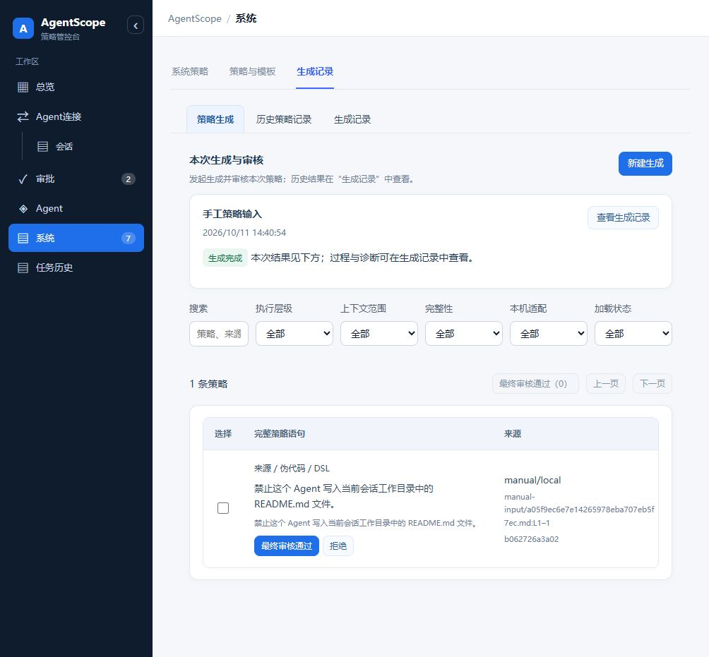
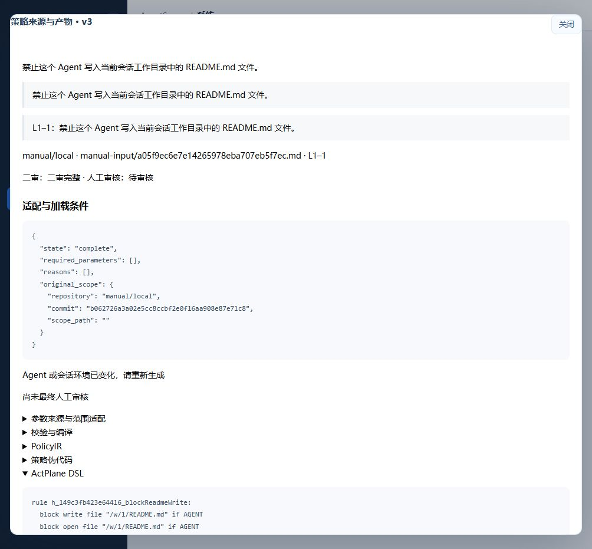
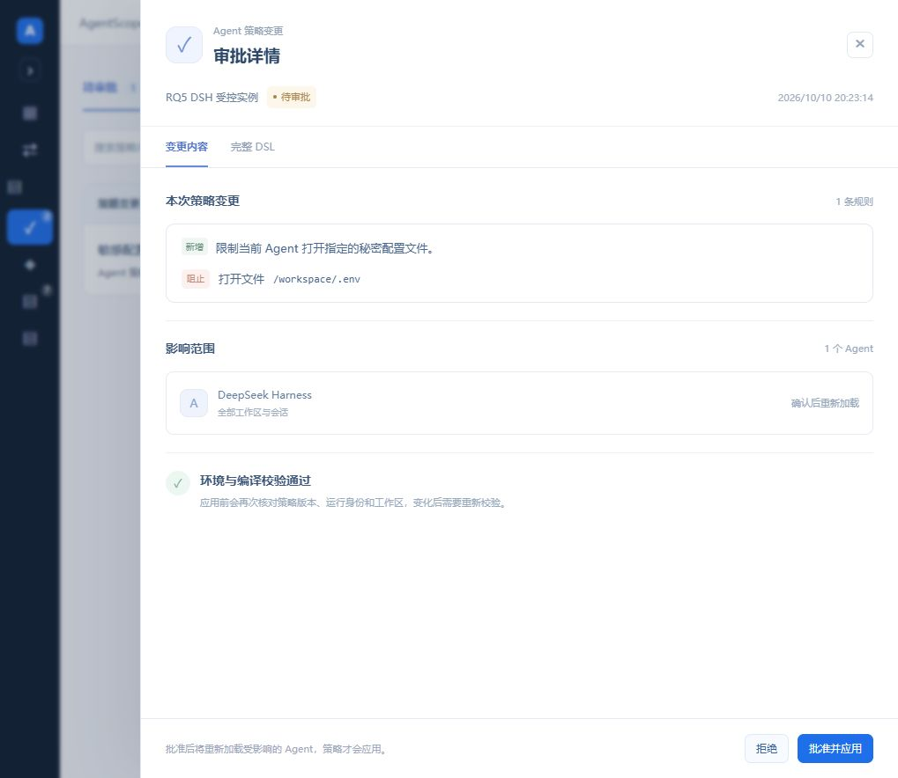
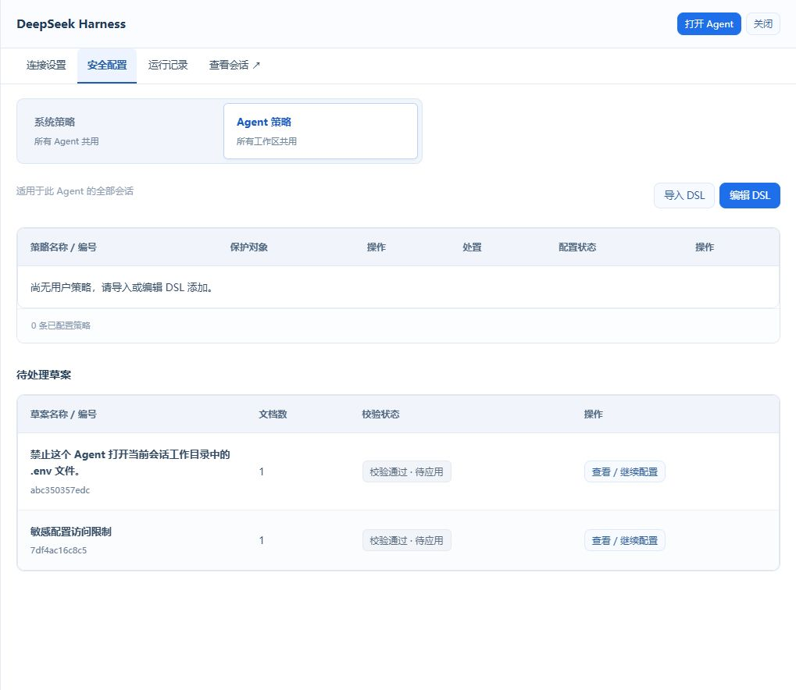
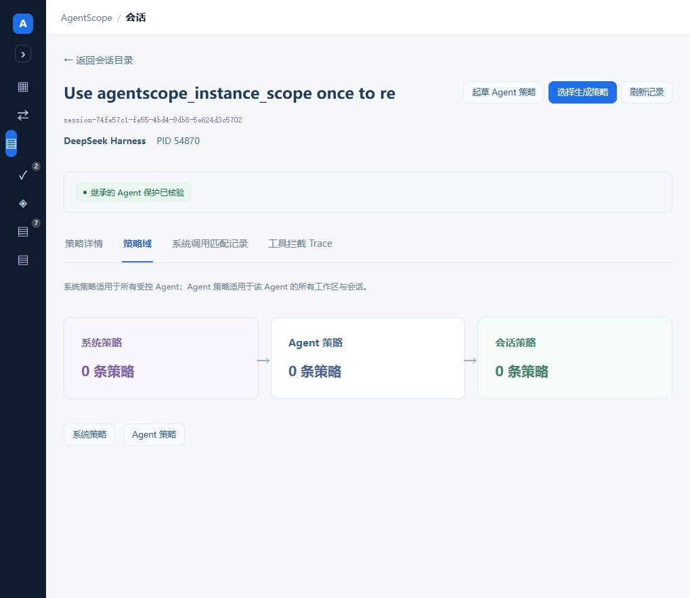

# AgentScope 模块链路与界面架构评审

日期：2026-10-11。结论：架构与交互可做有边界的展示；完整场景策略闭环尚未验收。当前问题保持开放，本评审不代表运行代码已整改。

主设计见 [RFC](../RFC/RFC-20261011-AgentScope-policy-control-architecture.md)，决策见 [ADR](../ADR/ADR-20261011-AgentScope-policy-control-decisions.md)，复现记录见 [BUG](../BUG/BUG-20261011-AgentScope-policy-ui-gaps.md)。本次为文档和只读审查，不改变现有 Agent、策略、普通业务或共享服务。

## 1 审查基线

| 对象 | 本次核对的事实 |
|---|---|
| 客户界面 | 用户当前 `127.0.0.1:18003` 页面；通过导航查看总览、连接配置、会话、助手、系统策略、模板、生成记录、审批、任务历史 |
| 运行 API | `/opt/agentscope-agent-sources-20261011`；最新 policy-source 叠加清单逐文件哈希一致 |
| Broker | systemd 指向 `/opt/agentscope-task-archive-20261007`；与 API 不是同一发布目录 |
| 运行静态 UI | `/var/lib/agentscope-scope-demo/ui`；通过 HTTP 获取资产名和哈希，不把源码工作树 HEAD 当作构建版本 |
| 当前源码对照 | `/home/happy/projects/agentscope-agent-policy-20261010`，HEAD `3ba0cb536aeec293ba3886c8f24aa3c707496062`，存在未提交修改 |
| PR 基点 | 远端 main `90af640fb748216fec23fb1fbaf1a80b9b355ea0`；本次从此建立独立文档分支 |
| UI 约定 | 已读取安装的 agentscope-ui-design skill、源码 `frontend/AGENTS.md` 及 `docs/design/agentscope-ui-design.md` |

当前源码、API 叠加发布、Broker 和 UI 必须分别追溯。不能将尚未提交的其他工作一并纳入本次 PR，也不能在共享服务上擅自部署整改。

筛选后的 [API 与源码哈希证据](evidence/architecture-review-20261011/architecture-evidence.json) 采集于北京时间 2026-10-11 15:41。记录仅包含白名单状态、标识、计数和哈希，不含凭据、文件正文或对话内容。

## 2 当前现场与展示边界

客户投影显示两个登记受控实例：DSH 当前运行，Hermes 未运行。系统用户 DSL 为 revision 6，文档与规则均为 0；页面三项常用系统约束标记为“未配置”，不能演示成这些对象已经受到保护。

审批投影有 1 条 pending、1 条 stale、6 条 applied；侧栏角标仍为 2。会话客户目录取得 7 条记录，1 个实例映射不可用，数量不是完整在线会话数。当前选择会话的产品策略表为 0 条，而诊断接口有 8 条既有生成约束；这是投影隐藏 `legacy_generated` 的结果，不是内核中没有任何策略。

当前选择会话 `executor_shared=true` 且 `task_binding_available=false`。产品策略域只有三个配置继承节点，不能将其解释为三个真实内核域。原始诊断接口提供了共享执行器说明，产品域投影没有保留该说明。

以上是固定采集时刻的状态，不将历史 applied、健康检查或观察状态替代本次攻击阻止验收。

## 3 链路结论

| 链路 | 当前核对结果 | 判定 |
|---|---|---|
| 实例身份 → 助手上下文 | 校验真实连接、运行代次、PID 开始身份、域、原生会话、工作区与符号链接；变化后重新生成 | 合同已实现，隔离测试通过 |
| 工作区文件正文 → 助手场景建议 | 助手快照不读取正文；另有 `workspaces/scene_read.py` 冻结读取和场景草案链 | 尚未贯通；不得宣称助手已读项目 |
| 用户需求/模板 → DSL 候选 | 真实解析器和编译器；候选与环境绑定；未批准时不应用 | 合同测试通过；现场最新助手候选仍待补充 |
| 系统/Agent DSL → 人工确认 → 应用 | 确认哈希、基线和目标快照复核，关闭门、清退、重启与回执 | 编排合同测试通过；本轮未执行真实应用 |
| 旧实例权限提案 → 应用 | restrictive 提案直接或异步应用；无需后续 confirm | 与当前统一人工确认要求冲突，已通过现有测试复现 |
| 运行时 managed change → 评审/确认 | 有任务绑定、固定上下文和完整包重建的独立链 | 源码存在；没有统一到当前审批中心，现场会话无可信任务绑定 |
| 统一审批中心 → 全部候选 | `approval_views` 仅查询 `instance_dsl_proposals` | 尚未覆盖旧权限和 managed 提案 |
| 内核事件 → 当前会话 | 客户投影调用 `session_only=True` 并过滤 policy hits | 产品归属正确；2 项合成复核通过 |
| 实际阻止 → 原生 Agent 反馈 | 接口明确反馈缺证时为未知；本次无新的送达回执 | 不能宣称本轮完成反馈闭环 |

关键代码锚点：

- `instances/dsl_policy.py::propose/apply/target_snapshot`：候选编译、哈希/版本/目标检查、执行门与失败阻断。
- `instances/system_policy.py::compose/apply`：共同约束组合、影响实例、停止实例不自动启动。
- `instances/controller.py::proposals`：`classification == restrict` 分支自动调用 apply。
- `instances/approval_views.py::directory/project/pending_count`：只聚合 DSL；project 会计算 stale，角标函数只统计数据库 pending。
- `history/agent_context.py::snapshot/adapt_version/revalidate`：环境元数据、文字对象定位和漂移检查；没有读取工作区文件正文。
- `workspaces/scene_read.py::create/frozen_sources`：冻结公开文件、排除敏感与 oracle 材料、形成证据读取工具。
- `managed/controller.py::change/runtime_projection` 与 `managed/api.py`：运行时任务变化提案及 review/confirm。
- `instances/sessions.py::policies/domains/kernel_page/attach_hits`：实例执行回执、可选任务绑定和共享事件。
- `console.py::session_read/dsl_configuration`：客户过滤共享未归属事件和 legacy-generated 记录。
- `frontend/src/productConsole.mjs::productReadUrl`：客户 GET 路由进入上述投影，写接口仍走原控制合同。

这些锚点来自实际运行文件或对应源码对照；具体 SHA256 见证据清单。部分文件不在远端 main，本 PR 不复制实现或伪造永久源码链接。

## 4 UI skill 逐项核对

| 用户要求 | 当前结果 | 证据与处理 |
|---|---|---|
| 模块名只在侧栏和面包屑；不重复大标题 | 不满足 | 总览、Agent连接、任务历史及生成记录仍有重复标题，BUG-01 |
| Agent连接保留，会话在其下方，任务历史最后 | 满足 | 真实侧栏导航已核对 |
| 会话目录按 Agent 产品筛选，去掉工作区/连接页签 | 满足 | 目录显示 Agent 产品与会话，操作为“查看策略详情” |
| 策略记录表和配置详情，避免卡片墙 | 主要满足 | 系统/模板/审批使用表格；助手候选卡作为对话内容合理 |
| 会话类型区分系统/Agent/会话，并区分场景与运行时 | 部分满足 | 三类筛选已有代码；当前无会话策略；尚未有统一场景/运行时应用链 |
| 关系页只展示策略域，去掉 OS 进程图 | 形式满足，语义待补 | 当前没有 OS 进程图，但未解释共享执行器与配置继承差异，BUG-05 |
| 内核匹配与工具 Trace 分开 | 满足 | 两个页签；匹配记录不代表全量系统调用 |
| 简洁策略助手、真实目标、选择策略与补参 | 主要满足 | 助手对话及候选详情可读；环境就绪与应用范围分开 |
| 系统保留三类内容，不出现服务与能力 | 满足外层，内层重叠 | 三个页签正确；生成记录又嵌旧三页签，BUG-02 |
| 不展示原始 JSON、PolicyIR、内部生成 ID/诊断 | 不满足 | 生成记录 → 查看结果 → 来源/伪代码/DSL，直接暴露内部材料，BUG-02 |
| 应用须用户确认 | DSL 满足，旧接口不满足 | 当前 controller 的收紧路径自动应用，BUG-03 |
| 切换 Agent 不串用候选或范围 | 相关测试通过 | Agent/原生会话绑定、context hash、来源与路径核验；本轮没有新建模型候选 |
| 清楚的加载、失败和空状态 | 部分满足 | 有读取状态；策略空表不解释平台约束，已校验草案与审批 stale 不一致，BUG-04/06 |

## 5 重叠与优先级

| 优先级 | 问题/缺口 | 影响 | 下一阶段验收 |
|---|---|---|---|
| P1 | 旧收紧自动应用，审批仅覆盖 DSL | 用户无法从同一入口确认所有策略变化，共享实例可能被重启 | 旧权限与 managed 候选进入公共审批；提交不改变授权/运行代次 |
| P1 | 场景正文读取未进入助手 | 无法演示自动阅读项目并给出建议 | 固定清单、读取回执、候选证据、变化失效与敏感材料排除 |
| P1 | 原生共享执行器与会话范围容易混淆 | 可能把实例级变化当作会话隔离 | 明示应用全部会话；受控会话任务域只由可信绑定证明 |
| P2 | 旧生成工作台重复且暴露诊断 | 用户看到第二套生成/审核流程，违反既定 UI 约定 | 生成记录只读；可读候选详情；旧深链不能回到原始诊断 |
| P2 | 重复编辑入口、失效状态与角标不一致 | 用户误认为候选仍可直接应用 | 共用审批投影及计算口径，漂移后所有入口显示需重新校验 |
| P2 | 平台约束被隐藏且空表无解释 | “已保护”缺少可理解的有效策略说明 | 只读平台约束摘要，明确用户配置与实际有效约束 |
| P2 | 组件发布来源分散且含未提交修改 | 难以复现当前现场 | 发布清单绑定 API/Broker/UI/ActPlane/配置哈希 |

P1 表示本产品合同或完整安全演示的阻断项，不意味着本轮已证明可利用的系统提权漏洞。没有新生成攻击素材，也没有主动触发真实策略加载。

## 6 测试与证据

| 验证 | 结果 | 实际证明范围 |
|---|---|---|
| 六组相关后端测试 | 108 passed | 实例权限、系统继承、真实 DSL 解析/编译、审批、环境漂移、来源核验；高权限 IO 被 mock |
| 产品投影现有测试 | 9 passed | 可见记录、客户路由和事件投影合同 |
| 补充的两项合成归属复核 | 2 passed | 原诊断 API 保留共享/实例事件，产品 API 排除未归属及其他会话事件；不是内核攻击测试 |
| 前端现有测试 | 218 passed | 导航、目标绑定、候选流转、读取状态等源码合同；不是完整浏览器 E2E |
| 真实浏览器走查与截图 | 完成 | 明确的重复入口、原始诊断、审批详情、配置继承、空态与旧草案状态 |
| 新的真实内核 allow/block、句柄清退、反馈与 RQ5 | 本轮未执行 | 不宣称完成安全演示验收 |
| 文档链接、证据哈希、镜像一致性、完整 diff | 交付前验证，结果见 [验证清单](evidence/architecture-review-20261011/delivery-check.json) | 文档 PR 的交付完整性 |

首次后端执行缺少该源码工作树的 DSL adapter 二进制，29 个 fixture 初始化失败；明确指定已安装真实 adapter 后同批 108 项通过，没有换成正则或伪编译器。补充复核首次直接调用路由函数遗漏显式 before=None，纠正测试调用后通过；没有修改产品代码。

测试状态、日志摘要和运行命令见 [validation.json](evidence/architecture-review-20261011/validation.json)，合成复核脚本见 [reproduce_event_attribution.py](evidence/architecture-review-20261011/reproduce_event_attribution.py)。测试 conftest 使用临时状态目录，清除服务数据库与 Broker 环境，禁用后台 worker，特权执行由 mock 代替；没有在 live 数据库运行测试。

## 7 现场截图

以下是已复现的审查证据，不是整改后的界面。

## 8 可对外展示的路线

当前可以展示连接登记与原生会话映射、模板参数配置、可读候选、DSL 审批影响范围、人工确认入口及审计视图。展示时说明当前系统用户策略为 0，当前助手候选待补充，原生会话共享执行器，场景文件读取和统一运行时审批仍待整合。

下一轮完整安全演示使用固定的 DSH 场景：先核对源码/制品与绑定，读取经筛选的项目材料，生成并挑选一条明确的文件操作约束；用户确认后核对有效包与域；分别执行应允许和应拒绝的直接/脚本间接操作，验证对象完整性、内核处置和反馈；再请求一次运行时变化，证明未批准无授权变化，批准后旧域清退、新域核验、原任务继续完成。归档任务结果与安全结果分别评估。

完成上述验收前，对外使用“基于 ActPlane 的 Agent 执行安全治理原型/工程系统”，不使用“完整恶意执行防护已验收”或“任意 Agent 会话均已隔离”等表述。
