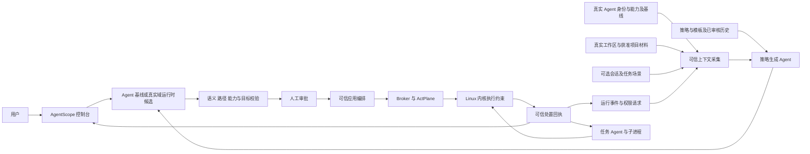
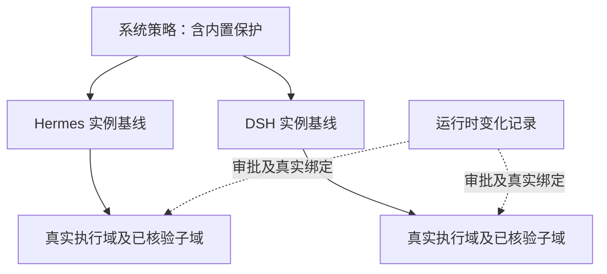
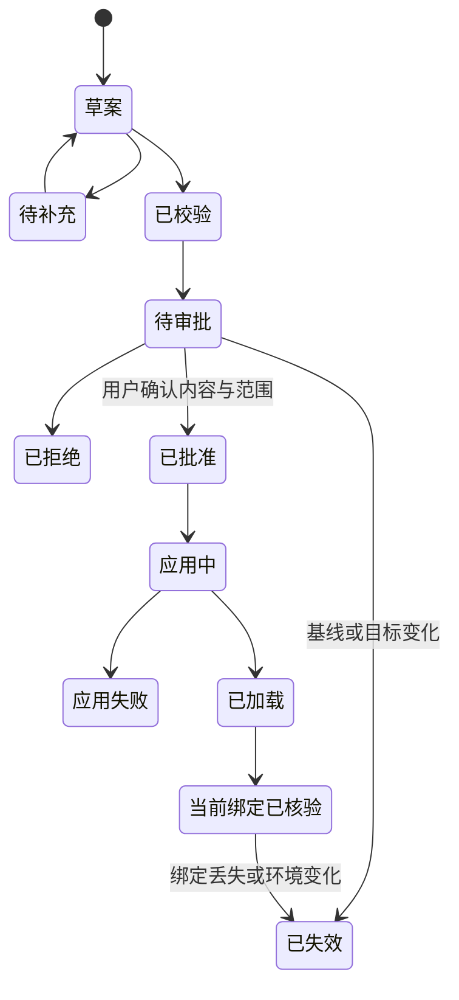

# AgentScope 策略治理与操作系统执行安全架构

2026-10-14 后续收敛决定：当前固定配置只保留系统策略与 Agent 基线；工作区/会话作为来源，后续按真实 ActPlane 域起草运行时变化。旧四层目标与强制局部加载器路线已取代。 见 [当前合同](RFC-20261014-AgentScope-agent-baseline-runtime-policy.md)。历史验收及既有批准范围不变，本轮仅文档修订。

2026-10-14 前轮执行映射复核（固定层结论现已部分取代）：当时保留四层；撤销默认一原生会话一 DSH worker 的既定选型，按真实执行单元、原生能力和共享影响闭包决定可应用范围。详见 [RFC-20261014-AgentScope-execution-binding-rederivation](RFC-20261014-AgentScope-execution-binding-rederivation.md)。本文历史验收与未完成状态不因本次文档修订改变。

2026-10-12 历史目标补充（已取代）：当时采用系统 → Agent → 工作区 → 会话四层配置及后续子委托，明确来源、作用域与执行绑定分离；见 [四层 RFC](RFC-20261012-AgentScope-four-layer-policy.md)。下文保留 2026-10-11 设计/现场的历史范围，新增工作区/原生会话局部应用仍待实现。

日期：2026-10-11。状态：当前目标为系统/Agent 基线与真实域运行时增量；工作区/会话仅作上下文和来源。历史实现状态见对应日期记录。适用对象：本机 Linux/WSL 18003 AgentScope、已登记受控 Agent、ActPlane 执行后端。本文区分目标架构、已核对源码和历史现场，不将文档更新表述为运行能力已发布。

AgentScope 的产品定位是面向 AI Agent 的操作系统执行安全治理控制面：将用户配置和场景理解转化为可审核策略，在精确的执行范围内通过 ActPlane 约束实际操作，再把处置和反馈证据呈现给用户。此前 18003 审计已经核对受控连接、策略助手、系统和 Agent DSL 配置、独立 DSL 审批及运行记录等模块；统一审批与场景读取的后续源码进展另有专项记录。Agent 基线与真实域运行时变化尚未按当前合同连成统一产品链路。

当前设计以系统/Agent 长期基线与真实执行域运行时变化组织策略对象、审批和应用。工作区/会话提供可选场景与来源，展示实际域继承结果，不成为独立配置所有权层。共享 Agent 域可作为明确批准的增量目标；只有原生可信子域存在时才提供其局部增强。当前版本适合带边界说明的架构与交互展示，尚不满足完整安全闭环的对外验收条件。实测结果、源码快照和问题分别见 [REVIEW](../REVIEW/REVIEW-20261011-AgentScope-architecture-audit.md) 与 [BUG](../BUG/BUG-20261011-AgentScope-policy-ui-gaps.md)。

## 1 产品价值与技术来源

面向使用者可以这样描述：AgentScope 帮助用户分别为 Hermes、DSH 等真实 Agent 实例建立安全基线，再为各自工作区生成项目约束；工作区中的会话继承相应策略。策略经过用户确认后进入可信执行后端，用户可以核对应用范围、实际处置和反馈。

核心价值包括四项：

1. 将自然语言需求转为用户可挑选、可核对的操作对象、触发条件和处置方案，降低策略配置门槛。
2. 将系统共同约束、Agent 专属约束、工作区约束及具备可信绑定的会话/任务增量组合为有效策略，防止局部配置静默移除上级底线。
3. 在操作系统层约束受控进程及其执行链，降低通过 shell、脚本、子进程绕过工具层检查的风险。
4. 将候选、确认、编译、加载、绑定、实际阻止和反馈分别记录，支持复核与问题定位。

ActPlane 的 DSL、信息流标签、eBPF 执行引擎及运行时域机制来自 [ActPlane 上游](https://github.com/eunomia-bpf/ActPlane)。AgentScope 的贡献在于控制面、Agent 连接适配、场景与策略生成编排、人工治理、证据关联和产品界面。仓库 `UPSTREAM.md` 记录的 ActPlane 快照基点是 `4c36aa54da2daf2b64de8782a38f77d5b76ec75a`，同时存在本地适配修改。可表述为“从零搭建并验证基于 ActPlane 的 Agent 安全治理系统”，不能把上游内核机制表述为 AgentScope 独立原创。

安全收益应绑定到具体规则和攻击动作，例如受控进程不能读取指定文件或修改受保护对象。不能仅凭“已接入”“已编译”或模型拒绝回答，宣称阻止了所有恶意行为、完成了全部 RQ5 场景或实现了任意自然语言规则的内核执行。

## 2 信任模型与执行边界

| 对象 | 信任与权限 | 合同 |
|---|---|---|
| 任务 Agent，例如 DSH/Hermes | 不可信执行主体；可能遭提示注入或产生误操作 | 执行用户任务，读取获准上下文，提出权限或策略请求；不能自行批准、装载或改写审计 |
| 策略生成 Agent/Pi | 不可信建议主体 | 只能读取明确提供的场景证据、能力与历史候选，输出建议和澄清问题；输出必须重新校验 |
| AgentScope API/控制面 | 可信治理主体 | 管理精确目标、策略版本、审批、幂等键、执行门和回执；不把模型输出当授权 |
| 管理员 | 策略确认主体 | 核对变更、影响范围与可执行性，批准或拒绝；确认绑定当前候选内容和环境 |
| Broker/ActPlane | 可信高权限执行面 | 编译、关闭旧执行域、加载、绑定、核验、采集可信事件；不接受任意模型命令 |
| Linux 内核 | 执行基础 | 在受支持 hook 上执行规则；操作失败、处置效果与规则命中须有对应证据 |

工作区文件、外部网页、Agent 消息和历史建议都是输入证据，不具有审批权限。读取场景与执行任务分别授权，不能为了生成策略授予任意文件系统或控制面访问。

当前执行环境是 Linux/WSL。Windows 上的控制台可管理该环境，但不能据此声称 Windows 原生进程受 Linux eBPF 保护。普通观测连接可以展示会话，不等于受控连接。所谓“所有登记 Agent 共用系统策略”，产品上应定义为“所有纳入受控执行并通过绑定核验的登记实例继承系统策略”；其余实例显示覆盖缺口。

内核失陷、可信 Broker 被接管和管理员主动绕过不在本版本的保证范围内。18003 是本机演示配置，免登录入口不能作为生产环境的用户鉴权与多租户隔离设计。

## 3 总体结构



图中生成目标先固定为 Agent 或工作区，会话只在需要会话材料时作为上下文引用。Agent 基线生成不强制选择会话或读取某个项目；工作区生成必须核验真实工作区及其归属。既有线上助手有可信环境元数据；场景读取接入助手的第三步源码进展见 [专项 RFC](RFC-20261011-AgentScope-agent-scene-step3.md)，该进展未证明工作区作用域已经实现或发布。

建议采用模块化单体控制面和独立高权限 Broker，先统一合同再按实际负载拆服务。不要为每个导航入口单独建策略数据库、审批系统或加载器。

## 4 既有模块及目标边界

下表保留此前 18003 审计快照的模块能力与缺口；独立分支的后续源码进展不等于该现场已发布。Agent/工作区目标职责在表后说明，实际发布仍按组件清单和绑定证据核验。

| 模块 | 当前实现的用户能力 | 唯一职责与待补齐项 |
|---|---|---|
| 总览 | 连接与保护摘要、历史候选数量、跳转 | 只做摘要；统一待审批统计口径，避免把候选数解释为生效策略数 |
| Agent连接 | 发现/登记、受控或观测模式、资源映射、启停、打开 Agent | 管身份与生命周期；安全配置入口应跳到对应 Agent 策略，不再形成平行配置中心 |
| 会话 | 原生会话目录、策略详情、配置继承链、系统调用匹配、工具 Trace | 管运行视图与会话归属；不凭共享 PID 推导独立会话内核域 |
| Agent 策略助手 | 对真实实例及原生会话起草需求、选模板/候选、补参、提交 DSL 审批 | 管建议与候选；补入可审计的项目文件读取，显示上下文会话与应用范围的区别 |
| Agent 策略 | 查看和编辑此实例的 DSL | 管实例范围的有效配置；对该实例全部会话生效，不能默认等价为选中会话专属 |
| 审批 | DSL 变更、影响目标、失效检查、批准并应用或拒绝 | 当前只聚合 DSL 提案；应统一旧权限和 managed 运行时提案的投影与决策入口 |
| 系统策略 | 系统 DSL、三项常用基础配置的参数入口 | 共同约束配置；当前三个参考项均未配置，参考路径不能作已保护证据 |
| 策略与模板 | 六个 Agent 专属模板、分类/搜索/参数配置 | 可复用资产目录；模板参数化后仍是候选，不自动安装 |
| 生成记录 | 生成任务列表、旧生成和审核页面 | 应只保留生成历史及可读候选详情；旧工作台与内部诊断泄漏须收敛 |
| 任务历史 | 历史任务及策略、审计回放入口 | 管归档；不能恢复权限，也不能作为当前在线与生效证明 |
| managed/bootstrap | 固定任务的场景证据、启动建议、运行变化评估、确认后重建 | 有独立安全编排，尚不能概括为任意原生会话均已接入 |

目标职责调整：Agent 策略助手提供长期基线和真实域运行时变化；工作区/会话仅提供可选材料与来源。会话页查看实际保护、共享范围和 DSL，并可发起准确域范围的增量候选；不再新增工作区/会话固定策略库。

## 5 策略对象模型

作用范围、生成来源和执行方式必须是独立维度：

| 维度 | 取值示例 | 含义 |
|---|---|---|
| `baseline_scope / runtime_target` | 固定 `system / agent`；运行时为真实域引用 | 工作区/会话为来源；旧 scope 记录保持历史语义，不静默换目标 |
| `origin` | `manual / template / scene / runtime` | 候选如何产生；不决定是否已经批准或生效 |
| `enforcement` | `kernel_pre_op / process_termination / notify / guidance_only` | 后端能提供的实际约束方式 |
| `status` | 草案、已校验、待审批、已批准、应用中、已加载、当前绑定已核验、失败、失效 | 可信服务状态；不能由前端点击或模型自报替代 |

“运行时生成”表示来源，不单独构成策略层级。候选初始目标为已核验实际域，可以显式覆盖共享 Agent 域；缺少可信域绑定时只形成建议。来源会话不承诺局部范围，长期化或推广到系统时重新起草对应基线候选、校验并审批；旧局部候选不静默扩大。

### 5.1 两个主要生成目标

| 生成目标 | 必需上下文 | 可选上下文 | 审批与应用范围 |
|---|---|---|---|
| Agent 基线 | 真实实例身份、已核验启动来源/能力、登记资源、系统及 Agent 基线版本 | 工作区或会话提供的参考证据；不作为实例级生成的前置条件 | 当前实例的全部工作区、会话及未来受控启动；Hermes 与 DSH 分别生成，不能按产品名串用 |
| 真实域运行时变化 | 当前实例、真实域/执行单元及运行代次、基线、有效版本与完整影响范围 | 原生工作区/会话材料、工具/内核反馈 | 目标域及核验祖先/后代的实际执行范围；共享成员和未来准入明确批准，来源不改变作用域 |

没有会话时，Agent 基线仍可基于已核验登记事实生成候选；事实不足的条款保持待补充。停止实例可基于登记证据起草，但不得伪造当前 PID、域或“正在保护”状态，实际启动/应用时重新核验。使用工作区材料须先核验来源与读取许可；缺少材料身份时标待补充，不将其伪装为独立授权层。

参考某个项目得出的规则不会自动升级为 Agent 基线。目标在生成前由用户选择并由服务端固定；从当前域运行时变化改为 Agent 基线或反向切换，必须重新生成/适配候选，不复用原审批。普通描述中的“当前项目”也不能自行决定更广的作用域。

目标合同建议如下，属于后续统一实现，不是当前已存在的完整数据模型：

```text
PolicyAsset: id, version, name, parameter_schema, supported_operations
WorkspaceIdentity: instance_id, workspace_id, native_identity, verified_project_path,
                   membership_revision, identity_hash
ContextSnapshot: purpose(agent_baseline/runtime_change), agent_identity,
                 workspace_identity(optional), native_session(optional),
                 workspace_manifest(optional), source_refs, context_hash,
                 capability_profile, captured_at
PolicyCandidate: id, scope, target, origin, asset_version, resolved_parameters,
                 statement, clauses, context_hash, base_revisions, candidate_hash
PolicyApproval: candidate_hash, reviewer, decision, impact_snapshot, reviewed_at
PolicyBundle: system_revision, agent_revision, runtime_change_revisions, domain_refs,
              effective_dsl, compiler_version, engine_profile, bundle_hash
ExecutionUnit: id, host_boot_identity, executor_identities, ownership, supervision_refs,
               generation, shared_subjects, membership_revision
PolicyBinding: subject_ref, unit_ref, mechanism, operation_coverage, binding_revision,
               engine_domain_ref(optional), desired_policy_hash, loaded_bundle_hash, verification_state
PolicyApplication: approval_id, logical_targets, execution_impact, availability_impact,
                   target_generation, application_state, failure_reason
ExecutionReceipt: binding_refs, bundle_hash, generation, host_boot_identity, pid_start_identity,
                  workspace_identity(optional), trusted_session_link(optional),
                  domain_binding, loaded_at, verified_at
PolicyMatch: receipt_id, clause_ref, actual_action, blocked, killed,
             trusted_session_link, call_id, feedback_receipt
```

正文文件、凭据、原始敏感日志和模型私有推理不写入公开审计。必要的策略解释引用经过筛选的证据及哈希；项目材料与发布证据采用不同存储权限。

## 6 继承、执行域与身份

### 6.1 产品配置关系与 ActPlane 映射

以下是 AgentScope 的目标配置继承模型，不是 ActPlane 规定的固定对象顺序，也不代表当前已经建立相同数量的内核域：



AgentInstance 是固定策略所有者；工作区是项目/资源上下文，会话是交互与来源记录。运行时变化按真实域绑定，不是图中的第三个固定配置层。不同 Agent 访问同一项目不自动共享授权；同一 Agent 的共享域内会话则共同受该域有效规则约束。

ActPlane [论文 §3.4](https://arxiv.org/html/2606.25189v2#S3.SS4) 定义进程树的父子策略域，没有固定 Agent/工作区/会话层名。上游 [架构计划](https://github.com/eunomia-bpf/ActPlane/blob/master/docs/design/arch_plan.md) 将 project 放在 session 之前并描述 workspace_scope，属于长期设计。[config.rs](https://github.com/eunomia-bpf/ActPlane/blob/master/crates/actplane-runtime/src/config.rs) 的 DomainEntry 只有通用父域及规则绑定等字段，resolve_domain_inner 递归解析继承；[capability.bpf.h](https://github.com/eunomia-bpf/ActPlane/blob/master/bpf/capability.bpf.h) 通过 cap_task 将 PID 绑定到域。工作区目录不会自动成为策略域，scope_id 也不能独立证明项目路径隔离。来源核对日期为 2026-10-11；上游 master 证据与本项目固定快照分开记录。

底层域只有一个 parent。跨 Agent 共用的项目约束应由控制面解析为版本化策略资产，组合进各目标的有效策略；不能把配置图中的多来源关系直接解释为内核多父域继承。系统强制约束必须以不可被子域覆盖的绑定保留。源码配置中的 default 与 locked 绑定语义不同，不能将可覆盖默认值当作强制底线；实际执行仍须经过后端能力、authority 和绑定核验。

逻辑有效策略表达为配置组合关系：

```text
DesiredPolicy(D) = compose(系统内置保护及系统规则, Agent 基线,
                           D 及经核验祖先中适用的已批准运行时变化)
ExecutionProjection = project(DesiredPolicy(D), mechanism_capabilities)
AppliedPolicy = verified_binding(ExecutionProjection, ExecutionUnit, approved_impact)
```

局部配置不能移除继承约束。受限环境下缺少能力的条款必须保留为未支持需求或语义指导，不能偷偷降级为“已阻止”。本地层自身规则的合法修改或扩大既有权限，必须由具备相应权限的人确认，并按已验证机制更新实际有效策略；不预设必须迁移原生会话。ActPlane 的域继承与 authority/declassification 语义不能被简化为任意文本规则相加。

### 6.1.1 执行单元和共享兼容性

两层基线归属由控制面维护，运行时目标和实际执行单元按原生拓扑解析，不以会话数量预设进程数量。一个原生会话可使用多个执行器，多个会话也可共享一个单元；Binding 必须带机制和覆盖操作。ActPlane 域引用包含 engine_ref；同一引擎中的一个 PID/TGID 同时只直接绑定一个域，并沿父链继承，fork 默认同域。临时切域、工具标签、线程 ID、cwd 或再启动一个 watcher 均不构成并发会话隔离。

目标策略在共享单元上要求不同处置且没有可信区分条件时，局部应用拒绝。审批冻结全部共享主体、实际规则影响和暂停/终止影响，不能按更严格合并掩盖范围扩大。原生会话授权的覆盖与 ActPlane 内核覆盖分开验收，未支持条款不能标为已加载保护。详见本次执行绑定重推 RFC。

### 6.2 2026-10-11 实现观察（历史）与应用能力门槛

2026-10-11 当次只读核对的实例 DSL `documents_for()` 实际组合的是 `system + instance`；助手 snapshot 仍要解析一个原生会话，selected_candidate 返回 scopeType=agent，并提示应用影响该实例全部会话。原生会话返回 executor_shared=true；managed 会话策略只有存在可信任务绑定时才追加展示。此前现场选中会话 task_binding_available=false 是历史审计事实。本轮未复测现场保护状态，不能演示为“每个工作区或会话已拥有独立可变的内核策略域”。

工作区/会话来源的运行时候选在起草时即固定真实域、全部执行单元、共享主体和中断影响。共享域可显式作为目标，不能把仅要求 S1 的旧候选偷偷扩大。无法满足局部差异时拒绝；路径对象限制不冒充工作区主体隔离。

批准范围可覆盖同实例同域运行代次内的未来会话，它们自然受当前有效规则约束，不新增原生会话创建门禁。工作区或 cwd 切换改变上下文，不自动换策略；执行器绑定或原生身份变化时重新解析真实范围、版本和影响。

策略域图必须明确区分“配置继承关系”和“实际内核域绑定”。当前产品图只返回三个配置节点，丢失了诊断接口的共享执行器说明；应补一句可读说明，并仅在有可信绑定时展示具体域事实。

精确身份至少校验 `instance_id + generation + pid/start_ticks + host_id/boot_id + engine_ref/domain_id + policy/bundle_hash`。可执行匹配来自核验后的 `/proc/PID/exe`；脚本入口、解释器和 Agent 产品名分别记录。`**/node` 或 `**/python` 只能说明解释器来源，不能单独唯一识别实例。内置 `source AGENT = exec "**"` 是受控执行域内的标签规则，不是具体 Agent 的绑定证明。

### 6.3 工作区/会话来源身份与证据

来源身份核验 instance_id、原生 workspace/session 标识、实际项目路径及归属代次，用于材料读取、可视化和追溯；不创建工作区策略所有权。缺可信来源时标未知，不凭挂载名、cwd 或名称猜身份；没有会话仍可起草 Agent 基线。

审批绑定真实运行时域、基线、共享成员/准入范围和可用性影响；源材料的读取许可与执行授权分别校验。候选不因共享路径读入另一 Agent 的会话、配置或凭据。

## 7 系统/Agent 基线与运行时增量链路

### 7.1 系统共同策略

用户配置 → 核对实际受控实例与资源、共享执行及可用性影响 → 生成系统候选及影响快照 → 编译/能力检查 → 用户确认 → 应用前核验漂移 → 按已核验机制更新 → 分别核验 → 写入回执。当前实例冷更新路径包含关闭执行门、排空或终止旧域及重启原来运行的实例，须展示完整中断范围；这不构成任意原生会话可独立重建或无损恢复的保证。原先停止的实例保持停止，未来启动时继承当前系统配置。失败按实际影响闭包门控，不能显示全面保护。热更新另按其未实施提案评审。

系统策略的配置覆盖与当前生效覆盖分别计数；存在观测连接、停止实例或资源不适用时，不以“所有 Agent 共用”代替实际覆盖报告。

### 7.2 Agent 基线生成及模板

用户选择真实 Agent → 固定实例身份、能力及系统/实例基线 → 描述长期约束或选择模板 → 生成候选并补参 → 校验 → 提交实例级审批 → 展示全部受影响工作区/会话与未来启动范围 → 确认后应用。无需先创建或选择会话；未引用工作区材料时不扫描项目。连接配置中的安全入口和 Agent 页共用同一候选与审批详情。

### 7.3 工作区/会话场景输入

用户选择真实 Agent 及可选工作区/会话 → 核验来源与材料读取许可 → 固定材料清单/摘要 → 显式选择 Agent 基线或当前真实域运行时变化 → 展示真实范围 → 生成候选 → 按该目标校验、审批与确认应用。目录选择不是独立安全域；长期化须新的基线候选及批准。

读取复用场景模块的冻结清单、脱敏和回执，不另起高权限读取器。目标、材料或基线变化时重新评估；切换上下文清除失效选择，不以专用提示词补救绑定错误。

### 7.4 真实执行域运行时增量与反馈

可信工具/内核事件或用户权限请求 → 固定当前会话、实际执行单元、共享范围、基线与证据 → 策略 Agent 评估 → 生成候选 → 校验机制覆盖及共享兼容性 → 审批完整影响 → 确认后按核验机制应用及恢复。风险动作的执行门可先暂停等待决策，但“暂停”本身不是策略获批。拒绝或澄清不得改变现有授权。

managed 链路已有变化评审和确认后完整包重建。此前现场审计发现旧实例权限链路会自动应用 restrictive 候选，与统一人工确认合同冲突；移除该路径及统一审批已有 [第一步源码进展](RFC-20261011-AgentScope-unified-policy-approval.md)。本轮不重写历史审计或宣称已发布，后续仍须核验实际运行组件中所有写接口的确认边界。

会话/任务来源的运行时发现可显式提升为 Agent 基线候选，转化后按长期范围重新生成、校验和审批；不再新建工作区固定策略层。系统共同策略仍由有权管理员显式配置，不能因某次局部反馈自动变成全局规则。

## 8 生命周期与接口



实际内核命中与反馈是回执维度，不是必须发生的策略状态：没有违规操作时，已核验策略可能没有命中；有命中也不必然表示阻止。`notify`、操作提交前 `block`、进程 `kill` 与语义指导分别展示。跨事件的“执行过检查程序”也不能等价为“检查业务结论正确”。

| 当前接口族 | 当前作用 | 整合合同 |
|---|---|---|
| `/api/console/*` GET | 客户投影、可见记录与会话可信归属 | 统一客户读模型；保留完整后台事实，隐藏只影响展示 |
| `/api/security/system/dsl/proposals` 与 `/{id}/confirm` | 系统 DSL 校验和确认应用 | 由公共候选/审批编排调用，保持哈希和目标快照复核 |
| `/api/agent-instances/{id}/dsl/proposals` 与 `/{pid}/confirm` | Agent DSL 校验和确认应用 | 保留实例全部会话合同；不得承接工作区候选并静默扩大范围 |
| `/api/history/inputs`、`/api/history/generations` | 输入及候选生成 | 增加明确的 Agent/工作区目标；session 作为可选上下文；保留环境绑定与幂等重试 |
| `/api/console/approvals` | DSL 审批读模型 | 增加旧权限和 managed 提案适配；统一失效状态与角标 |
| `/api/agent/instances/{id}/policy/proposals` | 旧 Agent 权限提案，收紧可自动应用 | 改为仅提交候选；不能保留隐藏的自动应用路径 |
| `/api/managed/tasks/{id}/changes/{job}/review`、`expansion/confirm` | 任务运行时变化评审与扩权确认 | 保留具体任务哈希与域迁移合同，投影到统一审批 |

统一接口是设计目标，不要求立即替换所有底层路由。先在一个可信应用编排器中适配已有状态机，避免把多步数据库更新伪装成跨服务原子事务。每次应用记录 application_id、阶段和回执，重复请求返回原结果；中断后保持阻断并显式恢复。

目标内部请求保留 purpose、target、context_ref 和幂等键，区别 Agent 基线与真实域 RuntimeChange。实例与域引用由服务端核验，冻结绑定代次、全部共享执行和可用性影响；原生 workspace/session 仅作可选来源并校验材料权限。客户端不能用路径、PID、source 或文件正文代替权威身份。不再要求新增 workspace/session 策略存储和应用接口；旧 scope 请求保持原语义或拒绝，新域范围必须重新起草审批。本文不宣称新的 RuntimeChange HTTP 合同已经实现。

## 9 内容重叠与解耦安排

| 当前重叠 | 保留的入口 | 应收敛到的唯一模块 |
|---|---|---|
| 系统生成记录中的旧“新建生成”与 Agent 助手 | 助手集中生成 Agent 基线/真实域运行时变化；系统生成记录只查看 | PolicyGenerationService |
| 历史候选审核、DSL 审批、旧权限提案、managed review | 审批中心负责用户决策；候选详情只提交审批 | PolicyReviewService，区分资产审核与执行授权 |
| Agent连接安全页、Agent/工作区配置、会话配置按钮 | 多处可跳转同一编辑器，保留精确作用域和目标 | PolicyConfigurationService |
| 系统三项基础配置与 Agent 六个模板中的文件保护 | 可以有不同适用范围的入口 | 同一版本化 PolicyAsset，作用域与参数独立 |
| 任务历史、生成记录、内核事件、工具 Trace | 各自保留符合目的的视图 | 同一证据存储，分别按任务/生成/应用/执行索引 |
| 平台生成约束与用户 DSL | 用户配置表保持清晰；会话给出系统内置保护摘要 | 有效策略读模型，不能把隐藏理解为不存在 |

策略来源相同不等于策略重复。去重至少比较作用域、目标、操作、条件、处置、继承来源与版本；不能只按自然语言或路径相同合并。首期对完整等价项提示复用，其他重叠保留并解释；有条件条款不能用“deny 优先”之类粗略替代完整 DSL 语义。

## 10 展示设计与验收门槛

导航保持总览、Agent连接及会话、审批、Agent、系统、任务历史。系统保留系统策略、策略与模板、生成记录；生成记录取消旧工作台嵌套导航。客户详情展示需求、对象、操作、处置、范围、校验和下一步；DSL 可在独立页签查看，PolicyIR、原始 JSON、内部运行标识和诊断日志进入受限技术验收材料。

Agent 助手先选择真实 Agent，再选择长期基线或运行时变化；后者解析并显示真实执行域和共享范围。材料按需引用已核验工作区/会话。保留简洁对话、结构化候选记录与折叠详情，不增加四层导航或工作区详情页签。

会话展示系统继承、Agent 基线、实际域运行时规则及 DSL，工作区/会话标来源，域共享范围就近可见。可跳转系统/Agent 配置或发起域增量；无可信绑定显示未知，不绘制虚构域。系统内置保护只读，用户只编辑有权变更的基线/域规则。

| 展示等级 | 门槛 | 当前结论 |
|---|---|---|
| 架构与交互走查 | 模块职责、候选/应用边界、已知缺口讲清楚 | 可以；使用本设计和评审说明 |
| 受控安全演示 | 固定环境、精确绑定、实际 allow/block、保护对象完整性、反馈回执 | 本轮未重新执行；不能以合同测试替代 |
| 完整场景闭环 | 文件读取、建议挑选、审批、迁移、生效、运行时复评和恢复均现场通过 | 尚不满足 |
| 生产交付 | 多用户鉴权、授权隔离、发布一致性、恢复与性能等专项完成 | 不在当前已验收范围 |

实施顺序：复核系统/Agent 主组合与原生入口；完善真实域 RuntimeChange 的身份、来源、共享范围审批、版本应用和生命周期；接入会话可视化；按当前 N01–N10 执行实际效果、原生流程和任务闭环验收。每阶段独立提交证据，不把设计或静态文档检查写成已发布能力。


2026-10-11 第三步进展：场景读取、人工采用、生成候选和统一审批接入已完成源码及隔离验收，未发布 18003；详见 ../RFC/RFC-20261011-AgentScope-agent-scene-step3.md。既有只读需求生成语义扩大另记 GEN-SEMANTICS-001，尚未整改；不宣称完整安全闭环。

## 11 原 Agent/工作区主线验收合同（历史）

下表保留原方案的验收推导，不再要求独立工作区固定层；当前必测项改为新合同 N01–N10。这些旧表条目均不因本次修订增加运行通过数。

| 编号 | 场景 | 必须得到的结果 |
|---|---|---|
| A1 | 真实 Agent 无会话，生成实例基线 | 不强制创建/选择会话；材料不足的条款待补充；生成不改权限 |
| A2 | Hermes/DSH 或两个同产品实例之间切换 | 身份、基线、对话和候选不串用；产品名和解释器路径不能替代实例身份 |
| A3 | 同一实例的工作区 A/B | A 候选不能保存到 B，也不能写入 Agent 作用域；相同路径不自动合并身份 |
| A4 | 原生工作区元数据缺失、矛盾或符号链接替换 | 明确拒绝可执行工作区候选或使原候选失效，不按 cwd/挂载名猜测 |
| A5 | 可选会话属于其他工作区/实例 | 拒绝上下文绑定；不改变生成目标 |
| A6 | 候选生成、校验、拒绝和未确认状态 | 不加载、不重启、不改变现有授权或原生会话；旧 Agent 接口拒绝 workspace 候选 |
| A7 | Agent 基线确认应用及未来启动 | 审批展示所有受影响工作区/会话；系统底线保持；未来受控启动继承当前版本 |
| A8 | 工作区策略确认应用 | 仅目标工作区执行受影响；其他工作区与 Agent 不变；未来所属会话先绑定再执行 |
| A9 | 共享执行器无法区分工作区来源 | 应用保持不支持，不降级成实例级策略，不声称工作区隔离 |
| A10 | 审批前身份、成员、文件清单或上层基线变化 | 候选失效并重新评估；旧确认和幂等键不能改绑目标 |
| A11 | 会话切换工作区、运行时建议提升作用域 | 先核验新归属和绑定；提升生成新候选并重新审批；旧域清退后才恢复 |
| A12 | 实际策略效果及业务隔离 | 目标 PID/domain、规则版本、真实 allow/block、间接脚本和反馈有对应证据；Hermes 与普通业务隔离，普通业务在 AI 不可用时可用 |

文档验收和后续实施风险见 [本轮复核](../REVIEW/REVIEW-20261011-AgentScope-agent-workspace-policy.md)。本轮没有授权变更普通业务接口或 Java 业务代码。
