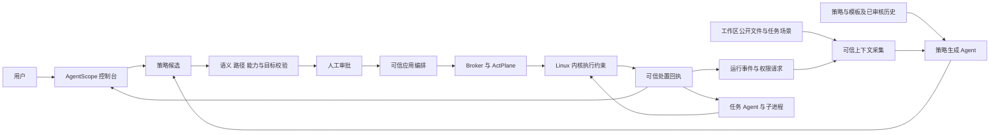
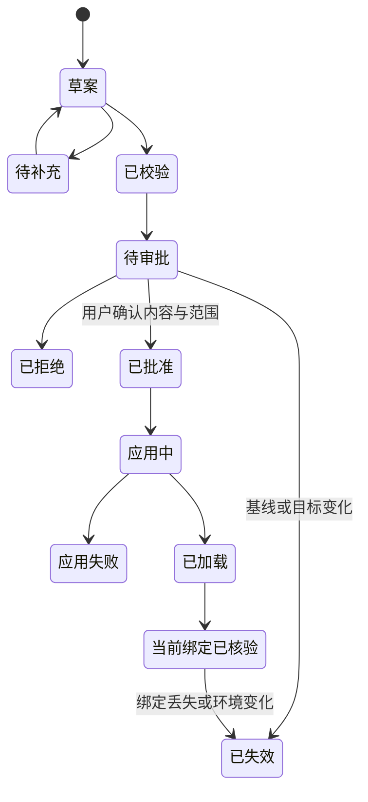

# AgentScope 策略治理与操作系统执行安全架构

日期：2026-10-11。状态：架构设计与当前实现核对；整改方案待实施。适用对象：本机 Linux/WSL 18003 AgentScope、已登记受控 Agent、ActPlane 执行后端。

AgentScope 的产品定位是面向 AI Agent 的操作系统执行安全治理控制面：将用户配置和场景理解转化为可审核策略，在精确的执行范围内通过 ActPlane 约束实际操作，再把处置和反馈证据呈现给用户。当前已经具有受控连接、策略助手、系统和 Agent DSL 配置、独立 DSL 审批及运行记录等模块；“助手读取项目文件后主动给出场景建议”“所有运行时候选进入统一审批”“原生会话独立执行域”尚未连成统一产品链路。

本设计的核心判断是：保留现有模块的用户入口，统一其策略对象、审批状态和执行合同。当前版本适合带边界说明的架构与交互展示，尚不满足完整安全闭环的对外验收条件。实测结果、源码快照和问题分别见 [REVIEW](../REVIEW/REVIEW-20261011-AgentScope-architecture-audit.md) 与 [BUG](../BUG/BUG-20261011-AgentScope-policy-ui-gaps.md)。

## 1 产品价值与技术来源

面向使用者可以这样描述：AgentScope 帮助用户管理多个 Agent 的执行安全策略，既支持共同安全底线和 Agent 专属配置，也支持结合任务场景生成候选；策略经过用户确认后进入可信执行后端，用户可以核对应用范围、实际处置和反馈。

核心价值包括四项：

1. 将自然语言需求转为用户可挑选、可核对的操作对象、触发条件和处置方案，降低策略配置门槛。
2. 将系统共同约束、Agent 专属约束及具备可信绑定的任务约束组合为有效策略，防止局部配置静默移除上级底线。
3. 在操作系统层约束受控进程及其执行链，降低通过 shell、脚本、子进程绕过工具层检查的风险。
4. 将候选、确认、编译、加载、绑定、实际阻止和反馈分别记录，支持复核与问题定位。

ActPlane 的 DSL、信息流标签、eBPF 执行引擎及运行时域机制来自 [ActPlane 上游](https://github.com/eunomia-bpf/ActPlane)。AgentScope 的贡献在于控制面、Agent 连接适配、场景与策略生成编排、人工治理、证据关联和产品界面。仓库 `UPSTREAM.md` 记录的 ActPlane 快照基点是 `4c36aa54da2daf2b64de8782a38f77d5b76ec75a`，同时存在本地适配修改。可表述为“从零搭建并验证基于 ActPlane 的 Agent 安全治理系统”，不能把上游内核机制表述为 AgentScope 独立原创。

安全收益应绑定到具体规则和攻击动作，例如受控进程不能读取指定文件或修改受保护对象。不能仅凭“已接入”“已编译”或模型拒绝回答，宣称阻止了所有恶意行为、完成了全部 RQ5 场景或实现了任意自然语言规则的内核执行。

## 2 信任模型与执行边界

| 对象 | 信任与权限 | 合同 |
|---|---|---|
| 任务 Agent，例如 DSH/Hermes | 不可信执行主体；可能遭提示注入或产生误操作 | 执行用户任务，读取获准上下文，提出权限或策略请求；不能自行批准、装载或改写审计 |
| 策略生成 Agent/Pi | 不可信建议主体 | 只能读取明确提供的场景证据、能力与历史候选，输出建议和澄清问题；输出必须重新校验 |
| AgentScope API/控制面 | 可信治理主体 | 管理精确目标、策略版本、审批、幂等键、执行门和回执；不把模型输出当授权 |
| 管理员 | 策略确认主体 | 核对变更、影响范围与可执行性，批准或拒绝；确认绑定当前候选内容和环境 |
| Broker/ActPlane | 可信高权限执行面 | 编译、关闭旧执行域、加载、绑定、核验、采集可信事件；不接受任意模型命令 |
| Linux 内核 | 执行基础 | 在受支持 hook 上执行规则；操作失败、处置效果与规则命中须有对应证据 |

工作区文件、外部网页、Agent 消息和历史建议都是输入证据，不具有审批权限。读取场景与执行任务分别授权，不能为了生成策略授予任意文件系统或控制面访问。

当前执行环境是 Linux/WSL。Windows 上的控制台可管理该环境，但不能据此声称 Windows 原生进程受 Linux eBPF 保护。普通观测连接可以展示会话，不等于受控连接。所谓“所有登记 Agent 共用系统策略”，产品上应定义为“所有纳入受控执行并通过绑定核验的登记实例继承系统策略”；其余实例显示覆盖缺口。

内核失陷、可信 Broker 被接管和管理员主动绕过不在本版本的保证范围内。18003 是本机演示配置，免登录入口不能作为生产环境的用户鉴权与多租户隔离设计。

## 3 总体结构



图中“工作区公开文件 → 上下文采集 → 策略助手”是待贯通的目标链路。当前助手有可信环境元数据；项目文件正文读取由另一条 `workspaces/scene_read.py` 任务链路实现。两者不能仅因都使用 Pi 或同一模型而视为已经贯通。

建议采用模块化单体控制面和独立高权限 Broker，先统一合同再按实际负载拆服务。不要为每个导航入口单独建策略数据库、审批系统或加载器。

## 4 当前模块及边界

| 模块 | 当前实现的用户能力 | 唯一职责与待补齐项 |
|---|---|---|
| 总览 | 连接与保护摘要、历史候选数量、跳转 | 只做摘要；统一待审批统计口径，避免把候选数解释为生效策略数 |
| Agent连接 | 发现/登记、受控或观测模式、资源映射、启停、打开 Agent | 管身份与生命周期；安全配置入口应跳到对应 Agent 策略，不再形成平行配置中心 |
| 会话 | 原生会话目录、策略详情、配置继承链、系统调用匹配、工具 Trace | 管运行视图与会话归属；不凭共享 PID 推导独立会话内核域 |
| Agent 策略助手 | 对真实实例及原生会话起草需求、选模板/候选、补参、提交 DSL 审批 | 管建议与候选；补入可审计的项目文件读取，显示上下文会话与应用范围的区别 |
| Agent 策略 | 查看和编辑此实例的 DSL | 管实例范围的有效配置；对该实例全部会话生效，不能默认等价为选中会话专属 |
| 审批 | DSL 变更、影响目标、失效检查、批准并应用或拒绝 | 当前只聚合 DSL 提案；应统一旧权限和 managed 运行时提案的投影与决策入口 |
| 系统策略 | 系统 DSL、三项常用基础配置的参数入口 | 共同约束配置；当前三个参考项均未配置，参考路径不能作已保护证据 |
| 策略与模板 | 六个 Agent 专属模板、分类/搜索/参数配置 | 可复用资产目录；模板参数化后仍是候选，不自动安装 |
| 生成记录 | 生成任务列表、旧生成和审核页面 | 应只保留生成历史及可读候选详情；旧工作台与内部诊断泄漏须收敛 |
| 任务历史 | 历史任务及策略、审计回放入口 | 管归档；不能恢复权限，也不能作为当前在线与生效证明 |
| managed/bootstrap | 固定任务的场景证据、启动建议、运行变化评估、确认后重建 | 有独立安全编排，尚不能概括为任意原生会话均已接入 |

## 5 策略对象模型

作用范围、生成来源和执行方式必须是独立维度：

| 维度 | 取值示例 | 含义 |
|---|---|---|
| `scope` | `system / agent / session` | 应用对象；决定谁继承和谁受影响 |
| `origin` | `manual / template / scene / runtime` | 候选如何产生；不决定是否已经批准或生效 |
| `enforcement` | `kernel_pre_op / process_termination / notify / guidance_only` | 后端能提供的实际约束方式 |
| `status` | 草案、已校验、待审批、已批准、应用中、已加载、当前绑定已核验、失败、失效 | 可信服务状态；不能由前端点击或模型自报替代 |

“运行时生成”不是第四个策略层级。它默认提出当前会话/任务的候选；提升为 Agent 专属或系统共同策略时，必须重新展示影响范围并获得相应确认。一次运行时发现不应静默扩大到全部 Agent。

目标合同建议如下，属于后续统一实现，不是当前已存在的完整数据模型：

```text
PolicyAsset: id, version, name, parameter_schema, supported_operations
ContextSnapshot: agent_identity, native_session, workspace_manifest, source_refs,
                 context_hash, capability_profile, captured_at
PolicyCandidate: id, scope, target, origin, asset_version, resolved_parameters,
                 statement, clauses, context_hash, base_revisions, candidate_hash
PolicyApproval: candidate_hash, reviewer, decision, impact_snapshot, reviewed_at
PolicyBundle: system_revision, agent_revision, session_revision,
              effective_dsl, compiler_version, engine_profile, bundle_hash
PolicyApplication: approval_id, target_generation, application_state, failure_reason
ExecutionReceipt: bundle_hash, generation, host_boot_identity, pid_start_identity,
                  domain_binding, loaded_at, verified_at
PolicyMatch: receipt_id, clause_ref, actual_action, blocked, killed,
             trusted_session_link, call_id, feedback_receipt
```

正文文件、凭据、原始敏感日志和模型私有推理不写入公开审计。必要的策略解释引用经过筛选的证据及哈希；项目材料与发布证据采用不同存储权限。

## 6 继承、执行域与身份

逻辑有效策略可以表达为：

```text
EffectivePolicy = 平台不可移除约束 + 系统共同策略 + Agent 专属策略 + 已确认会话策略
```

局部配置不能移除继承约束。受限环境下缺少能力的条款必须保留为未支持需求或语义指导，不能偷偷降级为“已阻止”。本地层自身规则的合法修改或扩大既有权限，必须由具备相应权限的人确认，并通过完整包与执行域迁移完成。ActPlane 的域继承与 authority/declassification 语义不能被简化为任意文本规则相加。

当前实例 DSL 的 `documents_for()` 实际组合的是 `system + instance`。原生会话返回 `executor_shared=true`，同一个实例的会话共用执行器；managed 会话策略只有存在可信任务绑定时才追加展示。本次被查看的原生会话 `task_binding_available=false`，不能演示为“每个会话已拥有独立可变的内核策略域”。

策略域图必须明确区分“配置继承关系”和“实际内核域绑定”。当前产品图只返回三个配置节点，丢失了诊断接口的共享执行器说明；应补一句可读说明，并仅在有可信绑定时展示具体域事实。

精确身份至少校验 `instance_id + generation + pid/start_ticks + host_id/boot_id + domain_id + policy/bundle_hash`。可执行匹配来自核验后的 `/proc/PID/exe`；脚本入口、解释器和 Agent 产品名分别记录。`**/node` 或 `**/python` 只能说明解释器来源，不能单独唯一识别实例。内置 `source AGENT = exec "**"` 是受控执行域内的标签规则，不是具体 Agent 的绑定证明。

## 7 四类入口共用的链路

### 7.1 系统共同策略

用户配置 → 核对实际受控实例与资源 → 生成系统候选及影响快照 → 编译/能力检查 → 用户确认 → 关闭受影响执行门 → 排空或终止旧执行域 → 更新系统版本 → 重启原来运行的实例 → 分别核验 → 写入回执。原先停止的实例保持停止，未来启动时继承当前系统配置。应用失败时执行门保持关闭，不能显示全面保护。

系统策略的配置覆盖与当前生效覆盖分别计数；存在观测连接、停止实例或资源不适用时，不以“所有 Agent 共用”代替实际覆盖报告。

### 7.2 Agent 专属策略及模板

用户选择真实 Agent → 选模板或手工编写 DSL → 补齐对象和参数 → 校验 → 提交该 Agent 的候选 → 审批显示全部受影响工作区/会话 → 确认后应用。连接配置中的安全入口和 Agent 页共用同一候选与审批详情，不能各自展示不同的“已校验”状态。

### 7.3 场景建议

目标流程是：选择 Agent 与上下文会话 → 服务端核验工作区 → 用户允许读取所需公开项目材料 → 固定文件清单、版本、摘要与证据引用 → 策略 Agent 结合能力和既有策略提出候选 → 用户挑选/补参 → 选择应用作用域 → 进入公共审批链路。

当前已实现环境快照、路径适配、来源核验、候选与环境漂移检查；当前助手未读取工作区正文。应复用场景读取模块的冻结文件清单、脱敏、隔离工具与回执，不另起一个可任意访问宿主机的生成 Agent。目标变化、文件变化或策略基线变化应导致重新评估，不通过补一条特例提示词掩盖上下文错误。

### 7.4 运行时变化

可信工具/内核事件或用户权限请求 → 固定当前会话、执行域、基线与证据 → 策略 Agent 评估 → 生成候选 → 审批 → 确认后应用及恢复。风险动作的执行门可先暂停等待决策，但“暂停”本身不是策略获批。拒绝或澄清不得改变现有授权。

managed 链路已有变化评审和确认后完整包重建。旧实例权限链路却会自动应用 restrictive 候选；这与本轮“策略应用由用户确认”的统一产品合同冲突，必须迁移到公共审批编排。新 DSL 候选的人工确认不能证明旧接口也满足该合同。

## 8 生命周期与接口



实际内核命中与反馈是回执维度，不是必须发生的策略状态：没有违规操作时，已核验策略可能没有命中；有命中也不必然表示阻止。`notify`、操作提交前 `block`、进程 `kill` 与语义指导分别展示。跨事件的“执行过检查程序”也不能等价为“检查业务结论正确”。

| 当前接口族 | 当前作用 | 整合合同 |
|---|---|---|
| `/api/console/*` GET | 客户投影、可见记录与会话可信归属 | 统一客户读模型；保留完整后台事实，隐藏只影响展示 |
| `/api/security/system/dsl/proposals` 与 `/{id}/confirm` | 系统 DSL 校验和确认应用 | 由公共候选/审批编排调用，保持哈希和目标快照复核 |
| `/api/agent-instances/{id}/dsl/proposals` 与 `/{pid}/confirm` | Agent DSL 校验和确认应用 | 明确实例全部会话作用域；与生成来源解耦 |
| `/api/history/inputs`、`/api/history/generations` | 输入及候选生成 | 只产生候选；保留环境绑定与幂等重试 |
| `/api/console/approvals` | DSL 审批读模型 | 增加旧权限和 managed 提案适配；统一失效状态与角标 |
| `/api/agent/instances/{id}/policy/proposals` | 旧 Agent 权限提案，收紧可自动应用 | 改为仅提交候选；不能保留隐藏的自动应用路径 |
| `/api/managed/tasks/{id}/changes/{job}/review`、`expansion/confirm` | 任务运行时变化评审与扩权确认 | 保留具体任务哈希与域迁移合同，投影到统一审批 |

统一接口是设计目标，不要求立即替换所有底层路由。先在一个可信应用编排器中适配已有状态机，避免把多步数据库更新伪装成跨服务原子事务。每次应用记录 application_id、阶段和回执，重复请求返回原结果；中断后保持阻断并显式恢复。

## 9 内容重叠与解耦安排

| 当前重叠 | 保留的入口 | 应收敛到的唯一模块 |
|---|---|---|
| 系统生成记录中的旧“新建生成”与 Agent 助手 | Agent 策略助手负责生成；系统生成记录只查看 | PolicyGenerationService |
| 历史候选审核、DSL 审批、旧权限提案、managed review | 审批中心负责用户决策；候选详情只提交审批 | PolicyReviewService，区分资产审核与执行授权 |
| Agent连接安全页、Agent 策略页、会话配置按钮 | 多处可跳转同一编辑器，保持精确目标 | PolicyConfigurationService |
| 系统三项基础配置与 Agent 六个模板中的文件保护 | 可以有不同适用范围的入口 | 同一版本化 PolicyAsset，作用域与参数独立 |
| 任务历史、生成记录、内核事件、工具 Trace | 各自保留符合目的的视图 | 同一证据存储，分别按任务/生成/应用/执行索引 |
| 平台生成约束与用户 DSL | 用户配置表保持清晰；会话给出平台约束摘要 | 有效策略读模型，不能把隐藏理解为不存在 |

策略来源相同不等于策略重复。去重至少比较作用域、目标、操作、条件、处置、继承来源与版本；不能只按自然语言或路径相同合并。首期对完整等价项提示复用，其他重叠保留并解释；有条件条款不能用“deny 优先”之类粗略替代完整 DSL 语义。

## 10 展示设计与验收门槛

导航保持总览、Agent连接及会话、审批、Agent、系统、任务历史。系统保留系统策略、策略与模板、生成记录；生成记录取消旧工作台嵌套导航。客户详情展示需求、对象、操作、处置、范围、校验和下一步；DSL 可在独立页签查看，PolicyIR、原始 JSON、内部运行标识和诊断日志进入受限技术验收材料。

会话展示系统/Agent/会话类型筛选，并在会话策略中标注场景或运行时来源。配置继承链显示“当前原生会话共享 Agent 执行器”；没有独立域时不绘制虚构的内核域。平台约束以只读摘要解释当前保护，用户编辑仅进入有权编辑的本层策略。

| 展示等级 | 门槛 | 当前结论 |
|---|---|---|
| 架构与交互走查 | 模块职责、候选/应用边界、已知缺口讲清楚 | 可以；使用本设计和评审说明 |
| 受控安全演示 | 固定环境、精确绑定、实际 allow/block、保护对象完整性、反馈回执 | 本轮未重新执行；不能以合同测试替代 |
| 完整场景闭环 | 文件读取、建议挑选、审批、迁移、生效、运行时复评和恢复均现场通过 | 尚不满足 |
| 生产交付 | 多用户鉴权、授权隔离、发布一致性、恢复与性能等专项完成 | 不在当前已验收范围 |

整改顺序：先统一人工确认和审批覆盖，再移除旧生成入口及内部诊断；接入场景读取；明确共享执行器与会话范围；最后以固定 DSH 场景执行真实允许/拒绝、脚本间接操作、旧句柄清退、反馈和任务完成验收。每阶段独立提交证据，不把计划写成已完成。
