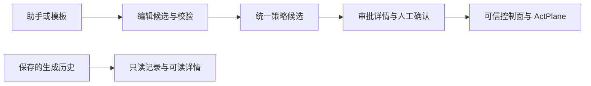

# RFC：AgentScope 第二步界面收敛

日期：2026-10-11。实现分支 `codex/ui-consolidation-step2-20261011`。基于系统策略库提交 `12c7646`，接入第一步统一审批提交 `7ce54b6`，集成后的第一步提交为 `eec9aee`。本阶段完成源码和隔离预览验收，未发布到共享 18003。

## 模块职责与操作链路

| 模块 | 保留职责 | 本次变化 |
|---|---|---|
| Agent → 策略助手 | 选真实目标、会话，起草候选与提交审批 | 保留现有简洁对话和精确目标合同 |
| Agent → Agent 策略 | 查看已配置策略，导入、编辑、保存并校验 DSL | 草案使用统一审批状态；编辑器只转交审批，不直接确认应用 |
| 审批 | 查看变更、范围、校验状态，显式批准或拒绝 | 接收 DSL 编辑器转交的新候选；失效状态与草案一致 |
| 系统 → 系统策略 | 系统配置库、保存版本、选择、校验和人工确认 | 保留 `12c7646` 的功能；共享审批详情的决策改走统一接口 |
| 系统 → 策略与模板 | 选择模板，绑定实际 Agent，起草候选 | 保留现有目标隔离 |
| 系统 → 生成记录 | 搜索、状态筛选、分页、只读详情 | 删除嵌套生成/历史策略页签、重复生成和最终审核入口 |
| 总览、Agent连接、任务历史 | 当前状态、连接管理、任务回放 | 模块名仅保留于导航与面包屑；总览待审批计数使用统一审批源 |

生成历史没有生成、审核、提交或加载权限。DSL 编辑器保存与校验只产生候选，随后跳转对应审批详情；只有批准操作调用决策接口。系统配置库保留共享 `ApprovalDetail` 内嵌预览，复用相同审批对象与 `/api/console/approvals/{id}/{decision}` 接口，不另建授权判断。

## 读取合同

`GET /api/console/history/generations/page` 返回 `items,total,limit,offset`。每条记录仅含 `id,status,created_at,finished_at,source_label,candidate_count`。ID 只用于读取定位，不在客户页面显示。

新增 `GET /api/console/history/generations/{id}?limit=20&offset=0`，按保存结果返回策略需求、历史目标名称、应用范围、保护对象、操作、处置以及可展开 DSL。详情只查询持久化记录，不执行实时资格检查、编译或 Broker 调用；离线 Agent 的历史仍可读。`ready` 只表示保存了已编译候选，不是批准、加载或当前生效事实。无可执行候选时显示“待补充需求”。通用候选明确标为未绑定 Agent，不能推导目标范围。

产品读取投影不返回原始输入、模型调用、PolicyIR、编译诊断、原始回执、内部 hash 或阻塞码。原始研究/运维 API 与保存记录仍保留。鉴权及 retained 可见性约束与现有产品 API 一致。

DSL 配置读取为每个草案补充 `approval={id,status,can_apply,reason}`，直接复用 `approval_views.project`。持久化 `state=pending` 可以投影为 `status=stale`，读取不改写候选状态；应用端仍重新核对指纹和基线。草案重新校验后使用新候选 ID 和状态，轮询继续追踪新候选。

## 导航与响应式

`systemTab=generate|records|audit` 及旧 `section=generate|records|audit` 入口归并到 `generations`。生成记录组件仅接收读取函数，不接收写入或继续审核回调。详情按需展开 DSL；850px 以下优先显示来源、生成状态与查看操作，时间在详情可见。模块名不在正文重复设置大标题。

## 范围与后续

本次不增加工作区文件读取，不改变执行域/内核边界，不调整普通业务代码。第三步才接入工作区场景读取与策略建议，并继续沿用候选、人工挑选和统一审批链。独立会话执行域与新增真实内核验收属于后续工作。

验收见 `docs/acceptance/20261011-ui-consolidation-step2/README.md`。
