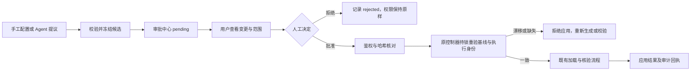

# AgentScope 统一策略审批合同（第一步）

日期：2026-10-11。状态：源码实现与隔离环境验收通过；尚未发布到 18003。

本次落实架构评审的第一步：统一当前产品链路的策略审批对象与人工确认入口，将实例策略的旧自动收紧、受管任务运行时提案接入审批中心。提交、查看和拒绝候选不改变已确认权限；只有可信控制接口收到绑定候选的人工批准，才调用既有加载器。

总体设计背景见[架构文档 PR #4](https://github.com/h3119835830/agentscope/pull/4)。本 RFC 记录本次实际代码，不把尚未实施的场景读取、会话独立执行域或生成诊断清理标为完成。

## 1 职责与边界

| 组件 | 职责 | 权限边界 |
|---|---|---|
| 实例策略提交器 | 校验类型化候选、冻结目标与基线、持久化 pending | user 与 agent 提交均不能自动停机、替换执行器或应用权限 |
| 策略生成 Agent/Pi | 生成 restrict/expand 候选 | restrict 只是变更分类，不是授权 |
| 统一审批投影 | 汇总候选、状态、基线、范围、可读差异 | GET 不调用 stop/start/install |
| 人工决策路由 | 管理员鉴权、候选哈希核对、分派原控制器 | Agent、任务或生成器凭据不能获得控制权限 |
| 原权威控制器 | 在生命周期锁内重验并应用、拒绝或报失效 | 保留各自编译、停止旧域、加载和核验合同 |
| Broker/ActPlane | 执行高权限操作、核验执行身份、提供回执 | 本次没有改写内核或 Broker 加载算法 |

统一的是审批合同与决策入口。DSL、类型化系统策略、类型化实例策略、受管任务运行时策略仍由各自权威存储和加载器管理，避免审批中心成为第二套权限状态机。

## 2 PolicyApproval/1

`GET /api/console/approvals` 返回目录及 `pending_count`，`GET /api/console/approvals/{id}` 返回详情。共同字段如下：

| 字段 | 含义 |
|---|---|
| schema | `PolicyApproval/1` |
| id / kind | 稳定候选标识与加载合同类型 |
| origin | 当前提交链路来源：manual 或 runtime；不决定作用范围 |
| scope_type / scope_id / target | system、agent、session 与精确对象；会话包含 task_id、session_id |
| candidate_hash / proposal_hash | 同一确认指纹；后者保留兼容旧客户端 |
| baseline | 提交依据的策略/文档哈希、revision、generation 或 version；缺失值不伪造 |
| status / reason | pending、stale、invalid、applying、applied、rejected、failed 与可操作说明 |
| can_apply / can_reject | 当前状态能否执行对应操作；服务端仍需再次校验 |
| scope_label / targets | 人可读范围与影响对象 |
| change_items / records / documents | 类型化权限前后对照、实际编译规则或实际 DSL 文档；不伪造 DSL |

类型与标识：

| kind | id | 权威存储 | 权威决策 |
|---|---|---|---|
| dsl | 保留原候选 id | instance_dsl_proposals | dsl_policy.apply/reject |
| instance_policy | instance:候选 id | instance_proposals | instances.controller.apply/reject |
| system_policy | system:候选 id | system_security_proposals | system_policy.apply/reject |
| runtime | runtime:作业 id | managed_jobs、managed_tasks、managed_events | managed.controller.review_change |

DSL 的 origin 表示当前手工提交配置的入口，不完整推断模板/场景的生成谱系。扩展来源枚举和全链路谱系不属于本次完成声明。

## 3 人工确认链路

决策接口：`POST /api/console/approvals/{id}/{confirm|reject}`，请求体仅接受 `proposal_hash`，禁止额外字段。控制接口沿用主应用管理员认证；免登录只沿用已有显式启用的本机回环开发模式。调用成功追加 `policy_approval_decision` 审计，操作者身份由可信请求上下文确定，不能由请求体冒充。

旧确认接口保留兼容，同样需要控制权限，继续调用相同权威控制器。候选提交接口不再包含自动应用分支。

## 4 重验与幂等

实例候选冻结 instance_id、资源目录、generation、系统 revision、本地策略哈希、运行进程/域身份，以及系统和实例 DSL 的 revision/document_hash。批准时必须与当前快照一致，同时核对有效策略与继承关系。指纹包含实例身份，相同工作区、相同策略的不同实例也不能互用确认指纹。

系统候选继续核对系统 revision/hash 与整个目标计划；任一连接、资源、本地规则或运行代次变化，要求重新提交。

受管运行时候选继续核对待审作业、revision、已加载策略 hash、基线 version、项目文件 hash、编译器身份和 Broker 实时域；本次增加会话与待审绑定核对。缺少冻结 session_id 的旧候选不能用当前会话补造审批依据。运行时来源只作用于冻结的任务会话，不自动提升为 Agent 或系统规则。

请求幂等键绑定提交体与 actor，重试不生成另一候选。顺序重复确认已完成候选只返回幂等结果；并发确认由原控制器锁保证至多加载一次，竞争请求可以返回冲突。拒绝后不能再批准。拒绝运行时收紧提案会保留未解决的用户约束并等待澄清，不把拒绝候选解释为撤回安全要求。

## 5 存储与历史兼容

新增两张附加表，不改原权限数据合同：

- `instance_proposal_contexts(proposal_id, context_json, request_hash)`：实例候选冻结快照及提交幂等依据。
- `policy_approval_baselines(approval_id, policy_json)`：类型化系统/实例候选的修改前策略，保证应用后的审批记录仍显示原始差异。

旧实例待审候选缺少快照时显示 stale，必须重新提交。旧运行时记录缺少指纹或权限基线时显示 invalid，不开放批准入口；没有对应受管任务的孤立作业不进入当前审批目录。旧记录没有修改前快照且当前基线已变时，明确提示无法展示完整对照，不拿当前策略冒充历史基线。

运行时 applied 从匹配作业和确认哈希的 request_resolved 回执投影，不修改 managed_jobs 的 completed 语义，不破坏既有策略记录查询。

## 6 状态与未覆盖范围

`applied` 表示原加载器完成该次配置/应用流程，不单凭审批状态声明内核 loaded、active 或实际阻止。未运行实例批准后只更新配置，保持未运行；真实加载与内核效果仍需执行回执和独立动作验证。

候选生成期间受管控制门可以等待评估或确认，已确认权限包、版本、允许目录与不可变底线不因候选自动改变。拒绝不是无条件恢复执行。

本次覆盖产品的 DSL、类型化系统/实例策略和 Managed Runtime 提案。旧 Scope Demo 实验接口继续沿用自己的显式审核合同，没有在本次迁移到目录；启动前审核也保持原启动审核流程。场景文件读取、会话独立域和模板/生成模块解耦留待后续步骤。

## 7 验收与发布

见[验收记录](../acceptance/20261011-unified-policy-approval/README.md)、[评审](../REVIEW/REVIEW-20261011-AgentScope-unified-policy-approval.md)、[问题闭环](../BUG/BUG-20261011-AgentScope-unified-policy-approval.md)和[决策记录](../ADR/ADR-20261011-AgentScope-unified-policy-approval.md)。当前只有本地源码、自动测试和临时 18114 浏览器验收完成；没有部署到 18003，也没有推送本次代码。
