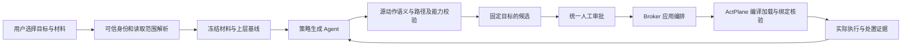

# RFC：AgentScope 四层策略、生成上下文与执行绑定

日期：2026-10-12。状态：采纳为目标架构；本次仅文档和静态审计交付，新增工作区/原生会话局部应用待实现。本文补充并取代 2026-10-11 总体 RFC 中关于生成目标、会话定位及执行隔离的目标描述，保留旧文件中的历史现场。

## 1. 结论和当前事实

系统 → Agent → 工作区 → 会话是合理的产品配置层级；任务、子 Agent、嵌套助手在会话下继续委托。生成材料、应用范围、授权主体和内核绑定是四个不同维度，不能由文件类型、生成时机或导航位置互相推导。

2026-10-11 的真实 DSH 验收在同一个原生会话执行了 23 项 OS 检查，并核对 7 条内核阻断记录；提案实际提交至实例级 DSL 接口。因此“全部工作区与会话”符合当时应用合同，不能把验收称为会话级隔离。选中会话、使用 `/w/0/sales.csv`、使用真实 node 来源均不能改变 Agent 作用域。详见 [BUG](../BUG/BUG-20261012-AgentScope-policy-scope-and-evidence.md) 和 [审计](../research/20261012-four-layer-policy/source-audit.md)。

当前审计基点为 AgentScope `fc4e9d5368fecc713830738a7ad5896dcfd00fd8`。四个关键后端文件与 18003 当前发布目录的只读摘要一致；这只是版本核对。本次没有应用候选、启动任务、重启服务或进行新的内核验收。现有源码只组合 system 与 instance DSL；原生会话共用实例执行器；managed 独立任务链路不等同于任意原生会话隔离。

## 2. 配置层级与责任

| 层 | 主要材料 | 权威目标 | 继承和生命周期 |
|---|---|---|---|
| 系统 | 管理员配置、共同安全要求 | 纳入受控执行的登记实例集合 | 当前与未来受控执行继承；观测连接不冒充受保护 |
| Agent | 独立 Agent 职责/安全规范、明确引用的 MD | 一个真实 instance_id | 此实例的工作区与会话继承，不按 DSH/Hermes 产品名批量扩散 |
| 工作区 | 仓库规范、项目文件、场景证据 | (instance_id, workspace_id) | 该工作区所属受控会话及未来所属会话继承；其他工作区不受影响 |
| 会话 | 当前任务、运行事件、权限请求 | (instance_id, workspace_id, session_id) | 当前原生会话的受控执行与后代；其他会话和未来新会话不继承 |

平台保护 Broker、策略、审计和控制通道的约束位于用户配置之外，不增加一个客户导航层。运行时任务/子 Agent 以 parent_binding 继承会话约束，不能凭自报 parent_id 获得委托权。

独立 Agent 规范和仓库 AGENTS.md/CLAUDE.md 都可作为材料。Agent 规范默认进入 Agent 候选；仓库材料默认进入工作区候选。材料可以跨来源引用，但生成前必须固定目标。将工作区或会话发现推广到更高层时，新建候选、重新解析目标、展示全部影响并重新审批，不能原地修改 scope 或复用旧确认。

“运行时生成”只表示 origin，默认目标为当前可信会话/任务；不构成第五个全局配置层。模板、人工配置及生成建议都使用相同的目标和审批合同。

## 3. 合同与数据流

### 3.1 四类独立信息

| 对象 | 最小必要事实 | 权威来源 |
|---|---|---|
| scope/target | system、agent、workspace、session 之一，相关实例/工作区/会话身份 | 可信登记与归属解析器 |
| origin/context_ref | manual、template、agent_document、scene、runtime；冻结的材料摘要和引用 | 受限上下文采集、原生事件及生成记录 |
| authority | 策略所有者、确认主体、上层强制约束、批准内容和影响快照 | 控制面审批记录 |
| binding | host/boot、进程身份、generation、domain、cgroup、有效包及编译摘要 | Broker/内核回执，客户端不得替代 |

输入只接受身份选择和需求，不接受客户端提供的“已验证 PID”、任意 source、工作区正文或 manifest 作为可信事实。实际项目路径是资源映射的证据，不替代 workspace_id；相同路径、挂载别名 `/w/0`、basename 或 cwd 不能生成工作区身份。工作区与会话必须经原生注册或可信适配器验证归属；能力不足保持待补充。

Agent 基线生成不强制选择会话。工作区生成不强制运行会话；适配器暂只能通过会话获得工作区事实时，明确记录此采集限制。会话运行时生成必须有可信会话身份、当前执行绑定和上层基线。

### 3.2 统一生成和审批

生成 Agent 不持有 Broker、策略确认或审计改写能力。外部材料始终是证据；文档内“忽略系统限制”“批准此规则”等内容不获得控制权。保留当前源动作抽取、独立复核、确定性权限映射与 DSL 校验；不增加只读、文件名或案例专用提示词。材料、否定、例外、目标和环境变更应使候选失效，而不是用旧 IR 自动修补。

所有变更，包括收紧、扩权、移除本层规则和推广范围，均需人工确认。保存、编译、提交、批准、加载、当前绑定核验、内核命中、实际阻止与反馈送达分别记录。待审批/拒绝/失败不改变现有授权；审批绑定候选摘要、上层基线、目标集合与上下文摘要。应用前再次核对，重复请求幂等返回原结果。

上层已应用的强制安全规则在后代中作为 locked 约束保留；局部 preserve/permit 只表示不增加本候选限制，不能放宽继承规则。策略所有者可以经新的审批版本修改自己层的规则，再重新应用受影响后代。可选模板/目录默认值是未选资产，不能与 ActPlane YAML 的可禁用 default binding 混为一谈。

## 4. 执行方案及不可省略的边界

首版采用**一个原生受控会话一个 DSH worker**，为其分配独立进程身份、cgroup、ActPlane 域和回执。AgentInstance 是产品登记身份，ExecutionBinding 是可有多个的运行身份，二者不再一一等同。DSH worker 必须能原生创建/恢复指定会话，并返回可信归属；该适配尚未实现，不能用新的 UI 标签代替。

四层配置先组合成每会话完整有效包，并在此执行域中保留上层锁定约束。配置四层不强制对应四个活进程或四个内核域；ActPlane 的真实 parent/domain 拓扑另行记录。工作区层与同工作区各会话使用共同配置基线，但会话局部约束不回写共同基线。首版仍由 Broker 在批准后排空旧 worker、完整编译/重建、核验后恢复同一个原生会话，暂不直接开放上游可变 MCP/control 接口给策略 Agent。

共享原生执行器仅可继续承载已明确的实例范围策略或提供局部建议。无法分别绑定工作区/会话时，局部提交返回能力不足，禁止自动转为 Agent 策略。可信 tool_call_tag 只能改善归因，不能让同一个 PID 同时处于两个会话域，也不能约束共享主进程中的全部读写。

内核继承沿真实 fork/exec 关系传播；子 Agent 可以获分配更窄的子域。跨 cwd 执行不改变所属会话。调用共享守护进程、代理服务或其他执行器不能假定仍在后代进程链中；未建立可信代理合同的路径不得声称有会话隔离覆盖。

批准应用前关闭相关执行门并排空/终止旧域中的在途工作；新包加载/绑定失败保持相关 worker 暂停，不影响其他会话。不能在共享主执行器上切换临时全局策略模拟并发会话隔离。恢复已批准配置时重新核验原生身份、上层基线、文件/能力摘要与新代次；变化则重新校验，不沿用失效批准。

会话 idle 是暂停活动，不是结束。明确关闭会话时停止其 cgroup 中全部后代并核验回收，再解除绑定/标记局部运行约束终止；不能留下脱离策略的后台进程。恢复同一未关闭原生会话可复用仍有效的已批准配置，必须重新绑定；新 session_id 不继承旧会话局部规则。跨工作区迁移需要新目标和继承快照，不能静默移动绑定。

ActPlane 的 scope_id 是整数权限元数据，源码中的大小比较不证明路径集合包含；实际文件范围仍由可信资源映射和编译规则约束。域祖先查询有有界深度（当前普通内核路径 8，legacy 1），不得承诺无限内核层级。有效配置超过可执行深度/规则容量时保守拒绝或由可信控制面完整展开并锁定后代约束；首版采用完整包方案，容量超限拒绝，不压掉规则。

## 5. 接口、存储和兼容建议（待实现）

| 接口族 | 保留/新增的合同 |
|---|---|
| 现有 system 与 instance DSL proposal/confirm | 保留现有明确作用域和幂等行为；不承接 workspace/session 候选；既有 Agent 规则不自动迁移或缩小 |
| history inputs/generations | 第一阶段已新增服务端冻结的生成目标：新 agent_context 默认为 session，场景 bind 为 workspace；已加载旧 Agent 文档保留历史范围，缺目标的旧候选禁止新导入；session_id 不能代替独立执行绑定 |
| 新增 workspace DSL 接口族 | 建议位于 `/api/agent-instances/{id}/workspaces/{wid}/dsl`，提供读取、提案、确认/拒绝；归属及独立绑定能力在提交/应用时都校验 |
| 新增 session DSL 接口族 | 建议位于 `/api/agent-instances/{id}/sessions/{sid}/dsl`，冻结 workspace 归属及会话生命周期，禁止共享执行器上静默扩大 |
| console approvals | 复用统一决策；投影精确目标、继承层、影响成员、执行能力和应用回执；新增字段兼容现有客户端，不修改旧审批的历史目标 |

持久化需要工作区策略版本、会话局部版本、继承基线快照、候选/批准关联及多 ExecutionBinding。复用统一候选/审批与应用编排，不按四个页面建立四套审核器。迁移时现有 system/instance 文档保留原范围；缺失新 scope 元数据的旧记录按其原接口解释，禁止靠生成会话反推并改写历史授权。

有效包摘要包括四层版本/内容、目标、实际源身份、能力清单、编译产物及绑定代次。parent 更新后，相关候选失效；当前后代由受控协调器重新核验/迁移，新会话先取得最新批准基线再启动。应用中断必须有可恢复的阶段回执，不能把跨进程操作描述为数据库原子事务。

## 6. 界面落点

沿用 [界面约定](../design/agentscope-ui-design.md)，不增加四层编号徽章或四套导航。系统入口管理系统策略；Agent 助手先选择“Agent 基线/工作区”并按需选原生目标和材料；会话页管理当前运行时候选与继承详情。列表使用记录表、详情按需展开，统一跳转审批中心。

场景建议默认提交工作区；运行时建议默认提交会话。界面在起草、提交和确认处显示同一实际范围，不只在说明小字中提示扩大影响。审批详情展示继承配置与本次局部变更；无法局部应用时说明需要独立受控执行，不展示可应用按钮。工作区只显示可信原生名称和实际项目路径，无可信信息则不伪造名称。此处允许目标选择，未恢复旧工作区目录/详情导航。

E1–E13、RQ 编号、内部模型诊断留在研究附件，不进入客户模板标题。系统调用匹配与工具 Trace 分开；无可信关联的内核事件只可表示执行域证据，不补造会话/工具归因。

## 7. 分阶段实施与验收合同

后续依次实施目标与持久化合同、Agent 无会话生成及 MD 采集、工作区场景作用域、原生会话独立 worker 与绑定、运行时局部候选及生命周期。每步先验收再考虑发布；不以文字替换提前宣称隔离已完成。

| 编号 | 后续必须通过的场景 | 判定 |
|---|---|---|
| A01 | 无运行会话生成 Agent 基线 | 固定实例和上层基线；不伪造 PID/domain |
| A02 | 仓库 MD 与独立规范分别生成 | 证据与目标独立，仓库默认 workspace，推广需新审批 |
| A03 | 同工作区 S1/S2，仅批准 S1 局部只读 | S1 可读不可改；S2 原可写仍可写；PID/domain 与事件不串用 |
| A04 | 同 Agent 的 W1/W2 | W1 规则不改变 W2 执行；chdir 不逃离 W1 主体 |
| A05 | A/B 两 Agent 共享仓库 | 共享路径不共享授权；仅批准 A 不改变 B |
| A06 | 子进程、孙进程、嵌套子 Agent | 保留父约束；子域不能放宽；域深度超限显式失败 |
| A07 | 生成、提交、拒绝、确认漂移与重试 | 未批准权限/绑定/有效包不变；漂移拒绝；重复确认幂等 |
| A08 | 上层 locked 与局部 permit/假 gate | 不能绕过；确认程序名不能冒充可信人工批准 |
| A09 | 会话结束、后台进程、PID 复用与恢复 | 后代回收；新身份重新核验；未来新会话不继承局部规则 |
| A10 | 共享执行器、缺工作区身份、容量不足 | 不支持局部应用且不回退扩大到 Agent |
| A11 | 应用失败、重启恢复、上层更新 | 相关域保持门控，其他会话可用；基线与回执重新核验 |
| A12 | OS 操作、反馈和任务结果 | root 内核记录、真实 allow/block、DSH 存活和任务效用分别验证 |

具体案例和命令准备见 [后续复现方案](../research/20261012-four-layer-policy/reproduction-plan.md)。A01–A12 在调研阶段仅作为待实施验收合同，均不计入该次通过数。

2026-10-12 实施更新：已实现目标冻结、独立局部审批和不支持时禁止应用，见[第一步 RFC](RFC-20261012-AgentScope-policy-targets-step1.md)及[验收](../acceptance/AgentScope-policy-targets-step1-20261012.md)。新生成不再沿用 legacy Agent 默认目标。原生工作区／会话独立 worker 与加载器仍未实现，A03–A06 等内核隔离项仍待验收，不能由本轮 HTTP 拒绝结果替代。
