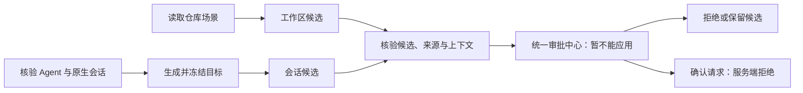

# AgentScope 四层策略第一步：策略目标与审批范围

日期：2026-10-12。范围：生成、候选提交、审批投影和禁止扩大作用域；不新增原生工作区／会话加载器。

## 目标与实现边界

系统策略作用于全部受控 Agent；人工配置的 Agent 策略作用于指定实例。仓库场景候选默认工作区，运行时候选默认来源会话及其后代进程。本轮将后两类目标固定在服务端，不再导入实例级 DSL 配置。当前原生 DSH 适配器没有独立局部加载合同，故局部候选只能提交、查看、拒绝，不能批准应用。

会话名称、PID、cwd 和对象路径都不代表独立执行绑定。当前连接没有通过 `native_workspace_info` 核验的工作区 ID 时，目标仍为工作区，`workspace_id=null`，界面显示“工作区身份待核验”，不得退回 Agent 级目标。会话候选固定真实 `(instance_id, session_id)`，但不据此声称内核已隔离会话。

## 三类合同

| 信息 | 字段与职责 |
|---|---|
| 产品目标 | `target={scope,instance_id,workspace_id,session_id}`；决定申请的权限范围 |
| 生成依据 | `origin=scene/runtime`、冻结生成上下文、artifact 与 context hash；用于追溯和提交时重验 |
| 执行能力 | `application_capability={supported,reason}`；服务端声明实际加载器能力，不能由客户端或材料来源决定 |

人工系统／Agent API 保留原合同。统一审批投影补齐目标字段，保留旧字段兼容读取。既有 managed task 的独立运行域审批仍走原来的会话加载链；不与共享原生 DSH 执行器混为一谈。

## 数据流

`agent_context.snapshot` 默认固定会话目标；`agent_scene.bind` 切换为工作区目标。`selected_candidate` 重新核验上下文、来源、编译结果和语义一致性，校验冻结目标未变化。生成结果分别表达“可提交候选”和“可加载”，绑定能力不足只阻止加载，允许保存可审查的候选。

新增 `POST /api/agent-instances/{instance_id}/policy-candidates/{artifact_id}/proposals`，只接收 `candidate_hash` 和 `request_key`。接口有管理员认证、严格字段校验和实例所属校验；客户端不得提交 target、PID、binding 或替换文档。确认指纹包含文档及目标，审批指纹进一步包含候选和上层基线。相同幂等键及内容返回原审批；相同键不同内容冲突。

新增 `local_policy_proposals` 保存不可变候选、上层基线和审批指纹。局部审批状态为 `blocked` 或 `rejected`，`can_apply=false`。统一确认入口与局部直接入口都拒绝应用，不能调用 Broker 或实例级加载器；拒绝可重复且不修改已加载权限。

## 展示与核验解耦

局部审批展示读取冻结记录，不逐行重新访问原生会话或扫描仓库。`blocked` 表示没有可执行的应用转换，不表示来源当前仍有效；展示中的 PID／连接是独立的实时位置投影。提交新候选时仍做完整上下文核验；幂等返回旧记录不会赋予权限。未来实现局部加载器时必须在决定执行前重新核验目标、父策略、执行代次和候选，而不能直接启用现有记录。

审批目录的运行时历史先在 SQL 中过滤后台保留、已删除及非受管任务，再作状态投影。避免总览每次轮询对不可见作业逐项打开连接、读取任务和状态；统一目录与待审批计数仍来自同一投影规则。并发读请求仅共享正在进行的一次目录查询，不保留跨请求的时间缓存；下一次串行读取重新查询，失败后可重新读取。真实服务堆栈显示并发 summary 在隐藏历史作业循环中积压，单独离线目录耗时约 0.66 秒，线上曾超过 25 秒；仅去除局部重验不足以解决此问题，因此同时收敛此读取路径。

旧生成候选缺少冻结目标时，不能新导入系统／Agent 配置，需重新生成。已加载的相同旧文档允许原样保留，避免把历史 Agent 范围伪装成局部范围。旧 `actor=agent` 实例提案缺少可信会话目标时，未应用记录显示“会话目标待核验”并禁止确认；新实例级运行时提案直接拒绝。人工管理员明确提交的 Agent 范围配置保持原行为。

## 界面入口

实际服务为 `http://127.0.0.1:18003/`。Agent → 策略助手显示会话／工作区候选及应用范围；候选详情显示局部绑定阻塞原因。审批 → 需要处理包含“暂不能应用”的局部记录，详情显示精确范围与来源会话，隐藏批准应用操作，仍允许拒绝。18115 是原来的合成只读 UI 预览，本轮未修改。

## 后续验收门槛

下一步才实现可信局部执行绑定。须验证同工作区双会话、同 Agent 双工作区、双 Agent 共用仓库、后代进程继承、跨目录执行、未审批不变、上层约束不可绕过、会话退出后的子进程处置。上述内核隔离项本轮没有执行，不能以目标字段或 HTTP 409 代替。

关联：[ADR](../ADR/ADR-20261012-AgentScope-local-policy-fail-closed.md)、[REVIEW](../REVIEW/REVIEW-20261012-AgentScope-policy-targets-step1.md)、[BUG](../BUG/BUG-20261012-AgentScope-policy-targets-step1.md)、[验收](../acceptance/AgentScope-policy-targets-step1-20261012.md)。
