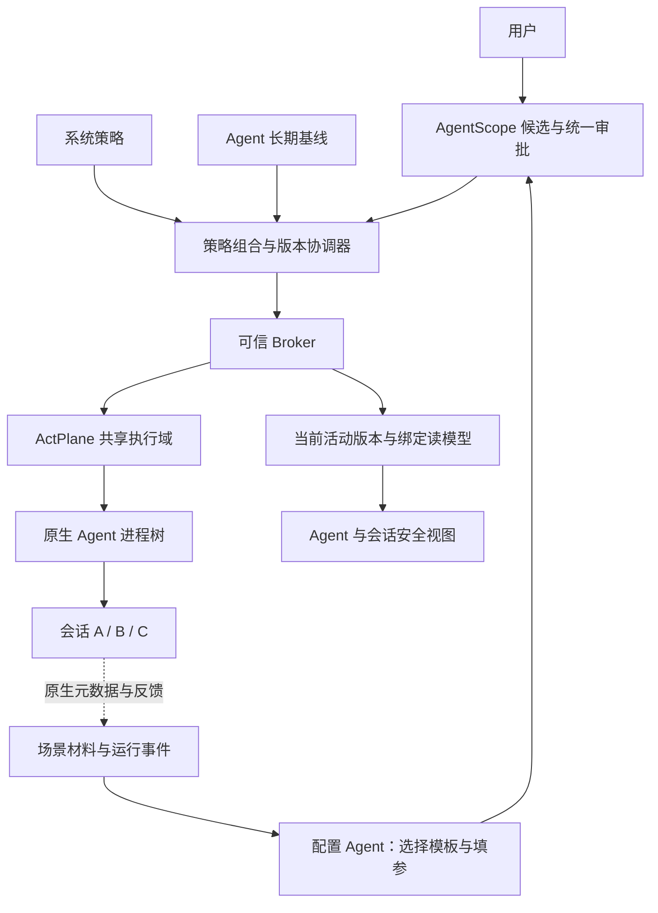

# RFC：系统与 Agent 基线，加真实域运行时增量

2026-10-14 配置方法补充：运行前与运行时共用受已发布模板约束的配置 Agent，模型只选模板/填参，通过同一受限 API 保存配置子记录；具体模块界面与安全面板见[模板配置工作台 RFC](RFC-20261014-AgentScope-template-agent-security-workbench.md)。两层基线/共享域与人工应用边界保持。

日期：2026-10-14，后续收敛决定。状态：当前目标合同；本轮仅修订文档，未修改应用/DSH、运行新策略或部署。

## 1. 决定和取代范围

按用户“做到 Agent 这一层，其他运行时新增”的要求，固定配置层收敛为 **系统策略 → Agent 基线**。工作区和会话保留原生登记、场景材料、来源及运行视图，不再作为必须实现的独立策略所有权层或独立 DSL 应用接口。

运行时增量是已批准基线之上的版本化变化，应用到可信绑定的 **实际 ActPlane 域**；它是更新途径，不是第三个固定配置层，也不因来自某会话就具有单会话作用域。AgentScope 的 AgentInstance 是管理身份，ActPlane 的域是执行身份，不能假定一个实例永远只有一个 PID/域。

本合同部分取代[四层 RFC](RFC-20261012-AgentScope-four-layer-policy.md)、[四层 ADR](../ADR/ADR-20261012-AgentScope-four-layer-policy.md)和[执行绑定重推 RFC](RFC-20261014-AgentScope-execution-binding-rederivation.md)中保留四个固定配置所有权层、必须建设工作区/会话独立加载器的目标。后者的真实执行单元、域身份、共享影响、机制覆盖和生命周期边界继续有效。历史测试与审批记录保持原范围，不改写为当前合同的通过证据。

## 2. 与 ActPlane 对齐的事实

| 已核对源码 | 事实 | 对当前设计的含义 |
|---|---|---|
| `actplane/bpf/capability.bpf.h:94–99,522–536` | cap_task 为进程标识到一个直接域的映射，域另有父域 | Agent 页不能按逻辑会话数制造多个并列活动域 |
| 同文件 `539–557,572–576` | 查询祖先约束，fork 默认继承父进程绑定 | 子进程不自动具有独立权限；上层保护仍保留 |
| `actplane/crates/actplane-cli/src/main.rs:360–364` | DeltaCommands 当前只有 Add | 有追加原语，不代表通用停用、删除、替换或无损热更新已完成 |
| `backend/agentscope_app/instances/dsl_policy.py:45–49` | 现有组合读取 system 与实例 DSL | 两个固定配置层与现有主组合方式相符，但不证明新运行时合同已落地 |

以上基于本项目当前 vendored 源码，源码摘要见[本轮检查](../REVIEW/evidence/agent-baseline-runtime-policy-20261014/validation.json)。前轮已核对实际 ActPlane 二进制的路径/摘要，但没有建立可复现源码构建溯源；本次亦无新的内核行为验收。ActPlane 本身使用通用进程域，不规定 AgentScope 的“系统/Agent”产品层名。

## 3. 固定基线与运行时变化

| 项目 | 所有权和目标 | 作用与期限 |
|---|---|---|
| 系统策略 | 系统管理权；纳入受控执行的实例集合 | 内置保护 system_builtin 和管理员规则，当前/未来受控启动继承 |
| Agent 基线 | 一个确切 AgentInstance，不是 DSH/Hermes 产品名 | 实例长期职责、安全规范和明确批准的资源约束；启动时组合系统基线 |
| 运行时增量 | 具备相应域变更权的人工批准；目标为实际域及受影响执行单元 | 当前批准运行代次内的变化；来源工作区/会话仅作 provenance，不能改变实际范围或期限 |

目标表达：

```text
AgentBaseline = compose(SystemBaseline, AgentPolicy)
DesiredPolicy(D) = compose(AgentBaseline, applicable_approved_runtime_changes(D))
LoadedPolicy(D) = verified_apply(project(DesiredPolicy(D), capabilities), binding(D), approved_impact)
```

`applicable` 包含当前域及经核验祖先的有效约束，组合时避免重复或丢失规则；不是任意 DSL 文本追加。系统/Agent 强制保护不能由下层运行时变化放宽。需要改变基线时，回到拥有该层权限的配置入口，新建版本、重新批准并确认应用。

运行时规则默认绑定 `engine_ref + domain_id + domain_generation/binding_revision`，不自动持久化为 Agent 基线，不因来源会话关闭而自动删除，也不自动带入下一次运行代次。需要长期保留时显式提升为 Agent 基线候选并重新审批。域结束须核验后代、旧资源和绑定回收后标记结束；新运行重新解析身份和版本。

## 4. 运行时增量范围和生命周期

### 4.1 共享域是默认运行模型

按用户本轮明确接受共享的决定，当前默认以一个受控 Agent 运行实例的共享执行域承载其原生会话，不为每条会话分配独立策略。DSH 的 S1/S2 共用该域时，S1 发现风险可以提出增量；确认页必须写明“来源 S1，作用于该 Agent 的共享执行域，影响 S1/S2 等当前成员及该代次后续进入该域的执行”。用户批准这一真实范围后才可应用，不能显示“仅本会话”。这是直接起草共享域变化，不是把既有会话级候选偷偷改成 Agent 策略。

举例：S1 请求禁止读取项目 `/project/private/`。规则加载到共享 Agent 域后，S2 对该目录的访问也受限制；限制的文件路径是对象范围，不能据此声称只限制某个工作区。若要求 S1 禁止、S2 允许同一可观察操作，而原生边界不能区分，则拒绝该局部要求。

### 4.2 可信子域是可选能力

原生 Agent 已提供可监督的独立执行进程/沙箱，且 ActPlane 子域绑定、全部 I/O 和生命周期均已验证时，可以在真实子域添加局部变化。子域仍继承上层保护，不按 session_id、工具标签、cwd 或不同 PID 自动建域。此能力是适配增强，不是本版本必须满足的工作区/会话固定层。

### 4.3 统一确认与执行合同

生成/人工起草 → 冻结来源、逻辑意图、真实域、基线和影响 → 校验支持的语法/机制/权限/共享范围 → 人工批准 → 单独确认应用 → 应用前重新核验 → 加载、读回绑定和真实状态 → 回执、执行反馈与效用验证。Agent 只提出建议；收紧也不自动生效。重复应用幂等，漂移使批准失效。

影响闭包包括跨实例共享执行单元、规则改变及暂停/终止影响，不能按当前页面过滤。批准范围可明确包含同一受控实例、同一真实域运行代次内的未来会话；这些会话自然使用当前域有效规则，不为每个逻辑会话新增权限门禁或修改原生创建流程。成员信息按可获得的原生事实更新；新增执行器、跨实例共享、域/基线/绑定代次变化则重新校验，超出已批准范围须重新审批。未知成员数量不能变成“只影响当前会话”的承诺。

### 4.4 停用、恢复和更新方式

运行时新增不承诺“不重启”已实现。原语支持、产品应用接口、内核加载和真实任务结果分别验收。[热策略生命周期提案](RFC-20261014-AgentScope-hot-policy-lifecycle-proposal.md)仍为未实施方案，本决定不批准它的完整引擎改造。

增量规则的停用/删除/替换须重新计算有效版本、检查继承与既有资源并重新确认，不能将 Add 当作 Delete。机制不支持时明确拒绝或展示已验证的完整包重建路径及中断范围，不静默重启或声称无损更新。取消来源会话、结束逻辑会话、停用规则和停止执行单元仍是四件事；共享服务不能为单会话操作被误杀。

### 4.5 同域串行应用与版本一致性

多个会话可以并发执行任务、提出不同候选；同一实际域只有一个获授权的应用协调器。按 `(engine_ref, domain_ref, binding_generation)` 串行应用，候选冻结 `base_active_revision + baseline_hash + binding_revision`。另一个已批准变更先应用后，旧候选须重算并重新确认，不能自动重放覆盖最新规则。

每次形成不可变完整 PolicySnapshot，保存系统/Agent 基线版本、适用运行时变化、规范化规则及 DSL 摘要、能力/编译器和绑定身份。快照是版本与审计合同，不能据此宣称现有引擎具备原子切换。持久化意图版本和 Broker/内核读回的当前事实分开。

应用步骤为冻结影响 → 校验当前版本 → 计划支持的更新方式 → 用户显式确认 → 获取实际执行协调权 → Broker 应用 → 读回核验 → 更新当前活动投影。DB CAS 只能保护控制面记录；Broker 还须校验应用令牌/预期绑定，禁止失效协调器继续写入。未具备可信 fencing 时不支持多 Broker 并发或自动无损交接。

追加、完整包重建和热更新通过统一加载器能力合同选择。第一版只开放已验证的操作子集；旧句柄、状态型规则、删除和替换没有相应能力则拒绝或显示已验证的中断路径。多个实际域的应用记录逐域回执，不能把跨域操作说成一个数据库事务即可原子完成。

失败区分“已证明旧版本仍活动”和“部分加载/当前未知”。后者对真实受影响范围按既有保护合同门控并协调，不显示旧版本仍完整生效；不能未经验证就宣称回滚成功。同域各会话读取同一活动投影，加载中、失败、未知同样一致显示。

## 5. 共性模型与界面落点

保留 Connection、AgentInstance、NativeSubject、ExecutionUnit、EnforcementCapability、PolicyBinding。NativeSubject 记录 workspace/session 原生身份及来源，不新增独立策略库。一个会话可能使用多个执行器，一个执行单元可能被多个会话共享，绑定必须含机制和覆盖操作。

RuntimeChange 至少记录：候选/批准标识、origin_workspace/session（可空且可信）、engine_ref/domain_ref、运行和绑定代次、基线/有效版本摘要、操作类型、规则摘要、共享成员与未来准入范围、可用性影响、批准/应用回执及期限。字段是目标合同，不假称现有数据库或 API 已有这些字段。

系统页管理系统规则；Agent 页集中管理长期基线和“运行时变更”。工作区模块显示原生文件夹/场景，允许把材料带入候选，但选择文件夹不创建工作区专属安全域。会话安全面板保留老师要求的可视化入口，显示系统继承、Agent 基线和实际域的运行时规则，提供查看 DSL 和发起增量入口。

每条展示来源与**真实作用范围**、所属域/执行单元、覆盖机制、当前版本及核验状态。共享域明确提示“同域会话共同生效”；目标 DSL、批准版本和实际加载 DSL 分开。只知道逻辑会话、缺可信绑定时显示未知，不把 Agent 范围的规则伪装为本会话专属规则。

### 5.1 默认参考架构



这里的 Agent 是一个登记、受控启动的实例，例如这一套 DSH 服务；不是每条会话，也不是所有名叫 DSH 的服务。默认一个运行实例内的会话共同受控；实际运行登记仍可以包含多个已核验执行单元/域，完整范围由绑定事实决定。若不同登记实例实际共享同一执行器，不能继续宣称各自基线独立，须明确共同目标并另行批准或拒绝该独立绑定。

| 模块 | 职责与输入输出 | 权威边界 |
|---|---|---|
| Connection / NativeAdapter | 原生 argv、cwd、宿主环境、打开方式和就绪状态；读取原生工作区、会话、执行身份和反馈能力 | 不重写原生会话/工具；不凭目录或 session_id 造执行域 |
| 策略资产与候选服务 | 管理发布模板、配置子记录、系统/Agent 基线、RuntimeChange 与批准；手工/助手同源 | 模型只提案；保存/批准不等于执行 |
| 策略组合与版本协调器 | 解析真实目标、完整有效快照、影响、版本前置条件，协调同域单写入 | 不用 DB 状态代替内核读回；不自行批准变更 |
| Broker / ActPlane | 受控启动与绑定、支持操作的加载、保护监督、真实执行事实与回执 | 精确进程开始身份、引擎/域/运行代次；现有自保护继续保留 |
| 安全读模型与审计 | 聚合基线、活动运行时规则、目标/加载 DSL、来源、共享范围及核验状态 | 只读投影，不是第二个授权库；无会话归因的事件保持域级 |

### 5.2 最小数据关系

| 记录 | 核心关系 |
|---|---|
| AgentInstance | 连接、Agent 基线版本和长期管理身份 |
| AgentRuntime | 当前运行 ID/代次、引擎/域绑定集合、监督状态和活动版本；不是新增配置层 |
| PolicySnapshot | 不可变完整有效版本；含基线与运行时变化集合，关联已批准目标和实际应用回执 |
| RuntimeChange | 来源会话/工作区（可空）、目标 Runtime/域、前置版本、变更与期限、批准/应用状态 |
| NativeSession / Workspace | 原生身份、运行与来源关系、目录；不保存另一份安全授权版本 |

Session 安全视图经 `Session → AgentRuntime → verified active snapshot` 读取。同一共享域中的会话显示相同当前有效规则，来源筛选只筛选“谁提出”，不改变当前保护清单。原生身份关联缺失时可以显示 Agent 范围规则，但不能伪造该会话当前绑定已核验。

### 5.3 启动、运行、查看与停用

1. 添加连接配置原生启动命令、目录/宿主、网页或终端打开方式；注册 AgentInstance 并选择批准基线。
2. 打开时由可信 Broker 组合基线并按已核验受控启动合同建立/核验运行绑定；原生入口就绪与保护就绪分别核对，再显示当前保护。配置存在和网页可达都不能代替执行绑定。
3. 用户在原生 DSH/Hermes 中创建工作区、会话并执行任务。适配器按原生能力同步目录/元数据和运行事件；不插入每会话进程或权限创建流程。
4. 会话或用户提出风险/权限需求，形成针对当前共享域的候选；统一审批、显式应用、更新域活动版本，然后全部同域会话视图同步。
5. 取消任务调用已核验原生取消能力；结束会话不删除域规则。停用运行时规则是新的版本变更；停止 Agent 才涉及整个运行域及全部共享会话，需展示真实范围。

Agent 入口集中放长期基线、运行时变化和当前有效规则；会话入口给出同一安全视图的会话上下文、DSL 和发起变更操作。审批显示简短范围如“当前 DSH 实例 · 共享会话共同生效”，技术域 ID/摘要放按需详情。当前规则、候选和历史分开，加载/失败/未知有可读状态；不增加工作区专属策略导航。

### 5.4 订单日报示例

手工验收的目标配置可设为：系统禁止读取凭据和未批准外发，DSH Agent 基线允许处理订单并写日报目录。会话 A 制作日报时提出“禁止修改订单原始文件”的运行时变化，确认范围是当前 DSH 共享域；批准应用后会话 A/B 对该文件的修改都受限制，读取和写允许的日报目录按实际规则继续。会话 A 结束后该代次规则仍在，停用/恢复规则另走版本变更；需长期保留则重新批准为 Agent 基线。此为设计用例，未在本轮运行。

## 6. 兼容与迁移

现有 system/instance 已批准文档按原目标保留。旧 workspace/session 草案、候选或记录不自动更名为 Agent/域增量；读取保留原语义，未应用候选要重新起草并冻结真实域和完整影响，重新批准。已有实际局部绑定若存在，先核验再制定迁移，不批量扩大权限。历史 API 可保持兼容拒绝/只读，不能偷偷换目标继续接收旧请求。

旧四层 A03/A04 的“必须提供工作区/会话独立策略层”退出当前固定交付要求，作为未来原生局部能力的可选验收保留。这不是将未实现功能判为修复完成；当前必需门槛改为下表。后续应用代码/界面迁移另行实现和运行验收，本轮不改变已有保护。

## 7. 当前验收合同（尚未运行）

| 编号 | 场景 | 必须满足 |
|---|---|---|
| N01 | 系统 + A/B 两个 Agent 实例基线 | 系统共同继承，A 变更不改变 B；同产品名不扩大范围 |
| N02 | 同 Agent 的 S1/S2 共享域，S1 来源增量 | 审批显示共享域；真实操作在两会话一致生效，不虚报 S1 独享 |
| N03 | 只起草/批准、拒绝、撤回、重试和版本漂移 | 未确认应用不改变权限；幂等或失效结果可追溯 |
| N04 | 来源会话结束、同代次新会话与新运行代次 | 不按来源结束偷偷删规则；准入版本一致；新代次不自动继承临时增量 |
| N05 | 不同 engine 的同号域、PID 复用、共享拓扑变化 | 旧绑定/回执不串用，变化重新核验 |
| N06 | 下层放宽上层规则、停用继承保护 | 拒绝或返回正确基线修改入口，不绕过权限 |
| N07 | 不支持的停用/热更新、加载失败 | 不伪成功；显示真实中断和共享影响，失败守住保护 |
| N08 | DSH/Hermes 原生创建/恢复、工作区、工具、上下文、并发和历史 | 原生流程保持，无专用工具 worker 或提示词补丁 |
| N09 | 会话安全面板和 DSL | 来源、共享范围、目标/加载版本、机制覆盖和未知状态一致 |
| N10 | 完整安全任务闭环 | 实际 allow/block、内核/工具证据、反馈送达、合法任务完成及当前版本分别取证 |
| N11 | A/B 并发提案、批准交错、重复应用、协调器失效 | 同域单一活动版本；旧基线拒绝，重复请求幂等；失效写入者不能改策略 |
| N12 | 加载中断、部分失败、只读视图延迟和控制面恢复 | 不虚报回滚/活动状态；按真实影响保护，同域视图一致并重新核验 |

子域隔离、热更新和旧资源撤销的更细验收只有在声明支持时才增加；不能因为不再要求四个固定层就降低实际执行和批准边界。

## 8. 配套记录

[ADR](../ADR/ADR-20261014-AgentScope-agent-baseline-runtime-policy.md)、[REVIEW](../REVIEW/REVIEW-20261014-AgentScope-agent-baseline-runtime-policy.md)、[BUG](../BUG/BUG-20261014-AgentScope-agent-baseline-runtime-policy.md)。本轮静态文档检查不能替代 N01–N12 的运行验收，不包含发布到 18003。默认共享运行架构的增补检查见[本轮静态回执](../REVIEW/evidence/agent-shared-runtime-design-20261014/validation.json)。
