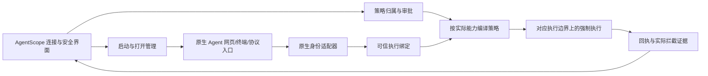

# RFC：AgentScope 多 Agent 启动与策略适配研究

- 日期：2026-10-14
- 状态：研究与接口草案；尚未实现、未部署，不能作为四层运行验收结论。
- 用户边界：先研究各 Agent 启动方式；只设计 AgentScope 通用接入，不修改 DSH 的安装源码、原生工作区/会话流程、提示词或工具实现。本阶段也不新增 profile 注入或覆盖原生沙箱。
- 关联：[ADR](../ADR/ADR-20261014-AgentScope-agent-launch-adapter-research.md)、[REVIEW](../REVIEW/REVIEW-20261014-AgentScope-agent-launch-adapter-research.md)、[BUG](../BUG/BUG-20261014-AgentScope-agent-launch-adapter-research.md)。

## 1. 需要解决的具体问题

产品实例、启动进程、原生工作区、逻辑会话和操作系统执行边界被当前接入过度合并。新增一个会话并不一定产生新进程；共享进程也不等于会话上下文必然混乱，但同一进程域上的规则不能自动成为某一逻辑会话的独立约束。四层配置的归属应保留为系统 → Agent → 工作区 → 会话，是否能够强制执行则由真实执行绑定决定。

本轮先撤回未发布的“每会话独立工具进程”草稿，停止隔离验收服务，保持已接受的应用代码基线 c6e660f。该草稿不作为默认架构，也未完成四层验收。

## 2. 已核查的原生启动方式

| 原生入口 | 当前源码/安装事实 | 对 AgentScope 的含义 |
|---|---|---|
| DSH Web | `dsh web --host 127.0.0.1 --port <port> --no-open`；原生 Agent factory 在同一运行时创建/恢复逻辑 Agent | 能监督 Web 实例；工作区/会话 ID 不能直接当成独立 PID |
| DSH headless | 已安装 launcher 的帮助列出单任务入口；源码在完成任务后 flush 并退出 | 可研究任务型接入；不是原生 Web 中任意既有会话的透明恢复入口 |
| DSH SDK / ACP | 已安装包存在；SDK 有会话 Map，ACP newSession 创建并保存逻辑会话 | 协议有会话语义，但没有自动承诺一会话一进程；本轮未做协议握手 |
| DSH TUI | launcher 帮助有示例；本机 `@deepseek-ai/dsh-tui` 包未安装 | 帮助有入口不能写成本机已经可用；本轮不安装 |
| Hermes dashboard / serve | 两者共享原生 Web 后端；`--isolated` 指 profile/server 独立 | 不表示每个 chat 已独立；默认 profile 可能附着到已有 machine server |
| Hermes CLI / ACP / compute host | ACP 使用会话对象与线程池；compute host 保存多个 sessions 并在线程池执行 | 不能因 Python 对象不同就宣称内核域不同；恢复和压缩可能轮换内部会话身份 |
| Hermes PTY | 原生代码有 PTY 创建与重连登记 | 部分入口确有子进程，但 PTY key/运行时 PID/数据库 session 的一一关系仍须实测 |
| Node / Python 命令型 Agent | 当前 AgentScope 有受限命令启动和 PTY/Web 入口 | 能管进程，不代表自动取得此程序的工作区、会话、工具或业务权限 |

本机安装 DSH 0.2.0-rc.2；可读源码目录没有 Git 元数据，且 launcher 与安装产物有差异，具体能力以安装产物为准。Hermes 源码修订为 3c27eb6234bf91b8ceee9e9071591b31e9b148cb。版本和命令仅为本轮读取事实，未升级任何 Agent。

## 3. AgentScope 拟采用的分工

### 3.1 启动与打开管理

保存程序和参数、启动目录、宿主机/环境、原生状态目录的明确引用、网页/终端/协议打开方式、就绪检查和生命周期所有权。启动与附着必须分别建模；已有服务、启动器进程、实际 executor 不能混为同一个 PID。只停止 AgentScope 具有明确所有权且身份未变化的运行单元，不能调用会停止所有同产品服务的全局命令。

通用启动不应在一个大条件分支里按 `agent_type` 重写各产品内部运行方式。产品专用的 argv、可选能力和就绪握手由适配器给出；命令以普通用户 argv 运行，特权 Broker 只建立并核验边界。凭据使用原生配置或明确的凭据引用，不写入命令或文档，不为了适配而复制、覆盖用户配置。

### 3.2 原生身份与协议适配

优先读取 Agent 已有 API、SDK、ACP 和明确的原生登记。工作区按 native workspace ID，逻辑会话按原生 session ID；产品无工作区概念时允许缺省，不能按 cwd 猜一个归属。支持有条件的身份别名和 rotation 事件，但持久会话、UI handle 与当前 execution identity 必须分别保存。

Web 原生入口与协议管理入口是两种接入方式。不能把另一个 SDK/ACP 会话直接冒充用户当前 Web 会话，也不能假设不同入口的历史可无冲突共享。本阶段不为此改造 DSH。

### 3.3 能力探测

各适配器分别报告：能否启动/打开；能否读取工作区/会话；能否取消某会话；是否有可信执行归属；是否有原生授权接口；支持哪些文件/命令/网络操作；是否有独立工作区/会话边界；是否支持热更新、停用及旧句柄撤销。每项带已核验、未核验或不支持状态及依据。

协议能力必须经过实际 handshake，而不是看 package 存在。ACP 的 sessionId 标识会话上下文，cwd 定义文件上下文；这些字段本身不是操作系统隔离证明。原生权限询问也不自动覆盖无询问的 I/O、MCP、后台任务和子 Agent。

### 3.4 执行绑定与策略放置

逻辑归属：`instance_id + native_workspace_id + native_session_id`。物理边界：`execution_unit_id + host/boot + pid/start_ticks + cgroup/domain + generation`。一个执行单元可以服务多个逻辑会话；映射支持一对多和暂不可验证，绝不能为了展示四层而伪造一对一。

系统与 Agent 约束可放在整个受控实例边界。工作区/会话约束只有在适配器给出对应的可信、完整执行边界时才可应用；否则仅保存配置/候选并准确显示缺少执行绑定，不能扩大为 Agent 策略。不假定 PID 动态来回切域能区分 Node 异步请求，不假定线程 ID 永远属于一个会话。

若原生入口已有独立 worker、沙箱或客户端授权/执行接口，研究直接接入这些原生能力；若无，则评审可选的原生多实例启动方式、协议管理方式及使用体验代价。上述均是待验证选项，不是已采纳的强制工具拆分方案。

## 4. 拟议接口合同

| 接口 | 返回事实 | 不得推导 |
|---|---|---|
| validate_launch / launch / attach | 规范 argv、所有权、启动结果 | 不等于权限已生效 |
| discover_runtime / open | 已核验入口和实际 runtime | HTTP 200 不等于执行保护 |
| list_workspaces / list_sessions | 原生身份与版本 | cwd 不等于 workspace ID |
| resolve_binding(subject) | 精确逻辑身份到物理边界的映射、共享性、覆盖范围 | 不能由 UI 或 Agent 自报能力直接授权 |
| validate_policy / plan | 编译结果与精确影响对象 | 不能顺便扩大局部 scope |
| approve / apply / disable | 冻结候选、审批回执、加载及撤销结果 | 批准不等于应用；去掉下层规则不移除上层保护 |
| cancel / stop | 原生取消结果或精确受控运行单元停止结果 | 停止某会话不能杀共享服务冒充成功 |
| observe_evidence | 可信归属的工具事件及 OS 证据 | 不能把共享事件自动归给当前 UI 会话 |

## 5. 下一阶段进入实现前的验收门槛

先对每种入口建立“启动器 → 服务 → 逻辑会话 → 实际 I/O → 子进程”的原生拓扑证据，再确定最小 adapter 合同。实测不改源码的两个会话并发、两个工作区、取消其中一个、恢复后身份是否改变、子进程/后台任务是否继承、已有文件句柄与 mmap 是否撤销。

四层验收使用 A1/A2 属于工作区 A、B1 属于 B，另一个 Agent 作为控制组：系统影响全部目标，Agent 只影响该实例，工作区只影响 A1/A2，会话增量只影响 A1。应用前后读写 OS 结果和独立可信绑定均须核验。原生工作区/会话仍按原有流程创建；不能以换入口或新建另一个会话掩盖断链。

## 6. 本轮验证边界

完成源码与安装产物锚点核对、已安装 launcher `--help` 退出检查、草稿撤回/隔离服务停止检查和文档证据检查。没有进行新的四层加载、Agent 对话、模型请求、并发会话或协议握手验收，也没有发布新应用代码到 18003。

证据：[research-evidence.json](../REVIEW/evidence/agent-launch-adapter-research-20261014/research-evidence.json)、[launcher help](../REVIEW/evidence/agent-launch-adapter-research-20261014/dsh-launcher-help.txt)。外部参考：[Linux cgroup v2](https://docs.kernel.org/admin-guide/cgroup-v2.html)、[ACP session setup](https://agentclientprotocol.com/protocol/v1/session-setup)。

## 7. 共性结构补充：逻辑策略与执行单元

2026-10-14 根据用户追问核查 ActPlane 源码：cap_task 是 pid_t → domain_id 映射；cap_domain_for_pid 查询此映射；cap_fork 默认复制父任务的 domain。多个会话在同一进程/域中执行时，共享该域及祖先域的已加载策略包。规则仍可按文件对象、操作和其他已支持条件给出不同结果，但当前接入没有把 DSH 原生 session_id 变成可信内核匹配条件。

统一结构采用以下对象，不能按产品固定为一会话一进程：

| 对象 | 共同字段与职责 |
|---|---|
| Connection | 原生启动 argv、cwd、宿主环境、入口、生命周期所有权；表示如何启动/附着/打开 |
| NativeSubject | instance_id、可选 native workspace_id、native session_id、可信原生关系；表示配置归属 |
| PolicyDocument | 系统/Agent/工作区/会话 scope、版本、DSL 与结构化表单；表示配置内容和来源 |
| ExecutionUnit | 实际 PID/start_ticks 集合、cgroup/domain、generation、shared_by；表示可核验的执行边界 |
| PolicyBinding | 精确 Subject → ExecutionUnit 映射、已批准的策略包 hash、覆盖操作、核验状态；表示哪些配置实际在哪里执行 |

在任意时刻，一个 ExecutionUnit 只能有一套与该单元绑定的有效内核策略包，包内可包含多条规则和域继承。多个 Subject 可以共享该单元；NativeSubject 与 ExecutionUnit 不强制一一对应。原生进程池导致一个 Subject 使用多个单元时，也必须逐一核验完整覆盖。

### 7.1 共享单元的兼容性检查

1. 分别计算各会话按四层继承得到的目标策略和所需执行能力。
2. 通过适配器解析真实执行单元和共享会话，不能用 cwd、产品名或 UI 参数猜测。
3. 对共享单元检查所需的内核策略是否等价且可由同一策略包承载。相同策略可共享执行；规则对象/操作不同并不必然意味着策略包不同。
4. 如果两个会话要求不同权限、却映射到同一执行域，拒绝声称局部生效。不能把禁止规则取并集后对全部会话实施，也不能取更宽权限后损失保护。改变整体影响范围须成为另一份明确审批候选。
5. 原生已有独立 worker/沙箱时可绑定其边界；原生可信会话授权接口可承担其覆盖操作的会话级检查，但必须与 ActPlane 进程域强制执行分别报告。不存在这些能力时，局部策略保留配置/候选状态。

四层可视化分别展示本层配置、继承配置、目标有效规则以及实际加载到哪个执行单元。共享执行单元时明确显示共享范围；未应用/缺少绑定的工作区或会话候选，不计入当前强制执行保护。此补充不实施进程拆分、不修改 DSH，也未发布新运行功能。
