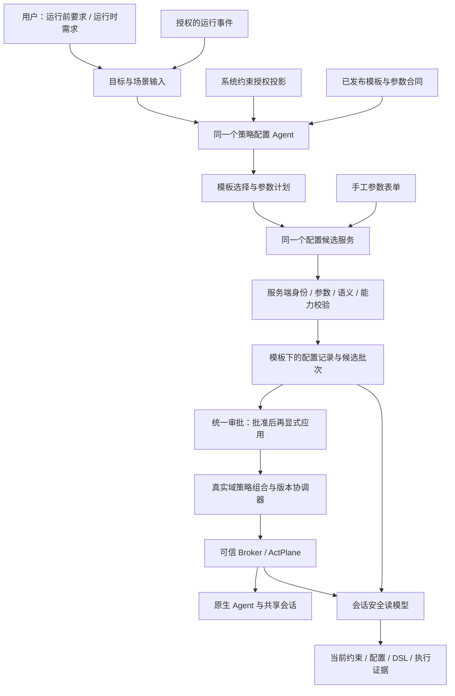

# RFC：模板配置 Agent 与会话安全工作台

日期：2026-10-14。状态：架构与界面设计，含本地示例预览；未修改应用/DSH、未应用策略、未部署 18003。本文整合运行前配置、运行时变化与用户可见的安全视图。

后续设计：2026-10-15 的[统一策略库与 Jev 模板选择](RFC-20261015-AgentScope-unified-policy-catalog.md)将系统策略和策略与模板合并为同一目录，适用范围改为子配置参数；包含当前发布状态复核与新的 HTML 预览，应用合并尚未实施。

## 1. 用户目标与设计依据

图片提出三项用户任务：打开任务/会话即可看清全部当前安全约束；用类似 App 权限页的勾选、复选、参数和文字表单配置；让旁观者能看见配置、检查、变化与执行效果。展示不只包含 OS DSL，还应包含已接入的原生授权/审批约束和行为指导，且明确各自执行方式。

用户指定对话“排查服务停机并规划ActPlane价值公告”（`01a1304c-7308-7f23-91c6-c8fd0b9ec09b`）补充了生成方法：策略配置 Agent 只能读取授权系统约束与已发布模板，像手工一样调用接口选模板、填参数、保存配置候选；模板下展示独立子配置记录。该对话在本轮读取时仍在实现中，不能作为已完成/已发布证据。本轮没有向该对话发送消息，也不修改其实现工作树。

固定范围继续采用[系统/Agent 基线与共享域增量](RFC-20261014-AgentScope-agent-baseline-runtime-policy.md)。工作区/会话是来源、原生上下文与查看入口；运行时默认作用于当前 Agent 的实际共享域。本文补充[指定对话中的模板约束提案](codex://threads/01a1304c-7308-7f23-91c6-c8fd0b9ec09b)的配置方法，范围以本合同为准，不恢复四个固定策略层。

## 2. 完整架构

策略配置 Agent 决定用哪些现有模板及如何填参；可信后端决定是否合法并生成规则；人工决定是否批准和应用；Broker/ActPlane 给出真实执行事实。外部 DSH/Hermes 执行任务，策略配置 Agent 不替它完成业务。一个生成 Agent 可处理两种阶段，不建立两套提示词、策略库、审批器或加载器。

## 3. 运行前与运行时使用同一套配置方法

| 事项 | 运行前配置 | 运行时配置 |
|---|---|---|
| 用户输入 | 选择登记 Agent、职责/场景、允许资源与安全要求；原生会话可为空 | 选择当前 Agent 运行记录；可从某会话、事件或用户需求发起 |
| Agent 可读内容 | 授权系统约束、已发布模板；服务端提供本次用户要求和可信资源引用 | 同一资料边界，增加授权的结构化事件/本次输入；既有配置合并由后端处理 |
| 目标 | 默认 Agent 长期基线；系统目标仅在用户明确要求且有管理权时出现 | 当前真实域和已批准共享范围；来源会话不改变作用域 |
| 产生物 | 模板下配置草案与候选批次 | 同格式配置草案，标明当前运行期限、来源及真实域 |
| 应用门槛 | 无运行时可先批准配置；启动时解析真实绑定并核验。未运行不显示保护中 | 冻结活动版本、绑定代次、共享与中断影响；批准后显式应用 |
| 期限 | 长期基线供当前/未来受控启动使用 | 当前运行代次；来源会话结束不删规则；长期化重新批准为 Agent 基线 |

缺少参数时正常澄清；缺少模板或执行机制时列明缺口。不能生成一段目录中不存在的自由策略来填空，也不能把用户只要求 S1 的旧候选默默改成共享 Agent 域。

## 4. 三类对象与单一来源

| 对象 | 内容与版本 | 界面位置 |
|---|---|---|
| TemplateDefinition | 固定语义、参数 Schema、可用目标、操作组/效果、机制覆盖和验证依据；发布版本不可静默改写 | 系统 → 策略与模板中的父模板 |
| TemplateConfiguration | 模板版本 + 参数 + 真实目标 + 来源 + 配置版本；手工/助手共用记录格式 | 父模板下独立子记录，可跳转 Agent/会话/审批 |
| PolicySnapshot / ApplicationReceipt | 由批准的配置引用组合完整有效版本；真实加载、绑定与执行回执另列 | 当前生效视图、审批应用结果、任务历史；不创建第二份授权库 |

每个静态模板可有多个同级子配置。新增配置追加记录；编辑生成该配置的新版本，不修改其他配置或父模板语义。父子结构用于目录组织，不代表 ActPlane 父子域。模板升级使依赖旧合同的新应用重新校验；现有应用与历史版本保留原事实。

当前事实必须区分：模板存在、配置保存、批准待应用、已加载、当前绑定核验、真实允许/拒绝、反馈送达、任务完成。规则数、配置数、模板数不是安全覆盖率。

## 5. 配置 Agent 的工具与服务端边界

下列为待实现接口合同建议，**不是已存在的路由或已可调用工具清单**。

| 受限工具 | 能做什么 | 必须限制 |
|---|---|---|
| list_published_templates / get_template_schema | 查已发布模板、允许参数和效果 | 只返回调用身份可用的模板/版本；不提供发布/任意执行能力 |
| get_system_constraints | 获取授权系统约束摘要 | 下层保护只读；不返回凭据、敏感文件正文或控制面私有配置 |
| get_scene_inputs | 获取本次用户要求、所选资源引用及获准事件摘要 | 不开放任意文件、终端、HTTP 或其他 Agent 会话读取 |
| validate_configuration_plan | 校验模板/参数/目标并返回可读差异和 gaps | 不产生运行副作用；拒绝未知模板、额外字段和自由 DSL |
| create_configuration_drafts / revise_configuration_draft | 保存/修改授权范围内的未批准候选 | 服务端绑定身份和目标；配置版本 CAS，修改后旧校验/批准失效 |
| submit_for_review | 在用户明确提交时形成审批批次 | 默认先保存草案；不拥有批准、应用、加载或审计修改权限 |

手工表单和 Agent 工具都调用同一个 ConfigDraftService 与校验/实例化逻辑。Agent 不通过 computer use 操作产品页面。后端根据已发布模板确定性产生 AST/DSL/机制配置；模型没有自由 DSL、source/label 表达式、任意脚本或加载参数出口。人类既有高级 DSL 权限可保留兼容，但该通用保存路由不进入 Agent 工具白名单。模板校验能核对发布合同和参数，不能自动证明自然语言要求完整；不确定的否定、例外和意图列待澄清，确认时固定真实操作、范围和未覆盖项。

身份由可信调用凭证和服务端会话固定，不能相信模型自填 actor、PID、instance_id 或权限。资源参数使用已登记、获准的对象引用及受控规范化；拒绝参数注入、越界路径和过期引用。模板、资源、基线和真实绑定变化重新校验。修正工具合同与上下文更新，不加只修某个案例的提示词。

## 6. 实际能力与通用安全约束

当前已核对源码 `history/capabilities.py:5–14,38–47`：open/read 共用读取组；write/unlink 共用变更组，后者还涉及写入方式打开、create/truncate、写入、删除和重命名。因此“只禁删除、允许写入”不能按现有 ABI 显示为精确支持。

目录可以保留两个需求来源不同的子配置，但提交前必须处理真实语义：精确要求无法满足时标不支持；用户若接受更广的变更组限制，重新形成明确该实际范围的候选并审批。不能只在说明小字里藏扩大限制，不能将两条记录当成两个独立内核能力。相同实际规则可由后端去重，但保留全部配置引用和来源，不丢审批关系。

通用约束使用 mechanism / operation_coverage / verification_state 分开投影：

| 约束 | 展示与配置 | 生效证据 |
|---|---|---|
| 文件/进程/网络等 OS 规则 | 已发布、通过能力核验的模板参数表单；高级 DSL 对照 | 对应执行域、加载回执及实际事件；编译不能代替拦截 |
| 原生工具权限/审批门 | 读取原生授权适配器；仅具备权威写入合同才可配置 | 原生控制回执；未接入时禁用操作并说明 |
| 文件资源授权 | 显示现有权威访问范围及配置入口 | 对应资源/权限机制；限制模板不自行授予读写权 |
| 行为指导 | 已发布指导模板中的文字参数 | 明确“行为指导，未强制执行”，不伪造 OS DSL/拦截 |
| 安全检查 | 只读核对身份、范围、继承、版本、能力与回执 | 无命中不等于安全；不完整显示未知，不运行危险探针 |

现有目录不可能仅凭条目数量覆盖所有 OS/工具/业务安全语义。维护冻结能力矩阵和缺口，不让模型自己补出底层机制。

## 7. 每个模块的界面功能

保留现有导航：总览、Agent连接及会话、审批、Agent、系统、任务历史。列表使用结构化记录表，详情按需展开；会话目录可折叠，不增加固定工作区策略导航。下表是目标功能，完整实现与否需逐项验收。

| 模块 | 用户来这里做什么 | 首屏与必要功能 | 与其他模块的关系 |
|---|---|---|---|
| 总览 | 确认哪些实例受控、哪里待处理、选择真实安全场景 | 当前保护/未知状态、待审批/待应用入口、具体场景和最近真实结果；不编造安全分数 | 跳 Agent、会话、审批；不在此另建配置库 |
| Agent连接 | 配置并打开原生 Agent | 程序/参数、宿主/cwd、网页/终端、资源登记、连接/保护就绪分开；打开、附着、停止/重启显示完整共享影响 | Broker 核验实际身份；原生工作区/会话照常创建，目录按原生适配器读取 |
| 会话 | 看清该会话当前安全约束并发起变化 | 可折叠目录；当前约束表；系统/Agent/域运行时来源与真实范围；安全检查、参数详情、DSL、发起增量/停用申请 | 同域会话读取同一活动快照；本会话提出的候选另区；继承配置跳所属入口 |
| 审批 | 核对并决定精确变更 | 批次/配置差异、请求语义与实际效果、继承、共享/中断影响、基线漂移；批准/拒绝后单独确认应用 | 唯一决策入口；读回后更新生效投影，不把批准当加载 |
| Agent | 用配置 Agent 做运行前/运行时配置 | 当前真实实例；阶段与需求、获准资源/场景；助手对话、澄清、模板参数候选表；长期基线/运行时记录/当前规则入口 | 同一工具集与配置记录；不展示助手专属另一份 DSL 库；切换实例/阶段冻结或清除旧选择 |
| 系统 → 系统策略 | 管理共同保护 | 已配置/待配置、当前实际覆盖、系统内置只读项、参数编辑和提交审批 | 授权系统范围才能改；生成不自动全局化 |
| 系统 → 策略与模板 | 找模板并管理配置子记录 | 静态父模板可展开；子配置含名称、参数摘要、目标、阶段、来源、状态；新增/编辑、跳审批、查看已应用版本 | 与手工/助手同源；模板维护者管理发布合同，助手无发布权限 |
| 系统 → 生成记录 | 回看配置 Agent 做了什么 | 请求、目标/阶段、模板/参数结果、待澄清与缺口、配置/审批链接；无模型私有推理 | 生成轨迹不代表已应用；可引用新候选，不恢复权限 |
| 任务历史 | 核对最终结果与证据 | 原生任务结果、策略变化/应用、工具反馈、内核证据分别查看；缺关联标未知 | 保留原范围/版本，不把域级事件硬归到某会话 |

## 8. 会话安全面板的具体布局

首屏固定为会话名称/所属 Agent、共享范围提示、当前核验状态，以及可读约束表。表格展示“约束名称、对象/操作、处置、归属/范围、机制与状态、详情/配置入口”。限制会话 A 的来源筛选不会隐藏同域会话当前共同承担的保护。

- 当前约束：实际已核验保护与未知/指导明确区分；草案不混入保护数量。
- 候选变更：本次新增/修改/停用、参数缺口、实际范围、提交审批入口。勾选/开关只改草案。
- 详情：同一参数表单，继承项只读；模板没有的能力不提供可应用控件。
- 高级：原始意图、模板实际操作组、目标/加载 DSL 对照、配置引用与绑定证据；默认不展示原始 JSON、内部英文错误码或进程图。
- 执行证据：系统调用匹配和工具 Trace 分开；有可信归因才关联会话。取消原生任务不等于停用共享规则。

汇总某一来源失败时显示该来源未知并提供重试，不能把读取失败计为 0 条约束。缓存带活动版本与核验时间；同域共用权威策略投影，原生会话关联缺失时不虚报该会话绑定已核验。

界面内保持短提示，如“同域会话共同生效”“已批准，待应用”“当前未核验”“工具控制尚未接入”。技术诊断与模板版本/哈希放按需详情或验收附件。

## 9. 两条完整用户路径

### 9.1 运行前

登记 DSH 连接与资源 → Agent 页选运行前基线、描述订单日报 → 配置 Agent 查授权系统约束和发布模板 → 填参后保存为模板子配置 → 用户检查对象/操作/范围 → 提交、批准 → 显式应用批准基线或在受控启动时加载核验 → 原生 DSH 创建会话 → 会话页显示系统/Agent 当前约束。

无需为配置创建假会话。允许读取订单、写日报目录须来自已核验资源权限；“不限制”或 block 模板不会授予权限。若缺完整访问配置模板/机制，列入缺口。

### 9.2 运行时

会话 A 或事件提出“员工资料不应读取” → 同一个配置 Agent 选择文件读取限制模板，使用授权文件引用 → 候选目标为当前 DSH 共享域，来源 A → 参数校验/继承去重/能力检查 → 用户在现有子配置与审批中核对 → 批准后显式应用 → A/B 同域保护视图同步 → 实际违规动作、反馈和合法日报结果分别验收。

A 结束不删除共享增量；停用另起配置版本与批准。当前加载器只支持追加而不支持精确停用时，面板明确标出能力不足，不能假装开关已撤销保护。

## 10. 版本、并发和兼容

模板版本、配置版本、候选批次、批准摘要、完整策略快照和实际绑定代次分别冻结。模型/用户都不能用最新表单覆盖已批准参数；同域协调器单写入，基线/活动版本漂移重新校验审批。失败区分旧版仍活动、部分加载和未知，不伪报回滚。

已有 system/instance 文档、自由 DSL 历史和工作区/会话旧候选保留原语义；不自动转换为新模板配置或扩大为共享域。迁移另案核验。另一对话正进行模板/子配置实现，本设计只提供目标合同与界面分工；不修改其工作树、部署或已受控原生 Agent。

## 11. 实施顺序与验收

1. 统一已发布模板合同及能力矩阵，补齐真实可用模板，确定子配置唯一记录与版本。
2. 手工表单/助手共用受限配置服务；完成身份、Schema、语义、资源与继承校验。
3. 接入一个配置 Agent 的两阶段上下文和受限 API 工具；修正上下文更新，不靠案例提示词。
4. 实现模板子记录、审批两步及会话安全读模型；优先展示明确状态和未支持项。
5. 对已核验共享域执行增量与失败协调，核对原生任务/反馈闭环；通用停用和热更新另按能力实现。

| 编号 | 必测场景 | 通过要求 |
|---|---|---|
| T01 | 手工和 Agent 同模板同参数同目标 | 同一配置合同与确定性规则，差别只在来源；界面记录一致 |
| T02 | 未知模板/版本、额外字段、自由 DSL、伪造身份/资源 | 服务端拒绝；无运行副作用，不靠提示词约束 |
| T03 | 运行前无会话与停止实例 | 可起草批准基线；无虚构 PID/当前保护；启动重新核验 |
| T04 | A/B 同域运行时变化 | 起草/审批范围一致，应用后共同生效；来源不是单会话权利 |
| T05 | 模板下追加/编辑多个子记录 | 追加不覆盖，编辑有新版本；父模板版本与其他配置不变 |
| T06 | 写入/删除同组与其他语义扩大 | 精确要求未支持时阻塞；更广候选须明确新确认，不以两条记录伪装精度 |
| T07 | 草案、勾选、批准但未应用、拒绝/撤回 | 当前权限/活动版本不变，来源/状态可追溯 |
| T08 | 模板、参数、上层基线、资源或实际域漂移/并发 | 失效/重新确认或幂等；不覆盖最新版本 |
| T09 | 通用约束、指导、工具未接入与无事件记录 | 状态和机制如实；指导无 OS 强制标签；无命中不等于安全 |
| T10 | 同域会话视图、折叠目录、窄屏及错误恢复 | 当前保护一致、候选分区、可用性与未知状态可理解 |
| T11 | 原生 DSH/Hermes 工作区/会话/工具/上下文回归 | 原生流程保持；Agent 通过 API 配置，不用 computer use |
| T12 | 日报合法完成、敏感访问阻断与反馈 | 实际允许/拒绝、反馈送达、合法结果分别取证，不能用编译结果替代 |

本轮只验收设计文档和示例预览交互，不将 T01–T12 算成生产/API/内核已通过。预览用合成示例、无运行服务连接；不写入场景业务目录。完整记录见 [REVIEW](../REVIEW/REVIEW-20261014-AgentScope-template-agent-security-workbench.md) 与[检查回执](../REVIEW/evidence/template-agent-workbench-20261014/validation.json)。

## 12. 配套记录

[ADR](../ADR/ADR-20261014-AgentScope-template-agent-security-workbench.md) · [BUG](../BUG/BUG-20261014-AgentScope-template-agent-security-workbench.md)。界面沿用[AgentScope 约定](../design/agentscope-ui-design.md)，会话分类按用户本轮两层基线/共享域决定调整，未改变人工确认或真实边界。
