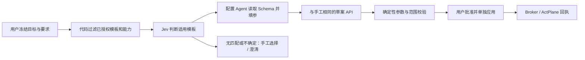

# RFC：统一策略库、配置适用范围与 Jev 模板选择

日期：2026-10-15。状态：设计增补及 HTML 交互预览通过；现有 18003 服务已启动并只读验证。本轮没有修改应用、DSH、真实策略或接入 Jev API。

## 1. 现状与合并目标

当前发布源为 `fddc532`，后续发布记录提交为 `6bb4f6a`，API 运行目录为 `/opt/agentscope-template-configurations-20261014-212944`。当前源码 `template_catalog.py` 将 15 项 Agent 模板与 12 项系统预设组合为 27 项目录；18003 `/api/policy-templates` 返回 27 项目录和 4 项既有配置。系统预设仍以兼容投影展示既有系统配置，需要跳回“系统策略”维护。模板能力和当前加载事实应分开；4 项保存记录不是 4 项已生效策略。

`SystemPolicyLibrary.jsx` 与 `AgentPolicyTemplates.jsx` 仍有不同管理路径。系统模板固定 `scopes=['system']`，另一组固定 `['agent','workspace']`。因此“模板下面有记录”已实现，但同一份语义合同不能直接自由切换所有 / 指定 Agent。仅删除一个页签不足以完成合并。

本方案将系统模块收敛为“策略库 / 生成记录”。策略库中父模板可折叠，下面的子配置列表仅展示场景中的实际策略名称、范围和详情入口；期限、参数、效果和状态收进详情。新增、编辑、审批和应用使用一致入口。Agent / 会话保留当前约束投影与配置入口，继承项只读，不复制成另一套配置库。

本增补细化[模板配置 Agent 与会话安全工作台](RFC-20261014-AgentScope-template-agent-security-workbench.md)，执行语义继续遵循[系统/Agent 基线与共享域增量](RFC-20261014-AgentScope-agent-baseline-runtime-policy.md)。系统范围与 Agent 范围仍是两个不同管理目标；界面与记录合同统一，不把所有 Agent 合并成一个物理执行域。

## 2. 适用范围是子配置参数

| 用户字段 | 结构化值 | 准确含义 |
|---|---|---|
| 所有受控 Agent | `scope=system, scope_id=system` | 当前及以后接入的受控 Agent 继承；不包括未接入进程、非受控连接或整台 OS |
| 指定 Agent | `scope=agent, scope_id=<instance_id>` | 一个已登记实例的全部工作区、会话及后续受控启动；不是所有名叫 DSH 的程序 |
| 配置期限 | `binding=baseline` 或设计中的 `binding=runtime` | 与适用范围分离：长期基线或当前运行代次；来源会话另存 |

界面只向用户暴露“适用范围”和必要的 Agent 实例选择。保存后冻结模板、目标及期限；换目标使用“复制为新配置”并重新审批，不修改既有审批的指向。全局操作需要系统管理权；拥有某 Agent 配置权不能创建系统配置。后端身份校验决定权限，Jev / 配置 Agent 的输出不赋权。

本轮没有新增真实 API 字段。实现时优先复用当前 `scope / scope_id`，并以 `target` 视图整理展示；若增加运行绑定字段，必须独立版本化 API 合同。不能让“运行时来源”自动变成“会话局部生效”。全局长期基线按各实例跟踪回执；跨所有运行域的实时广播暂不支持，界面禁用该组合。

## 3. 模板与独立子配置

模板发布版本持有固定语义、参数 Schema、允许目标、效果、操作访问组、机制能力及覆盖说明。配置持有模板 ID/版本、独立配置 ID/版本、参数、目标、期限、来源、审批引用。运行状态来自批准后应用的快照和回执，不从“保存成功”推算。

例如“文件读取限制”模板下面可以并列：共享凭据目录保护（所有受控 Agent）与日报任务隔离员工资料（DSH 实例）。这两个配置独立保存和审批。修改配置 A 不覆盖 B；模板升级不静默改写既有配置与已加载快照。

不能按显示名称直接合并旧模板。应比较对象匹配方式、效果、source 条件、参数校验及实际访问组：系统的后缀匹配与 Agent 的完整路径匹配未必相同；`notify / block / kill` 不能互换。确认语义等价后发布新通用模板版本；不等价的模板继续保留为同目录不同条目。旧 ID、配置版本、审批哈希、应用事实及溯源可追踪；未知或不完整旧数据标记“需要核对”，不得当作空配置。

迁移后由一个配置服务作为权威存储和写入口。旧系统配置以原 ID 或显式映射保留；兼容 API 委托同一服务，禁止双写或保留两个可独立修改的副本。迁移校验、版本匹配与回滚方案先验收，再停止旧写入口；本轮未实施数据迁移。

## 4. 生命周期及当前生效视图

草案 → 校验 → 提交审批 → 人工批准 → 单独显式应用 → 逐实例读取加载/绑定回执。停用也产生独立变更，批准不等于已停用。配置候选版本与已应用快照必须分别存储：编辑已生效项 v1 可产生 v2 草案，当前约束仍显示 v1。停用申请等待期间继续显示原保护，撤销成功后才移除当前约束。

系统变更可出现部分实例成功、部分失败、未运行或能力不符；总状态不能伪报全部成功。历史保留配置版本、冻结目标、审批结果、期望/实际活动版本和每个实例的应用/撤销回执；未来受控启动加载批准后的基线，仍需核验真实绑定。

当前写入与删除共用文件变更访问组。子记录可分别表达意图，但不能表达虚假的独立执行能力。要求“只写入 / 只删除”时，精确模式不可应用；接受整体覆盖时明确列出修改、创建、重命名、删除等实际影响并重新审批。提示类配置不能显示为内核阻止，适配器未接入的原生工具审批必须标明暂不支持。

## 5. Jev 与配置 Agent 的分工

TypeSafe 官方说明 Jev 从 state 和 typed questions 返回 Choice / Score / Noul。适合有界模板选择，不生成反馈文案、文件路径或 DSL。单主类选择可用 Choice，并包含 none；多项安全要求应按模板分别使用 Noul 或拆分原子判断，代码组合结果，不能让一次单选静默丢掉其他约束。

范围、权限、允许资源与已发布模板集合由可信后端先冻结并过滤，Jev 不能决定扩大目标。配置 Agent 通过受限工具读取模板合同、填写参数并保存草案；服务端渲染规则，复用手工的身份、参数、资源、模板版本和覆盖校验。模型既不发布模板，也不批准或加载策略。配置助手用现有 HTTP API 包装成工具调用，不依赖 computer use。

已存在的草案接口包括 `GET /api/policy-templates`、`POST /api/policy-template-configurations`、`POST /api/policy-template-configurations/{id}/versions` 与 `.../{id}/proposals`；当前生成接口为 `POST /api/agent-instances/{id}/template-configurations/generate`。这些接口目前仍有各自能力边界，本方案未让全局生成或运行时绑定自动可用。新增 Jev 服务适配器前应规定授权投影、超时、错误回退、输入脱敏和供应方访问配置；不向外部模型发送凭据原文或文件内容。

官方现列每百万输入 token 为 $0.042、输出免费；这是供应方价格，不是本系统实测费用。当前 stable 别名仍指向 1.13，1.14 为 preview；接入应固定验证过的模型版本、问题合同和阈值，记录实际返回版本。英文为主要训练语言，中文效果需要本项目数据验证。置信度是概率分布的统计量，不是正确性或安全保证；阈值通过本地标注样本校准，未校准时只推荐，不自动作安全判断。

资料核对于 2026-10-15：[介绍](https://docs.typesafe.ai/introduction)、[Choice](https://docs.typesafe.ai/primitives/choice)、[模型/价格/语言](https://docs.typesafe.ai/models)、[置信度](https://docs.typesafe.ai/confidence)、[API](https://docs.typesafe.ai/api)。独立研究[Jev 与 rubric judge 比较](https://arxiv.org/abs/2609.29769)也提示不同模型可能共享错误，不能将升级模型当作独立正确性证明。未注册账号、未请求模型 API、未产生费用。

## 6. 页面功能与分阶段验收

策略库：父模板折叠、独立子配置、全部 / 全局 / 单实例筛选；配置详情提供参数、适用范围、期限、DSL 和应用详情；真实产品需补只读错误/重试、加载中、无权限与来源缺失状态。生成记录保留同格式配置的手工/助手来源，不创建第二份策略库。Agent / 会话展示当前活动快照及继承来源，提供到统一配置入口的跳转。审批展示冻结版本、共享影响与独立应用动作。

本轮 HTML 使用 3 个合成模板和合成 DSH/Hermes 实例，刻意展示所有 / 指定目标及原生工具未接入的状态，不复制真实数据。Jev 推荐和参数填写是流程演示。原型验证不能证明后端授权、真实模型准确率、迁移、热加载或内核拦截。

实施验收还需覆盖：旧配置迁移无丢失且仅一个权威写入口；目标越权和换目标拒绝；参数/模板/审批/活动版本一致性；实际共享域影响；同域并发应用串行化；全局逐实例部分失败；Agent 未运行与后续启动继承；停用加载回读；模型超时与 none 回退；中文多需求漏选率；无额外 DSH 流程改动。

关联：[ADR](../ADR/ADR-20261015-AgentScope-unified-policy-catalog.md)、[REVIEW](../REVIEW/REVIEW-20261015-AgentScope-unified-policy-catalog.md)、[BUG](../BUG/BUG-20261015-AgentScope-unified-policy-catalog.md)。

## 7. 子配置展示细化（2026-10-15）

父行是固定策略模板；子行使用场景提取的具体策略名称，例如“禁止日报任务读取员工资料”，不能用“文件读取限制”模板名、场景标题、“配置 1”或助手来源后缀替代。正式生成结果的 `name` 应原样保存并回填；缺失名称应补充或澄清，不能静默回退到模板名。名称可由用户核对修改，配置 ID 与版本保持独立。

范围列只显示“所有 Agent”或选中的具体 Agent 名称，不列工作区、会话、基线或运行期限。所有 Agent 的后台含义仍是已接入的受控 Agent；具体 Agent 仍按实例绑定，范围展示简化不改变实际权限或执行边界。

“新增子配置”和子配置“详情”复用同一个模板参数表单：前者提供空参数，后者回填该记录实际策略名称、目标、参数和反馈。保存只改当前子配置的新版本，不改父模板或其他子配置；未保存的参数修改不能直接提交旧版本审批。来源、状态、DSL、应用回执在详情渐进展示；期限等设置折叠，提交审批 / 停用入口移入详情。

## 8. 以现有系统策略页面作最小改造（取代上轮预览样式）

用户明确要求减少改动并认可当前 `SystemPolicyLibrary` 的布局。落地以现有系统策略页的字体、间距、表格、搜索、分类、全部策略 / 已配置、勾选提审及详情编辑样式为基准；不采用前两轮简化原型作为正式外观。仅将模板与配置目录合并、补父模板折叠下的子配置和所有 / 指定 Agent 范围参数；子配置继续以实际场景策略名、范围、同款详情作为主要信息。保留现有详情中的必要状态与实际覆盖提示，不另造配置表单或审批器。生成记录保留，避免两套可独立维护的配置入口。

策略助手继续在 Agent 页面使用。撤回系统模块内“让 Agent 配置”的新增快捷入口；系统用于目录、人工配置和查看记录，助手产生的子配置也汇入同一目录。前轮 HTML 中的助手快捷入口及整体外观属于被更新的设计示例，不代表正式应用已改。

手工与助手使用同一授权生命周期：保存草案 → 完成配置后提交统一审批 → 用户批准 → 用户显式应用 → Broker / ActPlane 按冻结目标加载及核验。保存、勾选、助手生成和预编译都不是批准或加载；批准后也不由助手自动触发应用。停用、改参及扩大范围再次提交相应变更。指定 Agent 对应实例实际执行域，全局系统配置逐受控实例应用；未运行显示启动时加载，不能显示已内核生效。

当前只读复核：生成函数只保存配置，提交函数产生并编译候选，批准与应用分别实现；应用验证候选哈希、批准回执和目标基线。兼容 `confirm` 接口仍连续调用 approve 与 apply，不能声称所有旧入口都已拆成两个交互。后续最小改造应清理或明确标记旧组合确认入口，保留版本合同和调用兼容分析；不得将它描述为无需同意的后台自动加载。本轮没有调用批准 / 应用接口或变更真实策略。
