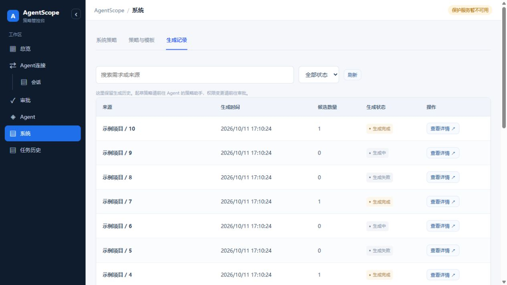
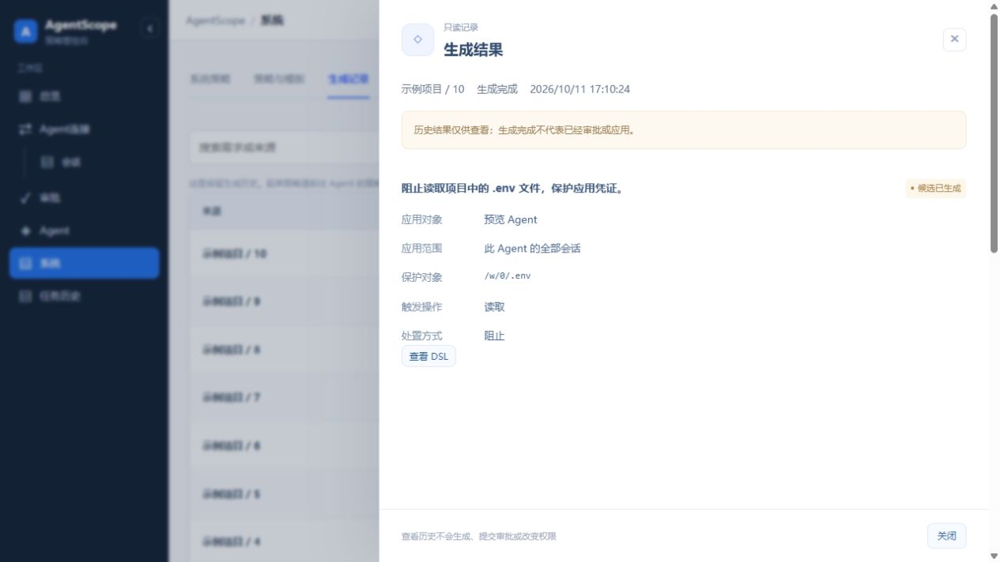
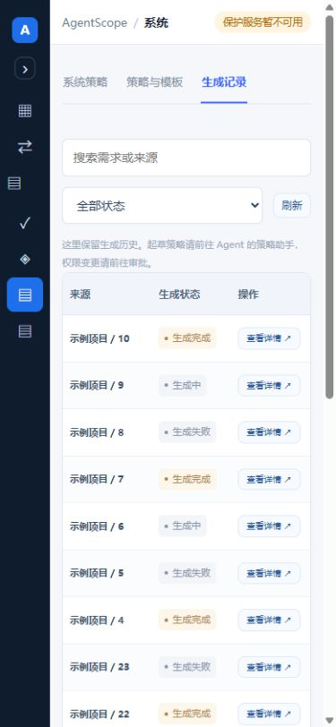
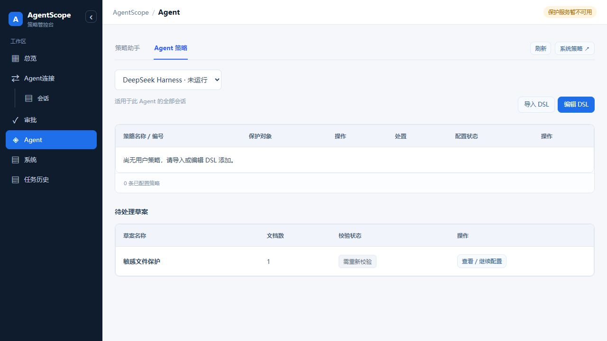

# 第二步：界面收敛验收与查看路线

2026-10-11。分支 `codex/ui-consolidation-step2-20261011`，基于 `12c7646` 与第一步审批。本次未推送、未发布到 18003。

## 自动化

后端完整回归：1050 passed，11 skipped；前端完整回归：228 passed；Vite 构建成功，保留已有 >500 kB bundle 提示。diff 检查通过。测试依赖为本机已有 Python/DSL adapter 及与源码一致的 ActPlane release 构建，特权 IO 使用替身。

```sh
AGENTSCOPE_DSL_ADAPTER=/opt/agentscope-system-policy-20261011-161846/backend/dsl-adapter/target/release/agentscope-dsl-adapter \
  /opt/agentscope/.venv/bin/python -m pytest -q backend/tests
(cd frontend && node --test src/*.test.mjs && npm run build)
git diff --check
```

本机 worktree 的 `actplane/target` 链接到 `agentscope-system-policy-ui-20261011/actplane/target`，两者均基于 `12c7646`；此依赖不是本次提交文件。其他环境需先按仓库说明构建 ActPlane/DSL adapter。

## 查看路线

独立只读预览：[打开生成记录](http://127.0.0.1:18115/?view=strategies&systemTab=generations)。这是实际构建的 React 页面，记录均为合成夹具，不是生产连接或内核验收证据。

1. 系统 → 生成记录：只有一层记录表；搜索、状态筛选、分页；点“查看详情”查看匹配与处置，并按需展开 DSL。没有重复生成、审核、内部 JSON 或生成 ID。
2. Agent → Agent 策略 → 待处理草案：示例草案显示“需重新校验”；打开后“前往审批”禁用。
3. 审批 → 需要处理：同一草案显示相同失效状态；没有批准应用按钮。
4. 总览、Agent连接、任务历史：模块名仅见于导航与面包屑。任务历史仍放在侧栏最后。

截图保存了桌面、720×900 和 390×844 实际页面，列表与详情均检查。生成历史的候选完成标识不代表已批准或当前生效。预览头部“保护服务暂不可用”如实反映没有接入 Broker。










## 交互与安全验收

已检查：旧 generate/records 链接归并、20+3 条分页、搜索无结果后恢复、生成失败提示、不可用记录提示与重试、详情折叠 DSL、三个模块无重复标题、草案/编辑器/审批一致失效状态。源码测试覆盖新候选替换旧候选、精确目标隔离、无写入回调和权限审批回归。

历史 GET 测试在调用前后比较数据库 dump，并让实时资格/环境核验函数直接失败，以证明没有进入控制链路。浏览器验收另比较权限、候选、加载回执快照；查看不改变权限。预览禁止所有写方法，不连接真实 Broker，不启动 LLM 或后台 worker。

复现预览（运行后保留终端，回环端口 18115）：

```sh
/opt/agentscope/.venv/bin/python scripts/preview_ui_consolidation.py
```

每次启动新建临时数据库。脚本写入 `/tmp/agentscope-step2-preview.json` 记录临时目录和目标身份；退出进程即可停止。仅供本机界面查看，禁止将此无认证夹具部署到生产或外网。

18003、18000、18004 服务均未在本阶段重启/替换。文档同步到用户指定技术文档根目录。第三步的工作区场景读取尚未开始。
