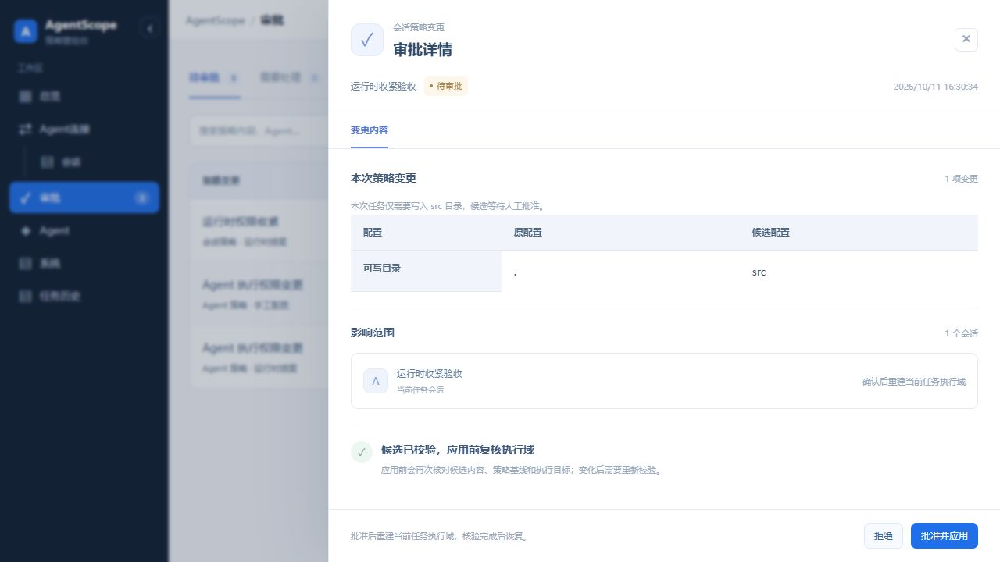
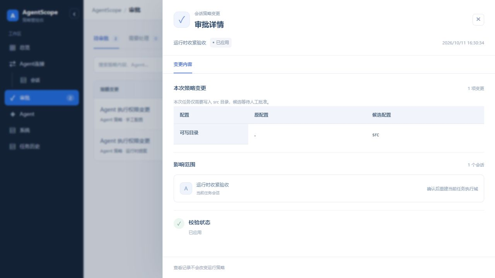
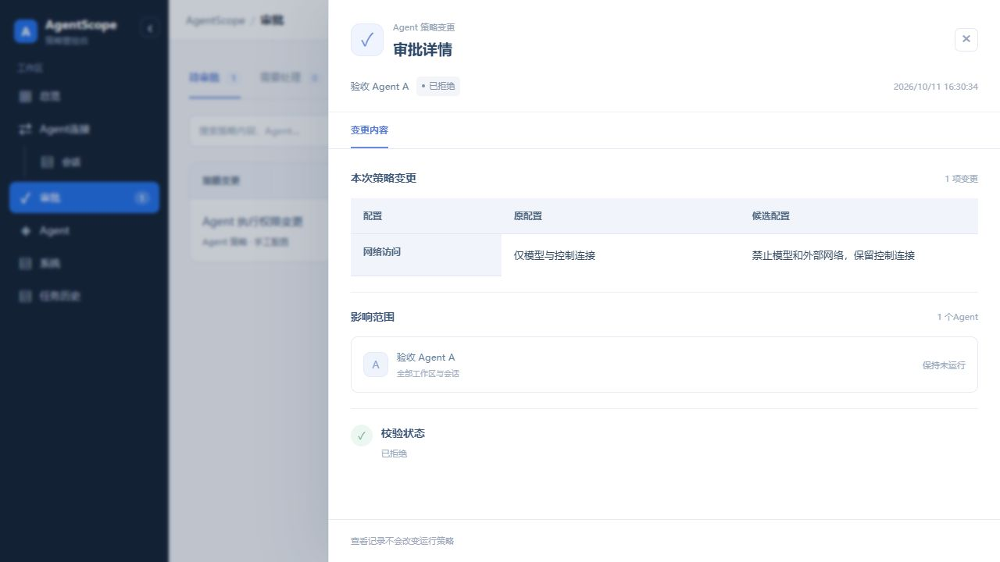
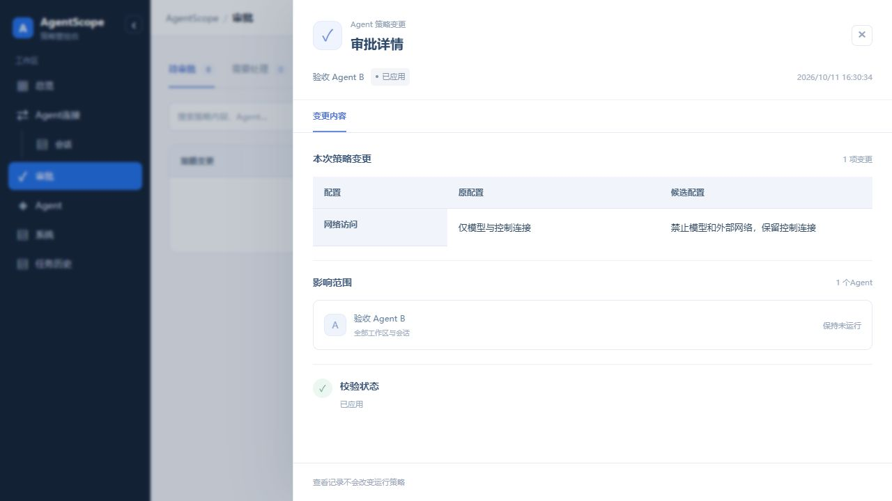
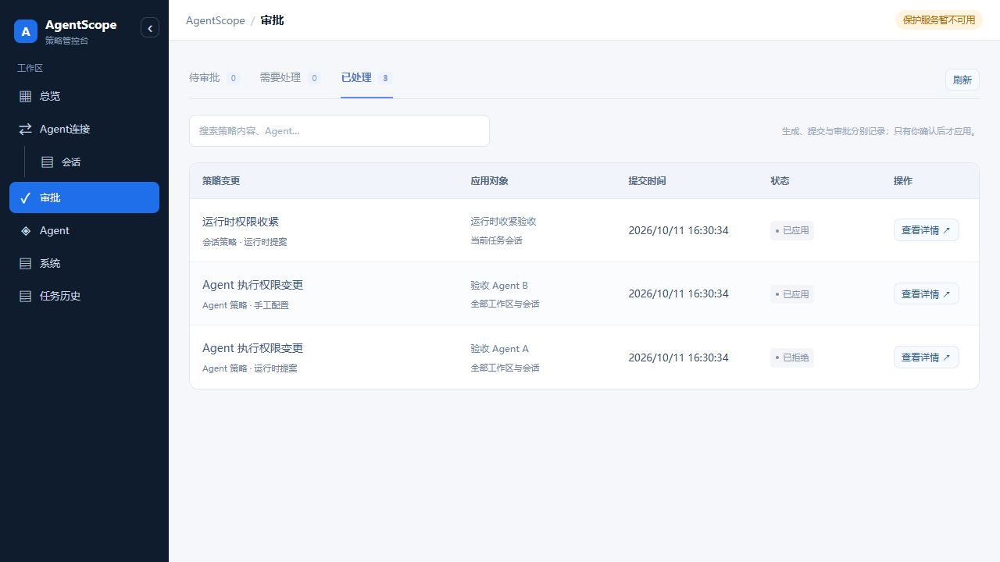

# 第一阶段：统一策略审批验收

日期：2026-10-11。源码基点：`b6b6fa2`；实现分支：`codex/policy-approval-unification-20261011`。验收范围为本地源码及隔离服务，18003 未发布本次代码。

## 自动化结果

| 检查 | 结果 |
|---|---|
| 后端完整回归 | 991 passed，52 skipped，0 failed |
| 前端完整回归 | 220 passed，0 failed |
| 前端构建 | Vite 构建成功；保留已有 >500 kB bundle 提示 |
| diff 空白与补丁检查 | git diff --check 通过 |

本地命令（在仓库根目录执行）：

```sh
AGENTSCOPE_DSL_ADAPTER=/opt/agentscope-task-archive-20261007/backend/dsl-adapter/target/release/agentscope-dsl-adapter \
  /opt/agentscope/.venv/bin/python -m pytest -q backend/tests
(cd frontend && node --test src/*.test.mjs && npm run build)
git diff --check
```

上述适配器和 Python 路径为本机验收依赖，其他环境需替换为实际安装位置。DSL 合同测试使用真实 ActPlane 解析/编译器，特权进程/域操作使用替身；跳过的测试不计为通过。

安全断言覆盖：user/agent 提议均不自动应用；查看与拒绝不加载；鉴权与错误指纹；相同工作区不同实例隔离；目标、资源、DSL、会话与基线漂移；无快照旧候选；历史缺字段记录；精确批准和重复确认；运行时拒绝保留未解决安全要求；批准后历史对照保留。原有并发、应用失败、底线继承、项目文件 hash 与归档回执测试继续运行。

## 实际浏览器交互

临时地址为 `http://127.0.0.1:18114`，运行真实前后端，独立数据库，所有业务对象均为人工构造的验收夹具；Broker 状态、stop/install 使用测试替身，真实 Broker socket 为不可用地址。页面“保护服务暂不可用”是这一隔离设置的真实反馈。

| 操作 | 数据库验收 |
|---|---|
| 生成并查看三条待审提案 | 两个实例仍 model_only；任务 version=3，目录 `.`，底线 fixture-baseline 不变 |
| 批准运行时收紧 | 只有任务更新为 version=4、目录 src；request_resolved=1；两个实例原配置不变 |
| 拒绝 Agent A 收紧 | Agent A 仍 model_only；候选 rejected；任务与 Agent B 权限不因拒绝改变 |
| 批准 Agent B 收紧 | Agent B 更新 disabled，保持未运行；Agent A 仍 model_only；任务维持 version=4 |
| 重新查看已应用实例记录 | 仍显示原网络配置与候选配置，不变成 0 项历史变更 |

截图为 1280×720 的真实页面。所有指纹、实例和任务均来自隔离夹具，不能用它们宣称生产内核效果。











结构化结果见[验收摘要](acceptance-summary.json)。临时浏览器页与服务在验收后关闭；未重启 18003 或其他共享服务。

## 交付边界

本次完成第一步的审批对象、人工确认、旧自动收紧移除和产品运行时提案汇总。旧 Scope Demo 实验接口及启动审核仍保留自己的显式审核入口，不包含在迁移范围。场景读取、独立会话执行域和其余 UI 整改按后续步骤处理。

本次代码尚未推送；本地验收通过不代表远端 CI、共享环境发布或新增内核效果已验收。
