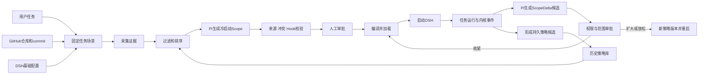

# AgentScope 任务启动前策略生成与 DSH 实验验收技术方案

> 历史技术规划归档（2026-10-07）：本文保留当时设计、预期接口和目标环境，不能作为已实现或已验收证明。现行实现与未完成事项以 [文档入口](../README.md) 中对应 RFC、REVIEW、BUG 为准。


> 文档状态：开发规划<br>
> 编制日期：2026-10-02<br>
> 运行环境：Ubuntu 24.04 ARM64 Linux 虚拟机。AgentScope、Pi 策略生成角色、DSH 和 ActPlane 均在虚拟机内运行；宿主机浏览器只访问管理界面。<br>
> 关联材料：《调研结果.docx》第 3.1—3.4 节；《AgentScope_历史策略库模块技术规划.md》。

## 1. 设计结论

建议把策略生成角色实现为 AgentScope 调用的 Pi 一次性任务 Agent；DSH 是受管的代码任务 Agent；ActPlane 是获批、且能映射到其 OS Hook 和 DSL 的规则执行后端。AgentScope 负责读取场景、检索历史策略、形成 Scope/策略候选、展示审批、管理版本，并通过受限 Broker 请求 ActPlane 加载。

本设计建立在 ActPlane 的论文和你的调研结果之上，并明确新增的部分：

- **RQ1** 为历史策略语料提供经验基础：收集公开 Agent 项目的指令文件、做语句级抽取与分类，并通过原文覆盖校验、交叉复核和人工抽样检查。你已有的 OpenClaw、OpenAI Codex、Qwen Code、ZeroClaw、NanoClaw 等 GitHub 样本可作为历史库种子。
- **RQ5** 为启动前按任务描述生成逐任务安全策略提供实验参照。论文使用 Codex 策略生成器，在 OpenAgentSafety 任务、OpenHands 环境中于任务进程启动前产生策略；不是 DSH、Pi 或 GitHub 代码仓库实验。
- **RQ4** 为真实代码仓库任务和运行时策略增量提供实验参照。论文在 OctoBench 代码任务上执行规则，并在运行过程中提交策略增量。放到 AgentScope 方案中，**这类运行时策略增量应建模为当前任务的 Runtime ScopeDelta**，由策略生成 Agent 读取任务现场后生成候选，再走权限校验和审批。
- 论文没有验证“历史策略检索＋目标仓库文件理解＋当前 Agent 配置融合＋DSH＋Pi＋人工审批”的全流程。因此本方案是结合 RQ1、RQ4、RQ5 的基础和你自己的策略管控思路形成的可实现扩展，效果要由 DSH 实验单独验证。[ActPlane 论文](https://arxiv.org/html/2606.25189v2)

### 1.1 “任务与启动场景”是什么意思

“任务”是一条具体、可重放的 DSH 执行记录：用户提示、目标 GitHub 仓库及固定 commit、工作区、DSH 版本和 profile、任务策略版本共同确定一次任务。“启动场景”是 DSH 进程启动之前，AgentScope 已经掌握的这些输入与证据。

因此，“启动前”不是抽象地说 Agent 要做某类工作，而是明确的时间点：

> 收到用户任务 → 固定 GitHub 仓库 commit → 读取 Agent 与仓库材料 → 检索历史策略 → Pi 生成初始 Scope/规则候选 → 人工审批 → ActPlane 编译并加载 → 启动 DSH。

用户说的“冷启动”就是在没有当前任务运行轨迹时，根据基础规则、历史库和当前任务场景生成第一版任务 Scope。它不意味着没有历史策略可用；历史库正是冷启动输入之一。

### 1.2 三种 Scope 状态和权限边界

| 阶段 | 策略生成 Agent 读取什么 | 生成什么 | 何时生效 |
|---|---|---|---|
| 任务启动前：冷启动 | DSH 基础权限/治理配置、目标仓库固定版本与适用文件、用户任务、历史策略候选 | 初始 TaskScope、历史复用项、本任务新规则候选、指导项/no-op | 经审核后，启动 DSH 前编译/加载 |
| 任务运行时：Scope 增量 | 当前 TaskScope、ActPlane 事件/命中原因、DSH 反馈和变更请求、当前任务阶段和仓库改动 | 收紧、请求扩大或调整 Scope 的 Runtime ScopeDelta 候选 | 收紧可在原任务域追加；扩权/放松继承规则经审批后新版本重启 |
| 跨任务：策略库更新 | 任务证据、运行轨迹、memory.md 差异、经审核的 Agent 治理 PR/发布 | 待复用的持久策略候选 | 单独审核晋升后，供后续任务检索 |

这保留了你调研稿的“历史策略—任务启动前—任务运行时”组织方式：RQ5是启动前生成的参照，RQ4是任务内增量的参照；RQ4是论文的研究问题，不是系统层级。[论文 RQ4/RQ5](https://arxiv.org/html/2606.25189v2)

### 1.3 规则进入 ActPlane 的范围

“审核通过的策略通过 ActPlane 加载”需限定为**审核通过且 ActPlane 当前版本能表达、能编译、能由受支持 Hook 执行的规则**。

- OS 可观察的路径、进程、操作和跨事件约束可映射为 ActPlane 规则。
- 命名偏好、代码质量、回复语言等语义要求无法仅靠内核可靠判断，保留为 DSH 指导或任务评测项，不得显示为“内核已加载”。
- ActPlane DSL 当前效果包括 `block`、`kill`、`notify`，不应臆造一个真实 DSL 的 `allow` 语句。AgentScope 的 TaskScope 是控制面模型；它须被映射成 ActPlane 能表达的限制规则和/或 Linux 沙箱配置。映射不了时标记为 unsupported 或 guidance-only。
- 已在任务启动前加载的策略是 DSH 继承的高权约束。运行时 Agent 不能删除、弱化或绕过它们。获批扩权应生成新 PolicyBundle 并重启任务，不冒称 ActPlane 可直接扩大原有进程域权限。


### 1.4 第二层的功能范围：任务启动前策略生成

第二层的输入是第一层已经整理好的历史策略库，以及本次任务的真实场景；输出是启动 DSH 前经审核、可追溯且已完成后端加载的初始 TaskScope/PolicyBundle。功能按以下顺序组成：

1. **触发与场景固定**：用户提交任务后触发；固定用户提示、GitHub 目标仓库及 commit、工作区、当前 DSH/profile 和基础权限。
2. **采集并读取场景**：Evidence Collector 固定 GitHub commit，读取当前 Agent 的有效治理/权限配置，以及目标仓库 README、任务路径适用的 AGENTS.md/CLAUDE.md、权限/Hook、CI/Makefile 等证据；保留来源角色、path、line 和 hash。Pi 通过只读 read 工具或 evidence_id 读取，不把两类文件混成一类。
3. **混合检索历史规则**：先按审核状态、有效期、Agent、仓库/路径、任务类型、事件和 Hook 能力过滤，再并行进行关键词及语义检索、融合排序和去重；展示语义关联、操作/对象适配度及来源回链。
4. **并发判断并形成冷启动 Scope**：Pi 对候选按批次并发作出“复用、参数化、提出新候选、指导项、待澄清/no-op”判断；Resolver 汇总冲突和优先级，形成初始 TaskScope，不因语义相似自动扩大权限。
5. **生成关联表达并校验**：为原子策略生成含元数据的策略记录伪代码、PolicyIR 和真实 ActPlane DSL，并保存显式映射；默认原子语句 1:1，复合语句拆分后允许 1:n。检查证据、冲突、Hook 能力并 dry-run 编译，元数据不并入真实 DSL。
6. **人工审核与启动加载**：界面逐条展示来源、历史匹配、Scope 差异、纯 DSL 和能力状态。用户批准本任务使用后，ActPlane Provider/Broker 编译、加载并绑定 DSH 进程域；确认状态后再启动 DSH。
7. **给第三层交接运行基线**：持久化 TaskContext、当前有效 Scope、PolicyBundle version/hash、ActPlane domain/PID tree 和事件订阅信息，供运行时 ScopeDelta 延续同一任务版本链。

因此，第二层包含“场景理解、历史策略选择、缺口候选生成、策略表达、人工审核、启动前 ActPlane 加载、运行基线交接”。历史语料采集/批量抽取属于第一层；运行中的 ScopeDelta 属于第三层，但必须使用第二层建立的 TaskContext 与策略版本作为基线。

第一层语料采集与第二层任务场景读取共用 GitHub Evidence Collector；混合检索与批量判断实现见 3.2，伪代码到 DSL 的映射见 3.3。贯穿各层的场景 Trace、日志和规则快照见 3.6。

## 2. 组件设计

| 组件 | 主要职责 | 权限边界 |
|---|---|---|
| AgentScope 控制面 | 场景整理、来源收集、历史检索、Scope/策略候选、审批、版本和 UI | 普通用户权限；不直接加载 eBPF |
| Pi Policy Generator | 通过只读文件工具或 evidence API 读取场景证据，检索历史策略并提出策略/Scope 候选 | 只读工具和本阶段自定义工具 allowlist；无 Shell/编辑/任意写入、无审批权、无 Broker 权限 |
| DSH Adapter | 按获批版本启动 DSH，传入任务和指导，提供当前 Scope，接收违规反馈和申请 | 任务凭据仅限当前 task_id 的只读查询/变更申请 |
| Policy Resolver/Validator | 检查来源、范围、冲突、Hook 能力、DSL 语法并产生 PolicyBundle | 确定性校验；不能根据语义相似自动批准 |
| ActPlane Provider/Broker | 编译、加载、绑定进程域、订阅事件和停止策略域 | 只接收经审批的结构化请求；拒绝任意命令 |
| Linux 内核/eBPF | 对已配置 Hook 捕获的事件执行规则并回报命中原因 | 不从自然语言、README 或 Prompt 中抽取语义 |

### 2.1 Pi 的运行方式与工具边界

Pi 由 AgentScope 按工作流阶段启动为一次性策略生成进程；一次调用完成当前阶段的分析并提交候选后退出，任务上下文、历史记录和策略版本由 AgentScope 保存。Pi 可以只读目标仓库/证据副本，但不直接修改目标仓库；它不持有 ActPlane 特权。

为让 Pi 按需调用功能，增加一个第一方 TypeScript 扩展 `agentscope-policy-tools`，仅注册 AgentScope 的受限自定义工具。扩展中的工具通过带有 task_id 和短期任务凭据的 API 调用 AgentScope；服务端再次校验任务归属、证据范围和操作状态。Pi 进程以普通权限运行。Pi 扩展与 Pi 共用进程权限，因此只加载审核过的该扩展，不加载仓库或用户目录中发现的其他扩展。

Pi 策略生成阶段开启 `read/grep/find/ls` 只读工具，关闭 `bash/edit/write`；候选写入通过 AgentScope 的 `submit_*` API 完成，不直接编辑目标仓库。Pi 的工作目录和工具 allowlist 不是操作系统沙箱：应在 Linux VM 内使用容器或专用低权限用户，并将任务证据/仓库只读挂载。Pi 扩展与 Pi 进程共享系统权限，也必须处于同一隔离边界内。AgentScope 按阶段明确加载相应 Skill。示意调用如下，部署时需以固定 Pi 版本的 CLI 文档和实际配置为准：

```bash
pi --print --mode json --no-session --no-context-files \
  --no-extensions --extension /opt/agentscope/pi-tools/index.ts \
  --tools read,grep,find,ls,get_task_context,list_policy_sources,read_policy_source,search_historical_policies,get_enforcement_capabilities,validate_policy_draft,submit_task_policy_proposal \
  --no-skills --skill /opt/agentscope/skills/task-scope-bootstrap/SKILL.md \
  --model <固定模型> "根据任务场景生成策略候选"
```

本配置用 `--tools` 显式允许只读工具和本阶段自定义工具；`--no-builtin-tools` 会关闭包括 `read` 在内的内置工具，故不用于这个读取场景。`--no-extensions` 后只显式加载 AgentScope 扩展；`--no-skills` 后显式加载当前阶段 Skill。Pi 自身没有操作系统级沙箱，CLI 工具 allowlist、VM/容器隔离和 AgentScope 服务端授权是不同控制层。[Pi 安全说明](https://github.com/earendil-works/pi/blob/main/packages/coding-agent/docs/security.md)；[Pi CLI](https://github.com/earendil-works/pi/blob/main/packages/coding-agent/docs/cli.md)；[Pi Skills](https://github.com/earendil-works/pi/blob/main/packages/coding-agent/docs/skills.md)；[Pi Extension 权限说明](https://github.com/earendil-works/pi/blob/main/packages/coding-agent/docs/extensions.md)

### 2.2 Pi Skills：按开发和运行阶段串接工具

Skill 按完整工作流拆分，工具按单一操作拆分。GitHub 下载与固定 commit 由 AgentScope 的 Evidence Collector 完成；Pi 不需要独立 GitHub 插件，通过受限 evidence_id API 或只读挂载读取文件。这样不会把任意 URL、凭据或 Git 操作开放给生成器。

| Skill | 触发时机 | Pi 按顺序完成的工作 | 产生的记录 |
|---|---|---|---|
| `policy-statement-extract` | 导入一批 GitHub Agent 指令文件后 | 列出已登记文件 → 读取带行号证据 → 抽取原子策略语句、分类并翻译英文 → 提交语句候选 | 历史库子模块二：带原文、来源和译文的策略语句候选 |
| `policy-to-dsl-candidate` | 子模块二中策略语句需转 DSL 时 | 读取待处理语句及元数据 → 检索相似/重复历史策略 → 生成策略记录伪代码、PolicyIR 和纯 ActPlane DSL → 查询能力并预检 → 提交 DSL 候选 | 历史库子模块三：待审核伪代码与真实 DSL |
| `task-scope-bootstrap` | 当前任务、GitHub 仓库及 commit 固定后、DSH 启动前 | 读取任务场景和有效证据 → 检索已审核历史策略 → 选择复用/参数化/新候选/no-op → 生成冷启动 TaskScope、PolicyIR 和 DSL → 预检 → 提交本任务审核 | 本任务冷启动策略包；可执行规则尚待审核与加载 |
| `runtime-scope-update` | 收到 ActPlane 事件、DSH 反馈或运行时 Scope 申请时 | 读取当前 Scope、版本和事件 → 判断需收紧/请求扩权/无需变更 → 生成 ScopeDelta 和 DSL → 预检 → 提交待审增量 | 当前任务的 Runtime ScopeDelta 候选；不会自动扩大权限 |

AgentScope 根据当前环节显式选择 Skill，不让 Pi 自行猜测工作模式。各 Skill 共用 `references/policy-record-schema.md` 和 `references/policy-matching.md`，以统一策略元数据、匹配规则和 DSL 输出格式。Pi Skills 可被显式加载；Skill 负责指导模型按序调用工具，状态转换和授权由服务端强制执行。

### 2.3 Pi 可用的工具定义

所有工具都由 `agentscope-policy-tools` 扩展实现，并转发到 AgentScope API。工具的参数必须引用现有 task_id、source_set_id 或 evidence_id；不接受 Pi 自由指定任意文件系统路径作为信任证据。

| 工具 | 必填参数 | 返回/副作用 |
|---|---|---|
| `get_task_context` | `task_id` | 返回固定用户任务、DSH/profile、GitHub URL/commit、workdir 和当前策略版本 |
| `list_policy_sources` | `task_id`、`source_set_id` | 返回本任务/导入语料中已登记的 Markdown 证据 ID、路径、commit、hash |
| `read_policy_source` | `task_id`、`evidence_id` | 只读登记文件，返回带行号的片段和来源信息 |
| `get_statement_candidates` | `source_set_id`、`candidate_ids` | 读取子模块二的待转换策略语句和已有分类/译文 |
| `search_historical_policies` | `task_id`、`policy_statement`、`evidence_ids` | 按 Agent、repo、路径、事件、上下文、审核状态过滤候选并排序；返回来源和适用/排除理由 |
| `get_enforcement_capabilities` | `task_id` | 返回 ActPlane 版本、Hook、动作、BPF-LSM 和当前编译/加载支持状态 |
| `validate_policy_draft` | `task_id`、`policy_record`、`policy_ir`、`actplane_dsl` | 核对 schema、来源、范围、冲突及 DSL；执行编译诊断，不加载规则 |
| `submit_extracted_statements` | `source_set_id`、语句列表、证据 ID | 将原子语句/英文中文译文保存为子模块二候选，服务端设为待审 |
| `submit_dsl_candidate` | `source_candidate_id`、历史匹配结果、元数据、伪代码、IR、DSL、校验结果 | 保存为子模块三候选，等待用户审核；不改写历史生效版本 |
| `submit_task_policy_proposal` | `task_id`、TaskScope、已选历史策略 ID、新候选、校验结果 | 保存启动前审核包；用户批准后由控制面构造 PolicyBundle |
| `get_runtime_scope` | `task_id` | 返回当前 Scope、基础策略版本、近期 ActPlane 事件与 DSH 请求 |
| `submit_scope_delta_candidate` | `task_id`、`base_policy_version`、变更、证据 ID、理由 | 创建待审核 ScopeDelta；不会修改现有进程域或批准扩权 |

策略语句的自然语言理解、原子拆分、历史适用性判断和伪代码/DSL草拟由 Pi 模型完成，不再额外套一层“调用 LLM 生成策略”的工具。AgentScope 工具提供可信上下文和确定性校验。策略元数据（来源仓库、commit、path/line、策略类别、context、scope、历史匹配与审核状态）保存在 AgentScope 记录/伪代码中；PolicyIR 表达规则语义；交给 ActPlane 的真实 DSL 只保留其规则语法可识别的内容。

Pi 不开放以下能力：批准候选、晋升历史策略、调用 Broker、编译后加载、直接扩大 Scope、执行 Shell、任意写文件或访问任意 MCP。用户审核后，控制面独立执行后续状态迁移。
## 3. 策略管控主流程



### 3.1 固定任务场景并收集四组输入

AgentScope 为每个任务保存不可变的 `TaskContext`：

1. **用户任务**：原始提示、目标、任务类型和明确的权限要求。
2. **GitHub 目标仓库**：URL、固定 commit SHA、工作区、任务相关文件/目录。
3. **当前受管 Agent**：DSH 版本、profile、有效的 Agent 基础规则、工具权限、Hook、MCP allowlist、沙箱配置。
4. **历史策略候选**：来自 RQ1 GitHub 语料和已经审核的任务经验，带来源、仓库/commit/路径、语句行号、类别、上下文依赖、审核状态和适用范围。

要区分“当前 Agent 自身治理材料”和“目标仓库材料”。当前 Agent 的配置说明 DSH 自身日常受什么规则约束；目标仓库的 README、CONTRIBUTING、AGENTS.md、CLAUDE.md 等说明在这个项目和路径里执行本次任务时的背景与规范。除非任务是在维护 DSH/Agent 本身，否则目标仓库不是 DSH 的治理仓库。

收集顺序建议为：固定 commit 与目录树 → README/项目文档了解项目结构 → 读取目标文件路径祖先中的有效 AGENTS.md/CLAUDE.md 及其引用文件 → 读取 SECURITY.md、权限/Hook/沙箱配置 → 读取 Makefile、CI、测试配置以解析抽象命令。每条证据保存 repo URL、commit、path、行号、原文 hash、采集时间和类型。README 仅作为上下文，不自动变成强制规则；外部文本不得覆盖用户批准的基础安全约束。

### 3.2 检索历史策略而非整份拷贝文件

先过滤，再排序：

- 先要求来源可回链、记录未撤销/过期、适用 Agent/仓库/路径/事件范围兼容、无未解决语义，并且当前 Hook 支持；
- 同仓库与相关路径优先；其次同 DSH/运行时和同类任务；再其次其他仓库中限制同一操作/对象/跨事件类型的规则；
- 文本或向量相似度只用于召回和排序，不能作为适用性证明或自动加载依据；
- 未审核候选仅供参考。每次记录命中和排除的候选及理由，例如“依赖 pytest，目标项目使用 npm，故不复用”。

**混合检索实现**：策略入库时将规则拆为原子语句，保存规范化语句、英文原文/中文译文、策略类型、主体、对象、操作/事件、条件、Scope、Agent/仓库/路径上下文、来源 commit/path/line、审核/有效状态和 DSL 能力标签，并为语句生成中英文语义向量。查询时从任务目标、资源路径、操作和事件并行构造 query；先用结构化条件过滤，再并行执行全文关键词（BM25）和向量召回，用 RRF 等方式融合排序、按 policy_id 去重。相似度用于召回，不构成适用性结论。Pi 对 Top-K 候选按批次输出结构化适用/排除/需参数化判断，Resolver 再确定性检查冲突、支持能力和最小权限。SQLite 可保存元数据并用 FTS5 做全文检索，向量索引使用独立存储；检索模型以中英文语料召回率和延迟评测选择。

成熟 Agent 的 AGENTS.md/CLAUDE.md 原文件需先进入历史策略库，再把匹配的**策略记录片段**传给 Pi。不要将多份完整 Agent 文件混在 Prompt 里让 Pi 自己判断。原文件是经验来源，不自动成为当前任务高权规则。

### 3.3 Pi 生成初始冷启动 Scope 和策略候选

Pi 输入应是带证据 ID 的结构化 JSON，而非无来源的大段文本：

```json
{
  "task": {"id": "task-123", "prompt": "..."},
  "target": {
    "repo_url": "https://github.com/owner/repo",
    "commit": "<固定SHA>",
    "workdir": "/workspace/repo"
  },
  "agent": {"name": "DSH", "version": "<固定版本>", "profile": "..."},
  "evidence": [
    {"id": "e-1", "kind": "repo_instruction", "path": "AGENTS.md",
     "line_start": 12, "line_end": 15, "text": "...", "sha256": "..."}
  ],
  "history_candidates": [
    {"policy_id": "hist-42", "status": "approved",
     "scope": {"event": "write", "path": "/workspace/**"},
     "evidence_ids": ["e-h-8"]}
  ],
  "capabilities": {"hooks": ["fork", "exec", "open", "read", "write", "connect"],
                   "bpf_lsm": true}
}
```

策略表达显式保存映射关系：一个原子 PolicyRecord 默认对应一个 DSLArtifact；复合语句先拆成多条原子记录，确有需要时支持一个 PolicyRecord 关联多条 DSLArtifact。PolicyIR 是二者之间的规范化语义层。元数据和伪代码留在 AgentScope，真实 DSL 只包含 ActPlane 可识别语法；unsupported/guidance-only 记录可以没有 DSLArtifact。

Pi 按固定 Schema 输出：

- `reuse`：历史策略 ID、选择理由、原策略适用范围、需要的参数化值；
- `new_candidate`：当前场景新发现的规则、证据位置、主体/对象/事件/条件/效果、建议 Scope、理由和不确定项；
- `guidance_only`：语义性规则，供 DSH 遵循但不进入内核；
- `no_op/unresolved`：没有明确可执行行为，或证据/范围/Hook 不足。

Pi 不得自造仓库路径、命令、Hook 能力和审批结论。没有足够证据的候选先待澄清，不能自动阻断。当前任务可用 Scope 是“经过审核的基础边界＋必要的任务级调整”，不要从“用户要完成任务”推断任意权限。

### 3.4 检查、审核、加载后才启动 DSH

控制面按顺序做确定性处理：

1. 回查策略引用的证据 ID、原文行范围和 commit/hash；
2. 检查语句类型、策略对象、事件、条件和适用范围；
3. 按管理员/平台基础规则、当前任务要求、目标仓库适用规范和历史经验处理冲突；历史候选不具备覆盖基础规则的权威；
4. 用真实 ActPlane 版本确认 DSL 和 hook 支持情况，无法映射的条目放入指导或待澄清区；
5. 对候选规则编译/诊断，展示结果、误阻断风险和实际 Scope 差异；
6. 管理员分别审批“本任务启用”和“跨任务晋升”，然后才构造策略版本。

DSH 启动门槛：目标 GitHub commit 固定；需要审批的策略已有决定；获批内核规则已经编译/加载并绑定到 DSH 父进程域；系统对仅指导/不支持项有明确标记。任何规则都不能只因 Pi 输出就自动启用。

真实 DSL 示例（用于演示工作区边界，实际的 Agent 进程标记和路径须按 DSH 启动方式配置，并在目标 VM 用对应 ActPlane 版本编译验证）：

```text
source TASK_AGENT = exec "**/agentscope-dsh-launcher"

rule workspace-only-write:
  block write file "/**" if TASK_AGENT unless target "/workspace/jsbeeb/**"
  because "DSH may write only inside the approved task workspace"
```

ActPlane 规则语法使用 `source`、`rule`、`block/kill/notify`、条件/gate 和 `because` 等结构。内核策略本身不放数据库元数据；仓库来源、行号、策略类别、审核人等由 AgentScope 保存。[ActPlane Rule Language](https://github.com/eunomia-bpf/ActPlane/blob/master/docs/rule-language.md)

示意记录（元数据在 AgentScope 的策略记录伪代码中，实际 DSL 只有 `actplane_dsl` 字段）：

```yaml
policy_record:
  id: hist-42
  natural_language: "DSH 只能修改本次任务工作区"
  source:
    repo: "https://github.com/owner/agent-config"
    commit: "<SHA>"
    path: "AGENTS.md"
    line_range: [18, 20]
    sha256: "<片段hash>"
  classification:
    policy_type: "per-event"
    context: "task"
    event: "write"
  applicability:
    agent: ["DSH"]
    target_repo: ["*"]
    path_scope: "/workspace/<task-repo>/**"
  review: {status: "approved", reviewer: "<审批人>"}
  execution:
    backend: "ActPlane"
    status: "loaded"
    bundle_version: "task-123-v1"
  actplane_dsl: |
    source TASK_AGENT = exec "**/agentscope-dsh-launcher"
    rule workspace-only-write:
      block write file "/**" if TASK_AGENT unless target "/workspace/jsbeeb/**"
      because "DSH may write only inside the approved task workspace"
```


### 3.5 从历史语句到任务冷启动的 Skill/工具调用链

开发与运行分开编排，链路如下：

1. **GitHub 采集**：管理员在 AgentScope 指定 GitHub 仓库和固定 commit。Evidence Collector 只抓取允许的文件类型/路径，登记原文、路径、行号和 hash；不运行仓库脚本。
2. **语句抽取**：AgentScope 触发 `policy-statement-extract`。Pi 用 `list_policy_sources`、`read_policy_source` 读取登记材料，抽取原子语句、类别和英文语句的中文译文，再用 `submit_extracted_statements` 写入子模块二的待审区。
3. **语句转策略**：用户/管理员确认要处理的语句后，AgentScope 触发 `policy-to-dsl-candidate`。Pi 调用 `get_statement_candidates` 和 `search_historical_policies` 判断已有重复/可复用规则，再生成带元数据的策略记录伪代码、PolicyIR 与纯 DSL；`get_enforcement_capabilities` 和 `validate_policy_draft` 返回确定性预检结果；最后 `submit_dsl_candidate` 写入子模块三待审区。
4. **任务冷启动**：用户创建 DSH 任务后，TaskScenario 固定目标 GitHub repo/commit、当前 DSH 配置和用户提示；Evidence Collector 读取目标 README、适用的 AGENTS/CLAUDE、权限/Hook、Makefile/CI 等。AgentScope 触发 `task-scope-bootstrap`；Pi 查历史库中已审核且适用的策略，选择复用或参数化项，对历史未覆盖而证据充分的规则提出本任务新候选。
5. **用户审查和启动**：审核页面展示被选历史规则、排除理由、新候选、证据回链、Scope 差异、纯 DSL 和编译诊断。用户批准本任务使用后，AgentScope 生成固定 PolicyBundle，由 ActPlane Provider/Broker 编译、加载、绑定进程域；全部必要的启动前状态满足后，才启动 DSH。
6. **运行时 Scope 更新**：ActPlane 事件、DSH 反馈或 DSH 的变更申请触发 `runtime-scope-update`。Pi 读取当前 TaskScope、base version 与相关运行事件，提出收紧或扩权 ScopeDelta，校验后提交待审。收紧经审可追加；扩权须审批后创建新策略版本并重启 DSH。
7. **跨任务复用**：任务结束后，新候选、记忆变更和 Agent 治理配置变更分别走来源核验、证据复核与独立晋升审批。目标项目的普通业务 commit 不直接触发策略库生效。

每次 Pi 调用保存 `skill_name`、Pi/模型版本、输入 evidence IDs、工具调用顺序与参数、模型输出、校验结果、审批人、最终 PolicyBundle hash。这样能还原“读了什么—匹配了什么—如何生成—谁批准—是否由内核加载”。

### 3.6 场景 Trace、日志与规则快照

`scenario_id` 表示稳定的实验/测试场景；每次执行分配新的 `run_id`，同一场景可以有多次运行，比较不同策略条件、Pi/模型版本或 Agent 配置。场景定义只保存一次，运行数据按 run 追加，不互相覆盖。

每个 run 记录一条可回放的阶段链：任务/commit 固定、GitHub 证据采集、检索 query 与候选排序、Pi/Skill/工具调用、伪代码/PolicyIR/DSL 生成、校验与审批、ActPlane 编译/加载/进程域绑定、DSH 运行及内核事件、ScopeDelta、任务结束/策略撤销、候选晋升结果。事件至少含 `scenario_id/run_id/task_id/trace_id/span_id/parent_span_id`、event_type、actor、时间、耗时、状态、输入输出 artifact ID 和 policy/bundle version。

分开保存三类数据：Trace spans 用于阶段因果和耗时；append-only 审计事件记录谁在何时做了什么及结果；诊断日志用于排错并须脱敏。每个 run 保存不可变 PolicySnapshot，包含当次候选集、最终规则、真实 DSL、bundle hash、ActPlane/内核版本及编译/加载/绑定状态；它通过策略 ID 和内容 hash 固定当时版本，即使历史库后续更新仍可复现。提示词、文件片段和工具输出应脱敏，原始敏感 artifact 要有访问控制和保留期限。

存储上，SQLite 保存场景/run 索引、TraceSpan、AuditEvent、PolicySnapshot 和 artifact 元数据；较大的证据片段、模型输入输出及策略包按内容 hash 保存到 VM 本地数据目录，并由数据库保存受控引用。数据不得写入目标 GitHub 仓库；设置按项目/用户授权的查询权限、保留期限和删除/归档策略。

界面以 scenario_id 查看多次 run，以 run_id 查看时间线；逐步打开证据、检索命中/排除理由、伪代码—DSL 映射、审批决定、内核事件及最终结果，并支持不同 run 并排对比。

## 4. 运行时策略增量就是 Runtime ScopeDelta

运行时不是“又做一份静态任务策略”，而是持续读取**当前任务现场**，对当前任务 Scope 产生增量候选。AgentScope 触发 Pi Policy Generator 时，输入至少包括：

- 当前 `TaskContext` 和已经生效的 PolicyBundle 版本；
- 当前 Scope：read/write/exec/connect 范围及来源；
- ActPlane 近期事件、命中规则、处置原因和 Hook 能力；
- DSH 对拒绝原因的反馈、任务阶段、待完成目标和明确的 Scope 变更请求；
- 相关工作区 diff/状态（只用于任务上下文，不直接成为永久策略证据）。

Pi 的输出对象为 `ScopeDelta`，至少有：

```json
{
  "delta_id": "delta-9",
  "task_id": "task-123",
  "base_policy_version": "task-123-v1",
  "operation": "tighten | request_expand | modify",
  "scope": {"resource": "path", "target": "/workspace/jsbeeb/src/**",
            "actions": ["write"]},
  "reason": "当前任务需要在 src 中实现 StateManager",
  "evidence_ids": ["e-task-2", "runtime-event-17"],
  "proposed_policy_ir": {},
  "actplane_dsl": "...",
  "capability": "supported | partial | unsupported",
  "status": "pending_review"
}
```

控制面处理原则：

- **收紧 Scope**：例如将可写范围从整个仓库收窄到已批准子目录。校验来源、影响面、DSL 和冲突后，经授权可追加到当前任务域；页面显示 delta 版本和实际生效时间。
- **请求扩大 Scope**：例如由只读申请写入、由工作区内申请访问外部 endpoint。Pi 只能提出申请；审批前原策略照常生效。当前 ActPlane 不能让子域撤销继承限制，因此批准扩权时需生成新 PolicyBundle，并重启受管 DSH 进程/任务域。
- **修改已有范围或效果**：按“先新增候选、再显示差异和影响、经审批后应用”处理。不得让运行中的 DSH 自行编辑父策略。
- **未命中原因不明确、Hook 不支持、可能误阻断任务**：返回解释/待澄清，不生成可执行规则。

RQ4 的运行时策略 delta 在本方案中对应的就是这类 TaskScope 增量；论文数据能支持“任务中存在并使用策略增量”这一参照，但它没有验证本方案的 DSH Scope 审批 UI 或扩权重启流程。[RQ4 实验](https://arxiv.org/html/2606.25189v2)

## 5. 新策略写回历史库的双重审批

运行中新发现的策略先作为任务候选留存，之后才能跨任务复用：

1. 候选保留原文行号、GitHub commit、对应事件、进程/对象和事件轨迹；
2. 默认 `scope=task`、`status=pending_review`，不进入其他任务的自动检索结果；
3. 审核时分别选择“仅用于当前任务”或“晋升为可复用历史策略”；
4. 晋升需核对证据、有效仓库/Agent 范围、冲突、hook/DSL 可执行性、误阻断和版本；
5. 通过后建立策略新版本，再进入历史库检索；被拒候选保留拒绝原因但不生效；
6. Agent 的 memory.md 变更只分析新增/修改的规范性语句；经过审核的 Agent 治理配置 PR/发布是另一类持久更新源；
7. 目标仓库普通业务代码的 commit 不自动成为策略更新事件。

因此，“任务内写入记忆”“Agent 治理仓库改规则”和“目标项目提交代码”是三个不同事件，不应混成一个 Git hook 触发条件。

## 6. 功能模块和数据接口

### 6.1 AgentScope 模块

1. `TaskScenario Service`：创建任务、固定 GitHub commit、锁定 DSH/ActPlane/内核版本和初始权限。
2. `GitHub Evidence Collector`：通过只读 GitHub API/固定 commit 采集限定文件，保存来源、行号与 hash；私有仓库凭据留在服务端。
3. `Pi Read-only Workspace`：在 VM 内通过容器/专用用户和只读挂载隔离 Pi；allowlist 开启 `read/grep/find/ls`，关闭 Shell 与文件编辑/写入。
4. `Historical Policy Search`：结构化硬过滤后并行执行 BM25/向量召回、融合去重和批量适用性判断，记录 query、分数、命中/排除理由。
5. `PiPolicyGenerator`：按语料抽取、DSL 草拟、任务冷启动、运行时更新四种 Skill 调用 Pi；只读当前授权证据，通过候选 API 写入 AgentScope。
6. `Policy Resolver/Validator`：语句拆分、来源核验、冲突、作用域和能力检查、IR/DSL 验证及伪代码/DSL 映射完整性检查。
7. `Approval Console`：审核本任务启用、运行时 ScopeDelta、历史库晋升三类操作。
8. `ActPlane Provider + Broker`：通过固定 API 编译、加载、绑定进程域、订阅事件和终止域；不执行任意 shell。
9. `DSH Adapter`：启动/关闭 DSH，读取已批准 Scope，传达反馈，提交 ScopeDelta 请求。
10. `Policy History Service`：候选、审核、历史版本、失效/回滚和审计证据管理。
11. `Scenario Trace & Audit Service`：按 scenario_id/run_id 维护 Trace、审计日志、脱敏 artifact 和不可变策略快照，支持复现及 run 对比。

### 6.2 核心数据对象

| 对象 | 必需字段 |
|---|---|
| `TaskContext` | task_id、prompt/hash、repo URL、commit、workdir、DSH version/profile、基础 Scope |
| `EvidenceRef` | evidence_id、source_type、repo/commit/path/line_range、原文/hash、采集时间 |
| `PolicyRecord` | policy_id、原文、中文译文（英文时）、原子语句、伪代码、类别、context、范围、来源、审核状态 |
| `PolicyIR` | 主体/进程 lineage、对象、事件、条件/gate、效果、原因、证据、范围 |
| `DSLArtifact` | dsl_id、来源 policy_id、IR 版本、真实 DSL、目标 ActPlane 版本、编译/加载状态 |
| `PolicyRuleMapping` | policy_id、dsl_id、拆分序号和版本；默认 1:1，允许复合意图 1:n |
| `PolicyBundle` | task_id、version、TaskScope、指导项、DSLArtifact IDs、证据映射、bundle hash |
| `ScopeDelta` | delta_id、base_version、operation、scope change、事件/理由、来源、审核与执行状态 |
| `ApprovalRecord` | proposal_id、动作、审批人、理由、时间、前后版本 |
| `EnforcementBinding` | bundle hash、ActPlane domain、pid/tree、kernel/hook、compile/load/active state |
| `RuntimeEvent` | task_id、policy_id、操作/对象、结果/原因、策略版本、事件时间 |
| `PolicyProposal` | trigger（startup/event/request/memory/governance PR）、证据、候选 IR/DSL、状态 |
| `ScenarioDefinition` | scenario_id、实验来源/RQ、固定任务描述、目标仓库和基准 commit |
| `ScenarioRun` | run_id、scenario_id、条件组、task_id、Agent/Pi/模型/ActPlane/内核版本、起止时间和结果 |
| `TraceSpan` | trace_id、span_id、parent_span_id、run_id、阶段、actor、时间、状态和 artifact refs |
| `AuditEvent` | event_id、run_id、事件、操作者、时间、输入输出引用、权限决定、结果和版本变化 |
| `PolicySnapshot` | run_id、候选/最终规则 ID、DSL 快照、bundle hash、编译/加载/绑定状态 |

编译状态和审批状态分别管理：`candidate → pending_review → approved_for_task / approved_for_reuse / rejected`；执行状态为 `not_applicable → unsupported / validated → compiled → loaded → active → ended`。不能把“已批准”“已编译”“已加载”“已命中”混为一个状态。

### 6.3 API 草案与 Pi 工具服务端

Pi 扩展工具只调用以下 AgentScope 受限 API。服务端从 task_id/source_set_id/evidence_id 解析可信上下文；禁止客户端用工具参数替换已经固定的仓库 commit、工作区或进程域。

```text
POST /api/source-sets/{id}/collect-github
  AgentScope 后端按仓库和固定 commit 导入限定的 Markdown/配置文件

GET  /api/source-sets/{id}/sources
GET  /api/tasks/{id}/context
GET  /api/tasks/{id}/evidence/{evidence_id}
  list_policy_sources / get_task_context / read_policy_source

GET  /api/source-sets/{id}/statement-candidates?ids=...
POST /api/policy-history/search
  结构化过滤后并行执行全文/向量召回，返回融合候选、分数与来源

GET  /api/tasks/{id}/enforcement-capabilities
POST /api/tasks/{id}/policy-drafts/validate
  查 ActPlane 能力和做编译诊断；validate 是 dry-run，不加载

POST /api/source-sets/{id}/extracted-statements
POST /api/tasks/{id}/dsl-candidates
POST /api/tasks/{id}/policy-proposals
POST /api/tasks/{id}/scope-delta-candidates
  分别提交 DSL 候选、启动前 TaskScope 审核包和待审核 Runtime ScopeDelta

GET  /api/tasks/{id}/runtime-snapshot
  返回当前 Scope 版本、事件摘要和 DSH 请求

GET  /api/scenarios/{scenario_id}/runs
GET  /api/runs/{run_id}/trace
GET  /api/runs/{run_id}/policy-snapshot
GET  /api/runs/{run_id}/artifacts/{artifact_id}
  查询场景多次运行、Trace 时间线、策略快照和受控证据 artifact

POST /api/tasks/{id}/policies/{policy_id}/approve-task
POST /api/tasks/{id}/policies/{policy_id}/promote
POST /api/tasks/{id}/bundle/compile
POST /api/tasks/{id}/bundle/load
POST /api/tasks/{id}/launch
  这些是用户控制面/特权后端操作，Pi 工具凭据没有调用权限
```

Pi 工具凭据限制在当前任务或语料导入批次；读接口只返回已登记证据；写接口仅能创建待审候选。只有管理端审批和受限 Broker 能改变已生效策略或调用 ActPlane。

## 7. DSH、ActPlane 和 Linux VM 的运行架构

AgentScope API/UI 以普通权限运行；Pi 运行在普通、无特权进程中；DSH 进程树由 AgentScope Adapter 创建；ActPlane Broker 为唯一有权调用受限编译/加载接口的组件。Browser 只访问 VM 转发的管理端口。

推荐 DSH Adapter 接口：

```text
prepare(TaskContext, PolicyBundle) -> LaunchPlan
launch(LaunchPlan) -> ProcessRef
get_current_scope(ProcessRef) -> TaskScope
deliver_feedback(ProcessRef, RuntimeEvent) -> DSH feedback
request_scope_delta(ProcessRef, ScopeDeltaRequest) -> PendingApproval
close(ProcessRef) -> TaskResult
```

ActPlane Provider 需报告内核/BPF-LSM、Hook、动作和当前运行模式的实际能力。每次操作保存策略 hash、策略域 ID、绑定 PID/tree、编译器版本和状态。缺少 BPF-LSM/Hook 时明确显示 unsupported/partial；不能把“DSL 编译成功”报成“内核正在拦截”。

## 8. DSH 验收场景与对照实验

### 8.1 首选代码场景

建议先用 ActPlane RQ4 OctoBench 子集中公开的 case：

- case_id：`agents-jsbeeb-private-member`；
- 来源类别：`AGENTS.md`；
- 项目：[`mattgodbolt/jsbeeb`](https://github.com/mattgodbolt/jsbeeb)，JavaScript BBC Micro 模拟器；
- ActPlane artifact manifest 记录镜像 `minimaxai/feedfeed:md_jsbeeb`、工作区 `/workspace/jsbeeb` 和 3 条反馈策略。[RQ4 policy manifest](https://raw.githubusercontent.com/eunomia-bpf/ActPlane/artifact-ready/docs/OctoBench/data/policy_manifest.jsonl)

实施时从固定版 OctoBench/ActPlane artifact 取原始 prompt、case 基础 commit、评测要求和镜像 digest，并逐项记录。**不要用 jsbeeb 当前默认分支冒充 benchmark 快照。**论文的 RQ4 Agent 是 Codex CLI；这里换用 DSH 代表对 DSH Adapter 的新验收，不等同于逐项复刻原论文。

该 case 中的 private member 命名要求可能是源码语义要求；如果不能映射到 OS Hook，就让 DSH 执行并由评测器检查，不伪造成 ActPlane 规则。可同时验证有执行语义的 TaskScope，例如受管 DSH 只能写任务工作区。

### 8.2 必须跑通的四段验收

1. **冷启动 Scope**：初始规则来自 DSH 基础配置；Pi 读取任务 prompt、固定仓库证据和历史候选，选择一条合适的历史规则；界面展示来源与选用理由。
2. **内核绑定**：管理员审批后，AgentScope 编译/加载并绑定 DSH 进程域。仓库内授权写入成功；工作区外写入由实际 Hook 拒绝，记录命中原因并反馈给 DSH。
3. **运行时收紧**：制造一次实际越界/运行反馈，或由 DSH 提出缩小 Scope 的申请；Pi 结合事件生成 restrictive ScopeDelta；审核并应用后，原来允许的一类操作被拒绝，版本和生效时间可见。
4. **运行时扩权与持久候选**：让 DSH 申请仓库内新增子目录/操作或网络 Scope。审批前仍拒绝；审批后不能在原域偷偷放行，而是生成新策略版本并重启受管 DSH。若该新规则还要成为通用历史策略，必须另批晋升；不批准晋升时后续任务搜不到它。

### 8.3 “历史无匹配”扩展轨迹

基准 case 用于对照已有论文场景；“无历史记录→生成候选”另设同仓库的受控扩展用例，避免把自拟用例说成 OctoBench 原始任务：

1. 给 jsbeeb 固定 commit 与一条明确的、本库不存在的任务级 Scope 要求；
2. 先确认历史检索无匹配并记录检索条件；
3. Pi 读取任务场景/证据生成 `new_candidate`，状态必须为待审核；
4. 管理员批准“本任务启用”，编译和加载到任务内核规则域；
5. 分别验证获批路径可操作、越界路径被实际拦截；
6. 不审批“晋升历史库”时，另一个新 task 不得检索到这条候选。

这条轨迹专门测试你的增量：新任务揭示的约束可以补充策略库，但首次出现不等于立即永久泛化。

### 8.4 三组比较

固定 DSH 版本、模型、prompt、repo commit、镜像、内核/ActPlane 和评测器：

| 组别 | 历史策略 | Pi 生成 | 人审后 ActPlane | 目的 |
|---|---|---|---|---|
| A：基线 | 关闭 | 关闭 | 无 | DSH 原始行为 |
| B：历史复用 | 开启 | 只选已审核候选 | 启动前加载 | 检验适用性过滤和历史复用 |
| C：场景生成 | 开启 | 启动前生成；运行时生成 ScopeDelta | 人审后加载/追加/重启 | 检验冷启动与运行时动态更新 |

指标分开记录：证据正确率、历史策略 precision/recall、范围差异是否符合审批、DSL 可编译率、内核加载率、真实命中/拦截率、误阻断率、ScopeDelta 生成与审批延迟、任务完成结果、扩权重启正确率。Pi 自评不作为通过标准，证据和真实执行轨迹才是验收依据。

## 9. 开发顺序

1. **固定实验输入和 VM 环境**：取得 OctoBench RQ4 case 原始 prompt、repo commit、镜像 digest 与评测器版本；锁定 DSH、Pi、ActPlane、内核和模型版本。
2. **验证执行链路**：在 Linux VM 单独验证 ActPlane 编译、加载、进程域绑定、事件记录、真实拒绝和反馈；再用 AgentScope Adapter 手工受控启动 DSH。
3. **开发任务/证据/追踪底座**：实现 TaskScenario、GitHub 固定 commit、受限源文件采集、Markdown 行号/hash、Agent 配置及 DSH profile；并实现 scenario_id/run_id、AuditEvent、TraceSpan 和 PolicySnapshot。
4. **完成历史语句抽取 Skill**：实现 `agentscope-policy-tools` 扩展的 `list_policy_sources`、`read_policy_source`、`submit_extracted_statements`，再接入 `policy-statement-extract`，把批量文件拆为原子策略语句与译文，写入子模块二待审区。
5. **完成历史混合检索和 DSL 草拟 Skill**：实现状态/范围硬过滤、全文与向量并发召回、融合去重、批次并发适用性判断、Hook 能力查询和 dry-run DSL 校验；接入 `policy-to-dsl-candidate`，生成元数据伪代码、PolicyIR、DSLArtifact 及显式 PolicyRuleMapping 并写入子模块三待审区。
6. **完成任务启动前冷启动 Skill**：按目标 GitHub repo/commit、README、有效 Agent 指令、权限配置和用户任务构造 TaskContext；接入 `task-scope-bootstrap`，验证历史复用/参数化/新候选/no-op 四条分支。
7. **完成用户审核与 ActPlane 加载**：页面展示证据、匹配理由、冲突、Scope diff、compile/load 状态；保证 Pi 凭据无法审批、加载或扩大权限；批准后通过 ActPlane 加载并启动 DSH。
8. **完成运行时 ScopeDelta Skill**：接入 `get_runtime_scope`、`submit_scope_delta_candidate` 和事件触发器；验证收紧追加、扩权审批后重启、候选不自动跨任务生效。
9. **运行验收与对照实验**：分别执行 RQ4 代表任务和历史无匹配扩展轨迹；比较无策略、历史复用、历史加场景生成三组，报告来源准确度、编译/加载/命中、真实拦截、误阻断、ScopeDelta 延迟和任务结果。
10. **审核跨任务晋升流程**：对任务候选、memory.md 规范性变更、Agent 治理 PR 分别保存证据并走晋升审批；确保普通目标仓库业务 commit 不会自动更新长期策略。

## 10. 风险和结论

- Pi 负责理解与候选生成，不能承担授权、审批或内核执行；LLM 生成错误仍须由来源校验、能力检查、审批和确定性执行挡住。
- TaskScope 是 AgentScope 中的业务语义，PolicyIR 是中间层，ActPlane DSL 是具体的内核规则；三者不能合称为一个“策略 DSL”。
- 收紧、扩权、跨任务复用是三个不同状态迁移。Agent 申请不等于批准；当前任务批准也不等于长期晋升。
- 当前 Agent 的治理文件和目标 GitHub 项目的指令文件都要读，但来源角色不同；成熟 Agent 文件是历史经验，不能直接覆盖当前 DSH 的基础配置。
- ActPlane 只能执行其已支持并实际成功加载的事件规则；不支持的语义要求应诚实显示为指导/评测项。
- RQ4 对 DSH 的验证是本课题新增实验，不得声称论文已在 DSH 上验证。

## 11. 参考资料

1. Zheng et al., *ActPlane: Programmable OS-Level Policy Enforcement for Agent Harnesses*, arXiv:2606.25189v2：[论文全文](https://arxiv.org/html/2606.25189v2)。
2. ActPlane 规则语法、事件与效果：[Rule Language](https://github.com/eunomia-bpf/ActPlane/blob/master/docs/rule-language.md)。
3. ActPlane RQ4 OctoBench case 清单：[policy_manifest.jsonl](https://raw.githubusercontent.com/eunomia-bpf/ActPlane/artifact-ready/docs/OctoBench/data/policy_manifest.jsonl)。
4. jsbeeb 项目：[mattgodbolt/jsbeeb](https://github.com/mattgodbolt/jsbeeb)。
5. Pi CLI 与安全选项：[CLI 文档](https://github.com/earendil-works/pi/blob/main/packages/coding-agent/docs/cli.md)。
6. Pi 扩展权限边界：[Extensions 文档](https://github.com/earendil-works/pi/blob/main/packages/coding-agent/docs/extensions.md)。
7. Pi Skills 的加载、触发和 SKILL.md 结构：[Skills 文档](https://github.com/earendil-works/pi/blob/main/packages/coding-agent/docs/skills.md)。
8. DSH 项目及版本入口：[deepseek-ai/deepseek-harness](https://github.com/deepseek-ai/deepseek-harness)。
9. 本项目调研材料：《调研结果.docx》第 3.1—3.4 节；《AgentScope_历史策略库模块技术规划.md》。
