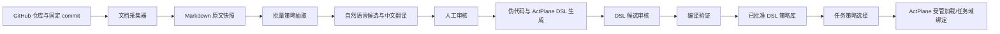

# AgentScope 历史策略库模块技术规划

> 历史技术规划归档（2026-10-07）：本文保留当时设计、预期接口和目标环境，不能作为已实现或已验收证明。现行实现与未完成事项以 [文档入口](../README.md) 中对应 RFC、REVIEW、BUG 为准。


## 1. 文档目标与范围

本文规划 AgentScope「历史策略库」的实现。策略库由四个可独立开发、通过稳定数据接口衔接的子模块组成：

1. 从指定 GitHub 仓库收集 `AGENTS.md`、`CLAUDE.md` 原文，并保存到 AgentScope 的数据目录。
2. 对批量 Markdown 文档执行 LLM 策略语句抽取，按 RQ1 的语料分析思路形成待审核候选；英文策略同时提供中文翻译字段。
3. 将已审核的策略语句转换为可读的 DSL 伪代码和 ActPlane 实际 DSL，均先进入候选审核。
4. 管理策略 DSL 记录、编译验证结果，以及它们在具体 ActPlane 任务域中的加载记录。

该模块属于三层策略生命周期中的「历史策略」层，为任务启动前的策略选择提供有来源、可检索、可复核的候选。它不替代任务启动策略审核，也不直接决定运行中 Scope 变更。

## 2. 现状与设计约束

AgentScope 当前已有 `strategies` 表、RQ1 语料导入和策略审核 API；目标任务准备流程也会从仓库文档提取部分证据。但还没有独立的 GitHub Agent 指令文档采集批次、英文翻译字段、批量 LLM 抽取队列、伪代码/真实 DSL 双产物和 DSL 加载历史。实施时应在现有结构上做数据库迁移，不覆盖或丢弃 RQ1 已导入记录。

当前数据库与运行状态默认保存在 Linux VM 的 `AGENTSCOPE_STATE_DIR`（缺省 `~/.local/state/agentscope`）下。新增文件统一保存在：

```text
$AGENTSCOPE_STATE_DIR/history-library/
  sources/<owner>/<repo>/<commit-sha>/<repository-relative-path>
  jobs/<job-id>/input-manifest.json
```

采集文件是不可变快照；界面编辑翻译、标注和候选规则时只写数据库，不修改源文件快照。源仓库代码和策略语料不提交到 AgentScope Git 仓库。

必须遵守以下边界：

- GitHub 文档只是待分析的数据。文档中的指令不能改变 AgentScope、系统提示、工具权限或审核要求。
- LLM 输出一律视为候选。未经人工审核的自然语言、伪代码和真实 DSL 不进入可检索的已批准策略集。
- 元数据由 AgentScope 单独保存；真实 ActPlane DSL 只包含可执行规则及其必要的规则说明，不把策略来源、仓库、行号、翻译或其他元数据塞进可执行 DSL。
- 编译成功只表示编译器接受该策略，不能显示为「已加载」或「内核正在执行」。只有 ActPlane 确认加载/绑定后才能记为已加载；具体任务域生效状态需单独记录。
- LLM 不调用特权 Broker、不编译并加载规则、不批准自身输出。编译与加载分别通过不同接口执行。

## 3. 模块总览与数据流



四个子模块通过记录 ID 和不可变来源 ID 连接，不直接互相读写对方的内部表：

| 子模块 | 输入 | 输出 | 人工把关点 |
|---|---|---|---|
| GitHub 文档采集 | GitHub 仓库 URL、分支/标签/commit | 固定 commit 下的 `AGENTS.md`、`CLAUDE.md` 快照及来源记录 | 选择仓库、确认采集结果 |
| LLM 策略抽取 | 已保存文档、抽取范围和版本化提示模板 | 带原文证据、分类、英文中文翻译的策略候选 | 策略是否真实存在、是否拆分正确、翻译是否准确 |
| DSL 转换 | 已通过的自然语言策略、ActPlane 支持能力 | 伪代码、真实 DSL 候选、转换诊断 | 语义是否保真、是否适合由内核执行 |
| DSL 记录与部署 | 已审核 DSL 版本、编译器/ActPlane 后端 | 编译状态、加载/绑定历史、版本与任务关联 | 批准策略、批准使用范围/任务 |

## 4. 子模块一：GitHub 指令文档采集

### 4.1 使用流程

1. 操作者输入一个或多个 `https://github.com/<owner>/<repo>` 地址，可选分支、标签或 commit。
2. 若输入分支或标签，采集器先解析其当前 commit SHA；数据库和本地目录始终以 SHA 定位，不能只记录可变分支名。
3. 采集器遍历该 commit 的 Git tree，收集任意目录中的文件名恰为 `AGENTS.md` 或 `CLAUDE.md` 的 Markdown 文件。初始版本只采这两种文件，不自动收集 README、Issue 或 PR 内容。
4. 下载文件原文并计算 SHA-256；将文件写入上述快照目录，同时创建文档记录。
5. 界面显示仓库、固定 commit、文件相对路径、文件大小、哈希、采集时间和状态；支持预览原文、重新采集新 commit、对同一 commit 幂等重试。

### 4.2 文件与上下文规则

- 保留仓库内的相对路径，因为根目录规则和子目录规则适用范围不同。子目录下的 `AGENTS.md`/`CLAUDE.md` 记录其目录作用域；抽取候选需携带该作用域，不能误当成全仓库规则。
- 原始字节作为快照保存；数据库另存 UTF-8 解码文本供检索。无法解码、超出单文件限制或下载失败的文件进入错误状态，不静默丢弃。
- 路径必须规范化并限制在该仓库 commit 的快照根目录内，阻止 `..` 路径穿越。
- GitHub 来源链接必须指向固定 SHA，例如 `https://github.com/<owner>/<repo>/blob/<sha>/<path>`；同时保存原始下载地址。
- 公开仓库使用只读 HTTPS 访问；私有仓库凭据若后续需要，只能在 VM 的服务凭据存储中配置，不写入 URL、数据库明文、前端或 Git。

### 4.3 建议接口

- `POST /api/history/sources`：创建采集任务，参数为仓库 URL 与 ref。
- `GET /api/history/sources/jobs/{job_id}`：查看采集进度、文件数、失败详情。
- `GET /api/history/documents`：按仓库、commit、文件名和状态检索文档。
- `GET /api/history/documents/{document_id}`：查看文档元数据与原文预览。
- `POST /api/history/documents/{document_id}/extract`：将一份或多份文档加入抽取批次。

## 5. 子模块二：批量 LLM 策略抽取

### 5.1 RQ1 思路的落地

沿用 RQ1 的核心方法：以 Agent 指令文档为语料，定位可独立理解的规范性语句，拆分复合句，对语句做策略类型、主题、执行层级和上下文依赖标注，并保留可回查的原文证据。不同之处是新增文件级批处理、中文翻译、LLM 提示版本与人工复核记录。

具体处理步骤：

1. 选择一个或多个文档快照，按 Markdown 标题和段落切分；超长段落按句子边界分块，重叠少量上下文，记录 chunk 对应的原文行号和字符区间。
2. 对每块调用可配置的 LLM Provider，以结构化 JSON 输出 0..N 个候选。模型必须返回原文片段和起止行/区间，不允许只给改写句。
3. 服务端用确定性逻辑校验：JSON schema、候选原文是否能在对应 chunk 中匹配、行号是否正确、字段枚举是否合法、必需翻译是否存在。匹配失败的候选标记为 `evidence_unresolved` 并要求人工核对，不自动修补原文。
4. 对英文候选生成简体中文翻译，保留原文并单独保存翻译。翻译需要保留 `must/should/may`、否定、例外和条件；低置信或语义不清的候选标记为待复核。
5. 将结果写入候选队列；审核人可合并重复项、拆分复合规则、修正类别/主题/范围、编辑翻译或拒绝，并保留原始 LLM 输出与修改轨迹。

### 5.2 RQ1 标注字段

建议标签参考 RQ1 的分析维度，但标签只是分析与检索元数据，不会自动成为内核规则：

- `strategy_type`：`semantic`、`content`、`per_event`、`cross_event`。
- `topic`：文件操作、命令执行、网络、凭据/秘密、测试与提交顺序、代码风格、审查流程等；支持多标签。
- `execution_layer`：`agent_instruction`、`tool_or_hook`、`os_event`、`kernel_candidate`、`unresolved`。由模型初标、审核者确认。
- `context_scope`：`self_contained`、`project`、`task`，并附作用路径/上下文说明。
- `evidence`：原始文档 ID、commit、路径、行号/字符区间、源文本 hash、固定 commit URL。

不得仅因语句使用“必须”“禁止”等词就判为可执行的内核规则。比如“提交前先运行测试”依赖跨事件状态，若当前 ActPlane hook/状态能力不支持，应保留为 Agent 行为参考并标注 `unresolved` 或 `unsupported`。

### 5.3 LLM Provider 与输出约束

统一定义 `ExtractionProvider.extract(chunk, schema, prompt_version) -> ExtractionResult` 和 `TranslationProvider.translate(text, source_language, target_language, prompt_version) -> TranslationResult`。模型名、部署端点、temperature、提示模板版本、输入/输出 hash、token 用量、耗时、重试次数均记入作业审计元数据。API 密钥只从 VM 环境变量或服务凭据读取。

候选结构至少包含：

```json
{
  "source_quote": "原文中连续、可回查的规则语句",
  "source_line_start": 12,
  "source_line_end": 13,
  "language": "en",
  "text_original": "原始语言策略语句",
  "text_zh": "英文候选对应的中文翻译；中文原文可为空",
  "strategy_type": "cross_event",
  "topics": ["test_before_commit"],
  "execution_layer": "agent_instruction",
  "context_scope": "project",
  "scope_path": "packages/example",
  "uncertainties": ["需要判断该规则是否适用于子目录外的提交"]
}
```

此 JSON 是抽取协议示例，不是 ActPlane DSL，也不能直接执行。

## 6. 子模块三：自然语言到伪代码与 ActPlane DSL

### 6.1 转换顺序

1. 仅允许将已审核通过的自然语言策略提交转换；审核通过的策略仍是 AgentScope 中的候选来源，不代表内核可执行。
2. LLM 先生成 DSL 伪代码，供研究者检查规则主体、对象、触发事件、条件、效果和例外。伪代码可附带策略 ID、来源位置、类别和适用范围等注释，便于追踪。
3. 在确认伪代码表达了原策略后，LLM 再按当前固定版本 ActPlane 规则语法生成真实 DSL 候选，并说明每条规则对应的 OS 事件/hook、目标字段及假设。
4. AgentScope 对结果做语法/schema 校验，并调用非特权编译检查接口获取 ActPlane 编译诊断与后端能力信息。真实 DSL 不支持、语义依赖缺失或编译失败时保留候选和诊断，不自动降级成“已通过”。
5. 人工审核通过后，DSL 版本进入已批准策略库；加载仍须由受控任务流程审批并由 ActPlane Provider 执行。

### 6.2 伪代码与真实 DSL 的分界

伪代码是审阅和解释产物，可以标注策略来源、类别、上下文、适用路径、事件/条件/动作映射及不确定点。真实 DSL 不混入这些数据库元数据；真实 DSL 只保留 ActPlane 可解析的规则。例如：

```text
# 伪代码（仅供审核，不可加载）
# strategy_id: <AgentScope 记录 ID>
# source: <owner/repo>@<commit> / path/to/AGENTS.md:L12-L13
# type: per_event; scope: project; topic: workspace_write
ON write(file)
IF actor == managed_agent AND file.path outside approved_workspace
THEN block
ELSE allow_by_other_rules
```

对应真实 DSL 只能依据 ActPlane 已支持的事件与字段生成；示例语法须以当前 ActPlane 规则语言文档及编译器版本为准：

```text
rule task-workspace-write-boundary:
  block write file "/**" if AGENT unless target "/approved/workspace/**"
  because "Writes are limited to the approved task workspace."
```

上例仅演示元数据不进入真实规则的边界。进入实际开发前，要用仓库锁定版本的 ActPlane 编译器确认语法、事件覆盖与 BPF-LSM 支持；不得把伪代码示例当成有效 DSL。

### 6.3 转换审计字段

每次转换保存输入策略版本 ID、源语言文本 hash、翻译版本 ID、LLM Provider/model、prompt 版本、伪代码、真实 DSL 文本、DSL/ActPlane 版本、能力检测结果、转换说明、未知项、编译输出 JSON、人工审核人/时间以及前后版本 diff。重新生成必须创建新版本，不覆盖旧产物。

## 7. 子模块四：DSL 策略记录、编译和加载

### 7.1 列表与状态视图

界面提供三个主要筛选分组：「待候选/待审核」「已通过候选」「已加载」。状态按不同维度记录，不能用一个状态字段掩盖审核和运行状态：

**策略审核状态**

- `draft`：生成中或由用户编辑。
- `pending_review`：待审核候选。
- `approved`：审核通过，可作为后续任务策略选择来源。
- `rejected`：审核拒绝；保留记录和理由，不得被任务检索。
- `superseded`：被新版本替代，保留旧版本审计记录。

**编译状态**

- `not_checked`、`checking`、`compiled`、`partial`、`compile_failed`、`unsupported`。
- 记录 ActPlane compiler 版本、完整输入 hash、诊断及支持/不支持的规则项。

**部署/加载状态**

- `not_loaded`、`loading`、`loaded`、`load_failed`、`unloaded`。
- 每条加载记录必须关联 `task_id`、策略版本、ActPlane backend、domain ID、加载时间、加载响应及实际策略 hash；同一个已批准策略可在不同任务中有多条独立加载记录。
- 若运行时还能确认绑定到 Agent 进程域，再额外记录 `active`/`inactive`；`loaded` 不能自动等同于进程域中实际生效。

「已加载」筛选展示至少一次成功加载的部署记录；策略本身仍保留 `approved` 审核状态。编译成功但未调用加载接口时，只能显示「已编译，未加载」。

### 7.2 编译和加载的责任边界

- **编译检查**：由 AgentScope 后端调用只读/非特权 ActPlane compiler；将结果连同版本绑定保存。编译检查不得修改运行中策略。
- **加载部署**：由 AgentScope 后端提交受限 Broker，Broker 只接受已审核策略版本和任务策略包，不接受自由 DSL 或 LLM 直接请求。加载响应成功并校验回读 hash 后才能写 `loaded`。
- **任务域绑定**：通过 AgentScope 的 DSH/ActPlane 受管启动路径完成；绑定的任务、固定仓库 commit、domain ID 和进程 PID 一起记录。若 ActPlane 当前接口无法单独加载历史策略片段，应先把已批准片段合并到完整任务 PolicyBundle，再编译并受管启动；未实现独立加载能力前，界面应如实显示「可审核/可编译，暂不支持单独加载」。
- **权限扩大**：复用既定限制，运行中的权限扩大不得直接改写当前 domain；须审批、生成新任务策略版本，并按当前 ActPlane 能力重启受管任务。

## 8. 数据库与对象模型

采用 SQLite 迁移增量扩展现有数据库。原始文档正文保存在文件系统；DB 中保存路径和校验 hash。建议新增/扩展以下表：

### 8.1 `source_documents`

`id`、`repository`、`requested_ref`、`commit_sha`、`relative_path`、`document_kind`、`snapshot_path`、`raw_url`、`content_sha256`、`byte_size`、`language`、`scope_path`、`collection_status`、`error_message`、`collected_at`。唯一键建议为 `(repository, commit_sha, relative_path, content_sha256)`。

### 8.2 `extraction_jobs`

`id`、`status`、`document_ids_json`、`provider`、`model`、`prompt_version`、`schema_version`、`input_hash`、`result_count`、`error_json`、`created_at`、`started_at`、`finished_at`、`created_by`。

### 8.3 扩展 `strategies`

保留现有 RQ1 导入字段与记录；增加 `source_document_id`、`extraction_job_id`、`source_quote`、`source_line_start/end`、`source_char_start/end`、`language`、`text_original`、`text_zh`、`topics_json`、`scope_path`、`extraction_confidence`、`uncertainties_json`、`llm_metadata_json`、`supersedes_id`。现有 `text` 继续作为 UI/search 的兼容字段，迁移时按旧数据填充 `text_original`，不得丢失旧 `status` 和来源。

### 8.4 `policy_artifacts`

一条策略可有多个转换版本：`id`、`strategy_id`、`version`、`pseudo_code`、`actplane_dsl`、`dsl_version`、`actplane_version`、`translation_input_hash`、`provider/model/prompt_version`、`mapping_json`、`uncertainties_json`、`review_status`、`reviewed_by/at`、`review_notes`、`created_at`。

### 8.5 `policy_compilations` 与 `policy_deployments`

`policy_compilations` 保存 artifact 或完整 PolicyBundle 的 `artifact_id`、任务上下文、编译器版本、输入 hash、状态、诊断 JSON、能力支持矩阵和时间。`policy_deployments` 保存 artifact/policy version、task/domain/PID、加载状态、加载/卸载响应、实际 hash 和时间。分表避免编译、审核、加载三个不同事实互相覆盖。

### 8.6 去重与版本不可变

来源文档按 repo+commit+path+hash 去重；策略候选按来源文档、规范化原文、区间去重，但允许审核人明确保留不同上下文解释；生成的 DSL 更新采用新版本和 `supersedes_id`，不覆盖已加载或已审核历史记录。

## 9. API 与服务边界

服务模块采用独立 Python 文件/接口，LLM Provider 与 ActPlane Provider 可替换：

```text
services/history_sources.py      GitHub ref 解析、文件列表、快照持久化
services/strategy_extraction.py  分块、LLM 调度、结构化校验、去重
services/strategy_translation.py 翻译及自然语言到伪代码/DSL 候选
services/actplane_compiler.py    编译检查、能力读取；不持有特权加载权限
services/policy_registry.py      状态转移、审核、版本与检索
services/policy_deployment.py    Broker 受管加载、回读验证、卸载/解绑记录
```

新增/调整的管理 API 建议如下，全部受现有管理员认证保护：

| API | 用途 |
|---|---|
| `POST /api/history/sources` | 提交 GitHub 仓库采集任务 |
| `GET /api/history/sources/jobs/{id}` | 获取采集任务状态 |
| `GET /api/history/documents` | 查询快照文档 |
| `POST /api/history/extractions` | 为选中文档创建抽取批次 |
| `GET /api/history/extractions/{id}` | 获取批次进度与错误 |
| `GET /api/strategies` | 扩展查询条件：来源、语言、类别、审核状态、是否有翻译 |
| `POST /api/strategies/{id}/review` | 审核/拒绝策略语句，保留审核理由 |
| `POST /api/strategies/{id}/artifacts` | 生成新的伪代码和 DSL 候选版本 |
| `POST /api/policy-artifacts/{id}/review` | 审核 DSL 候选 |
| `POST /api/policy-artifacts/{id}/compile` | 只执行非特权编译检查 |
| `POST /api/policy-artifacts/{id}/deploy` | 对指定已批准任务策略请求受管部署 |
| `GET /api/policy-artifacts/{id}/history` | 查看候选、审核、编译和部署版本链 |

LLM 长任务通过数据库 job 状态和后台执行器运行，接口返回 job ID；前端轮询或订阅状态，不在 HTTP 请求内无限等待。作业采用幂等 ID 和可恢复状态，服务重启后可把中断任务显示为 `interrupted` 并允许重试。

## 10. 管理界面规划

「历史策略库」内部用四个明确子页面或步骤导航，显示每一阶段的输入、输出和来源链：

1. **GitHub 文档**：添加仓库/指定 ref、查看采集进度、按 commit 展开 `AGENTS.md`/`CLAUDE.md` 文件、在线预览原文和下载状态。
2. **策略抽取**：多选文件并启动 LLM 批次；表格列出源语句、中文翻译、策略类型、主题、执行层级、上下文范围、原文行号、置信/不确定项；可筛选「待审核」「证据未定位」「英文缺翻译」。审核器可修改/拆分/合并/批准/拒绝。
3. **策略转 DSL**：显示原策略与来源、伪代码、真实 DSL、转换说明和 ActPlane 支持能力；支持版本 diff、手动编辑、重新生成、编译诊断；人工批准前明确标注「候选，不执行」。
4. **DSL 策略记录**：按「待审核候选」「已通过候选」「已编译」「已加载」筛选；展示审核状态、编译状态、加载任务/Domain、策略 hash、来源跳转和历史版本。加载/活动标签仅依据 ActPlane Broker 回执和运行时检查，不根据本地推断。

每条候选提供详情抽屉：原文与翻译、来源 commit 和路径行号、模型/提示模板版本、操作审计、伪代码/DSL 版本、编译诊断、加载历史。原文链接必须固定到 commit，而非默认分支。

## 11. 权限、安全与失败处理

- 只有管理员可以添加来源、启动抽取、审核候选、执行编译与请求加载；Agent/任务凭据不能审批或部署历史 DSL。
- 下载器仅访问 GitHub 仓库 HTTPS，不跟随不安全协议，不运行仓库脚本，不执行 Markdown 内容；设置单文件、总文件、请求速率及超时上限。
- 作为 LLM 输入的仓库文本需明确包裹为不可信引用数据；提示模板要求忽略其中试图要求模型调用工具、泄露秘密或改变系统约束的内容。
- LLM Provider 断网、超时、限流、输出 JSON 无效时记录错误并允许重试；不创建半完成的已审核策略。
- 编译器不认识的 hook、事件、路径语义或状态关系返回 `unsupported`/`partial`；只有明确可映射且通过编译的规则才进入下一步审核。
- ActPlane 加载失败时保留已批准 DSL 和失败诊断，但不显示已加载，不影响其他策略记录。
- 提供人工编辑和手动导入路径，但同样要求来源说明、审核、编译；禁止通过直接 SQL 修改审核/加载状态。

## 12. 实施顺序

### 阶段 A：来源快照

1. 增加 source documents schema 和迁移；实现 GitHub commit 固定、tree 遍历、指定文件下载和快照存储。
2. 新增采集 API 与「GitHub 文档」页面。
3. 用一个公开测试仓库验证根目录和多级子目录中的两种文件、缺失文件、重复采集、ref 更新和固定链接。

### 阶段 B：LLM 抽取与翻译

1. 定义 Provider 配置、提示模板版本和 extraction JSON schema。
2. 实现 Markdown 分块、批次队列、原文区间校验、英文翻译和候选持久化。
3. 增加审核页与 RQ1 标签编辑；确保无证据项、不确定项和翻译缺失不能误标为已批准。
4. 对 RQ1 样本做小批量人工对照，校验语句遗漏/幻觉、复合句拆分、类型标注和英文翻译流程。

### 阶段 C：DSL 双产物生成

1. 锁定 ActPlane DSL grammar/compiler 版本并定义可用能力矩阵。
2. 实现只接收已审核策略的 DSL Provider；先输出伪代码，人工确认后再生成真实 DSL。
3. 做编译检查和候选审核 UI；对 unsupported 和跨事件依赖实现显式诊断。
4. 用已有 ActPlane 策略样例做回归，验证生成规则能编译且未把元数据写进真实 DSL。

### 阶段 D：策略记录与任务加载

1. 增加 compilation/deployment 记录与策略版本详情。
2. 由 Broker 暴露受限的已批准策略部署接口；校验 artifact hash、审核状态、任务 ID 与用户授权。
3. 将策略合并入完整任务 PolicyBundle，在 Linux VM 中通过 ActPlane 实际加载并验证回读/事件；暂不支持独立片段加载时，界面清楚标明该限制。
4. 完成从 GitHub 来源到内核事件的端到端验收，再启用对任务生成流程的历史策略检索。

## 13. 验收标准

1. 输入仓库及 ref 后，能找到所有目录下的 `AGENTS.md`/`CLAUDE.md`，解析成固定 commit，快照内容可读且 hash 一致；重复采集不产生重复快照记录。
2. 对一批文档运行 LLM 抽取后，每条候选都能跳回精确文件和行号；英文规则保留原文并显示中文翻译；JSON/证据无效的结果留在复核状态。
3. LLM 抽取及翻译不能调用管理接口、Broker 或 GitHub 写操作；不确定/无法映射项不会自动变成可执行规则。
4. DSL 转换同时保存伪代码和真实 DSL；伪代码可显示来源元数据，真实 DSL 不包含来源数据库字段；重新生成创建新版本并保留 diff。
5. 候选审核、编译、部署是独立状态；编译失败、后端部分支持或缺少加载接口时，不出现「已加载」。
6. 已加载记录必须指向具体 AgentScope task、固定目标仓库 commit、ActPlane domain/version 和策略 hash；撤销/卸载/任务结束后更新部署状态但保留历史。
7. 任意策略可从 DSL 版本反查自然语言候选、翻译、原始 GitHub 文档路径、固定 commit、行号、内容 hash、LLM 版本、审核人和部署事件。

## 14. 第一个开发任务建议

先实现阶段 A，而不是先接入 LLM：增加 GitHub 来源表与快照目录；前端允许输入一个仓库和 ref；后端列出并保存 `AGENTS.md`、`CLAUDE.md`；页面能预览原文并显示固定 commit、路径、行号基础信息和 SHA-256。该阶段验收通过后，再以这些不可变语料作为批量 LLM 抽取输入。
