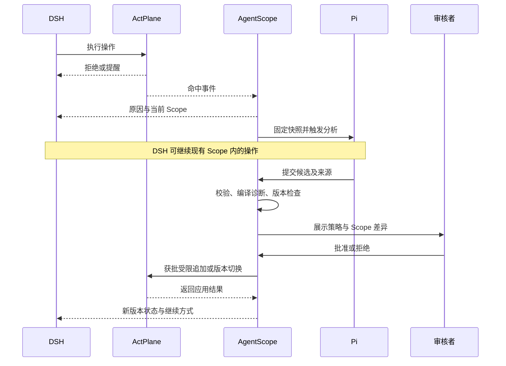

# AgentScope 运行时 Scope 增量与策略生成技术方案

> 历史技术规划归档（2026-10-07）：本文保留当时设计、预期接口和目标环境，不能作为已实现或已验收证明。现行实现与未完成事项以 [文档入口](../README.md) 中对应 RFC、REVIEW、BUG 为准。


> 文档状态：开发规划；文中新增接口、调度机制与验收结果均需实施后确认。<br>
> 所属层级：历史策略—任务启动前—任务运行时中的第三层。<br>
> 更新时间：2026-10-04。<br>
> 环境：Ubuntu 24.04 ARM64 Linux VM；AgentScope、Pi、DSH、ActPlane 均在 VM 内运行，宿主机浏览器查看界面。<br>
> 配套文档：[历史策略库模块技术规划](AgentScope_历史策略库模块技术规划.md)、[Pi 任务启动前策略生成与 DSH 实验验收技术方案](AgentScope_Pi任务启动前策略生成与DSH实验验收技术方案.md)。

## 1. 本层要实现的功能

任务启动前，第二层已经形成获批策略包，并通过 ActPlane 受管启动 DSH。本层接手同一任务的上下文、策略版本和进程域，在任务执行期间处理新的要求、反馈与 Scope 申请。

Pi 在收到触发后读取当前任务现场，检索已审核历史策略，判断是否需要改变当前规则；需要时生成策略语句、策略记录伪代码、PolicyIR 和真实 ActPlane DSL 候选。AgentScope 展示差异、完成确定性校验与人工审核，再通过 Provider/Broker 应用获批变化。任务结束或证据积累充分后，可将有复用价值的规则提交历史库晋升审核。

本层包括六项能力：

1. 持续接收 ActPlane 规则命中、DSH 工具反馈、真实用户补充要求与 Scope 申请。
2. 判断“无需改策略、细化已有规则、增加任务规则、收紧 Scope、申请扩权、仅提供指导”。
3. 由 Pi 基于证据生成候选，复用第一层的检索与 DSL 转换能力。
4. 分开管理候选审核、编译诊断、实际应用和运行验证。
5. 管理 Pi 与 DSH 的异步协作、版本冲突、失败恢复和重启。
6. 按场景保存 Trace、日志、规则快照，并将待复用经验送入历史策略库。

TaskScope 在本方案中包含资源边界与任务行为约束。一次新增流程规则可能只改变约束集合，没有增加或减少资源权限；界面须分别显示这两种差异。

## 2. RQ4 的依据与扩展关系

### 2.1 论文已验证的部分

RQ4 使用 OctoBench 的 21 个代码任务和 61 条规则。Codex＋GPT-5.5 先根据任务生成初始策略，运行中再依据 enforcement feedback，通过运行时接口为自己或执行任务的子 Agent 提交增量；总计 110 次。正文未分别统计新增与细化，也未说明双 Agent 是否常驻并行。[论文 §5.5](https://arxiv.org/html/2606.25189v2#S5.SS5)

策略域机制允许受限追加：子域继承父域约束，增量不能削弱继承规则。论文同时指出，更多 Hook 和时序门控的运行时更新仍需扩展。因此不能把任意可编译 DSL 都当作已支持热加载。[论文 §3.4、§4](https://arxiv.org/html/2606.25189v2#S3.SS4)

### 2.2 基于这些结果加入的系统设计

| 依据 | 本方案增加的功能 | 需要单独验证的内容 |
|---|---|---|
| RQ4 中任务内生成与提交增量 | Pi 负责策略候选，DSH 负责执行；事件队列连接两者 | 分离后的协作延迟、任务完成情况与候选质量 |
| 增量受策略域边界限制 | 展示当前 Scope、规则差异、影响面和审批结果 | 未批准变化是否始终不生效、是否保留平台基线 |
| 执行反馈可以参与规则调整 | 区分行为纠正、已有规则细化和新规则发现 | 能否避免反复生成重复规则或错误扩大权限 |
| 规则具有任务上下文 | 检索历史策略，保留任务证据与参数化过程 | 历史策略是否适用、缺口规则是否有充分依据 |
| 实验发生在单次任务内 | 增加历史库晋升和跨任务复用审核 | 晋升后能否改善后续任务，而非传播偶然经验 |

这里的“新规则”有两种含义：其一是把已有自然语言要求转换成此前不存在的具体 DSL；其二是从新要求或任务证据中提出新的规范性候选。两者都要记录来源；不能仅因 Agent 一次操作失败就推导出永久禁令。

## 3. 与现有代码的衔接

以下为 2026-10-04 对本地代码的静态检查结果，不代表本次已在 VM 完成运行验收。

| 当前入口或模块 | 已存在的代码能力 | 本层需要补齐的功能 |
|---|---|---|
| `GET /api/tasks/{task_id}/runtime` | 读取 ActPlane 事件文件并存入运行事件表 | 独立后台采集游标、可靠入队，避免依赖界面访问触发采集 |
| `scope-requests` 创建、查询、审核入口 | 收紧申请；受控输出目录扩权申请 | 与 Pi 候选、证据、完整规则产物及版本锁关联 |
| Broker `restrict` | 对审核请求提交限制增量 | 能力清单、内容哈希、应用确认、并发控制与补偿记录 |
| Broker `restart` | 停止旧执行并按新包启动 | 重启检查点、进程代次、上下文恢复及失败展示 |
| `validate_restrictive_delta` | 禁止新增来源标签，仅允许追加 `block/kill` 类子句 | 解析 AST；确认确为收紧，而非只检查文本前缀 |
| Pi 扩展 | 当前任务上下文、证据读取、已审核策略检索、候选提交 | 运行快照、能力查询、增量预检和运行时候选工具 |
| `governance_candidates` | 持久候选与审核晋升入口 | 语句审核、DSL 审核、适用性验证分别留痕 |

本地 ActPlane 来源基线在代码库 `UPSTREAM.md` 中记录为 `4c36aa54da2daf2b64de8782a38f77d5b76ec75a`，并包含集成改动。验收需额外记录实际二进制版本和构建哈希，不能只根据上游 master 文档推断本地能力。

上游当前规则文档描述了运行时 append 接口、增量准入与审计机制；这作为 Provider 能力核对的依据，功能开关仍以 VM 中固定版本的实测结果为准。[ActPlane 运行时实现说明](https://github.com/eunomia-bpf/ActPlane/blob/master/docs/rule-language.md#6-implementation)

## 4. 触发来源与是否生成规则的判断

### 4.1 触发来源

| 触发 | 采集内容 | 可能产生的结果 |
|---|---|---|
| ActPlane 命中规则 | rule ID、效果、操作、目标、进程域、原因、时间 | 指导 DSH 改正；必要时提出细化或 Scope 申请 |
| 用户补充、取消或收紧要求 | 来自已认证会话的原文、message ID、用户身份、时间 | 新任务约束、收紧候选，或仅更新任务指导 |
| DSH 显式申请资源 | 操作、目标资源、理由、当前失败与待完成目标 | 权限需求候选；审批前保持原有权限 |
| DSH 工具结果或任务阶段变化 | 工具输入输出、错误、阶段、相关改动 | 发现遗漏约束；不能仅从通用错误推导安全策略 |
| 记忆写入、治理配置变更 | 内容差异、来源版本、是否已审核/合并 | 持久候选；若要影响当前任务，另建运行时申请 |

不是每条对话或每次事件都调用 Pi。相同规则、目标与原因短时间内重复命中时先聚合，已有候选尚待处理时关联原候选。只有新的任务证据、新的目标或明确变更请求才重新分析。

### 4.2 分析结果

| 结果 | 判定依据 | 后续处理 |
|---|---|---|
| `no_change` | 规则正确且覆盖当前情况，DSH 只需遵守 | 反馈合规路径；记录判定，不增加 DSL |
| `guidance_only` | 内容、功能语义或风格要求无法映射到当前 Hook | 更新指导与检查项，标明由上层处理 |
| `refine_rule` | 已有任务规则未覆盖某个具体路径、操作或条件 | 提出补充子句/规则；不得削弱继承约束 |
| `add_task_rule` | 新要求或充分证据支持此前没有的具体约束 | 生成原子策略记录与 DSL 候选 |
| `tighten_scope` | 当前任务阶段或子任务需要更小的资源边界 | 形成 Scope 前后差异与受限追加候选 |
| `request_expand` | 当前合法目标确需额外资源或放宽任务局部限制 | 明确申请；审核并核对上限后选择受支持应用路径 |
| `needs_clarification` | 指代、路径、审批来源或必要性不清楚 | 在界面显示缺失证据，保持当前规则 |

`refine_rule` 不等于任意原地修改。对只能追加的运行域，细化体现为新增约束；删除或放宽既有规则需要单独的版本切换方案。服务端必须比较实际语义，不能相信 Pi 自报的 `tighten` 标签。

ActPlane 的规则命中事件也不是完整系统调用审计流。未出现事件不能证明任务没有违规；发现尚未覆盖的行为还需用户要求、DSH 工具记录或明确启用的观测证据。

## 5. 解耦的功能模块

| 模块 | 职责 | 输入与输出 |
|---|---|---|
| Runtime Event Collector | 独立采集 ActPlane 命中和 DSH 事件、保存游标与去重键 | 原始记录 → 规范化 RuntimeEvent |
| Trigger Router | 聚合重复反馈、识别新证据、决定是否入队 | RuntimeEvent/用户消息 → GenerationJob |
| Runtime Snapshot Service | 固定当前任务现场，形成一次分析的不可变输入 | task/run/版本 → RuntimeContextSnapshot |
| Historical Policy Search | 复用第一层硬过滤、关键词和向量检索 | 策略语句/场景 → 有来源的已审核候选 |
| Pi Runtime Generator | 解释反馈、判断适用性、生成原子候选 | 快照与候选 → 语句、伪代码、IR、DSL 草案 |
| Delta Resolver/Validator | 检查来源、权限差异、冲突、AST 与后端能力 | 草案 → 诊断、风险、建议应用方式 |
| Approval & Version Service | 管理审核、哈希绑定、旧版本失效和单任务锁 | 待审候选 → ApprovalRecord/待应用版本 |
| Enforcement Provider/Broker | 编译、受限追加、重启、绑定与实际状态查询 | 获批产物 → 应用回执与 EnforcementBinding |
| DSH Adapter | 返回原因、当前 Scope 和申请结果；暂停或重启会话 | 运行反馈 → DSH 可理解的结构化说明 |
| Trace & Audit Service | 保存因果链、日志和版本快照 | 全阶段事件 → 按 scenario/run 查询与比较 |
| Promotion Service | 参数化任务规则、验证适用范围、提交历史库 | 任务经验 → 待复用 PolicyRecord/DSL 候选 |

Collector、Pi Worker 与 API 可分别作为普通权限服务；Broker 单独运行。模块通过记录 ID、版本与结构化接口衔接，Pi 和界面不直接操作 eBPF maps。

## 6. Pi 与 DSH 如何协作

### 6.1 启动前与运行中的顺序

启动前依赖顺序为：第二层准备 → 人工批准 → 后端加载与绑定 → DSH 开始任务。运行中 DSH 与分析 Worker 可同时存在；Pi 采用事件驱动的一次性调用，分析完成退出，状态保存在 AgentScope。

同一任务的 Pi 分析和 DSH 合法操作可以并发。被拦截的操作仍然拒绝，Pi 分析不构成临时放行。需要冻结任务时由 Adapter/Broker 执行，并记录暂停边界；高影响范围切换不依赖 Agent 自觉等待。

用户刚提出的新限制要立即作为任务指导交给 DSH。若等待生成与审核期间继续执行可能违反这项限制，先在受管工具边界暂停受影响操作，无法精确暂停时暂停整个任务；界面显示“等待约束落实”。新的内核约束只从确认生效时开始计算，不能声称它阻止了更早已经开始的操作。审核拒绝安装某条 DSL 也不自动撤销用户的任务要求，需返回指导项或更合适的实现方案。



### 6.2 并发与版本控制

- 不同 task 的分析可以并发；每个 task 初始限制一个分析 Job，相关事件批量合并。未来并发批次仍需统一 Resolver 合并结果。
- Pi 输入包含 `base_policy_version`、`base_scope_revision`、`process_epoch` 和 `snapshot_hash`。
- 审核与应用前分别检查基础版本。期间策略、证据或进程域已变化时，候选标为 `stale`，重新计算差异，不套用旧审批。
- 一个任务同时只允许一次策略应用。审核批准仅提交待应用记录，由带幂等键的 Worker/Broker 完成应用与确认。
- 短时间重复事件按规则、目标、原因和进程代次聚合；使用退避与重试上限，避免失败反馈反复触发相同 LLM 调用。
- DSH 进程被 `kill` 后不能假设它仍会接收反馈。Adapter 记录任务/子进程退出，由监督进程和界面显示原因并决定后续处理。

这套调度是 AgentScope 的明确设计选择，需要验收；不把它写成 RQ4 已公开的调度实现。

## 7. 运行时策略的生成流程

### 7.1 固定分析输入

RuntimeContextSnapshot 至少包括：

1. 用户初始任务及已认证的补充消息；原文与消息 ID。
2. 固定 repo/commit、当前工作区、相关文件片段和本次 diff 的内容哈希。
3. DSH 版本/profile、任务阶段、工具能力与近期相关工具结果。
4. 启动前获批 PolicyBundle、当前生效增量、平台基线与权限上限。
5. ActPlane 的规则命中及反馈；必要时注明观测缺口。
6. 当前 domain、进程代次、实际内核/Hook、静态编译与运行时追加能力。

工作区可能持续变化。采集器保存本次读取的副本或片段及哈希，Pi 分析该快照；实际应用前重新核对关键路径和证据。仓库文本、工具输出、memory.md 都作为数据处理，不能替代真实用户审批。

### 7.2 生成步骤

1. **解释触发原因。** 先判断是正常拒绝、遗漏约束、过严局部规则、任务变化，还是与策略无关的错误；已有规则正确时优先返回合规做法。
2. **抽取原子语句。** 每条语句表达一个要求，明确主体、对象、操作、条件、例外和理由。英文语句单独保存中文译文。
3. **检索历史策略。** 按已审核、有效范围、操作类型、上下文和能力过滤，再并行进行关键词/向量召回、融合与去重。
4. **判断适用性。** Pi 按批次给出复用、参数化、补充、冲突或不适用的理由；语义相似只作为召回依据。
5. **处理缺口。** 历史库未覆盖但证据充分时生成任务新候选；缺少必要证据时返回待澄清，禁止猜测目录、工具或授权。
6. **生成三类产物。** 保存带元数据的策略记录伪代码、表达行为语义的 PolicyIR，以及纯 ActPlane DSL。候选与历史策略保持版本化映射。
7. **计算变化。** 服务端计算 Scope 前后差异、新增规则、受影响进程和资源、继承约束冲突及拟采用的应用方式。
8. **确定性预检。** 检查 schema、证据、路径规范化、AST、能力、规则数量与标签/门控预算，进行无特权编译诊断。
9. **提交审核。** Pi 只提交候选。Approval Service 根据候选哈希和当前版本创建待审项，获批后交给应用模块。

### 7.3 Pi 工具与 Skill

扩展现有第一方 `pi-policy-tools`，复用已有上下文、证据和历史检索工具。下表是待开发契约，不能作为已可调用的接口清单。

| 工具 | 必填输入 | 返回或副作用 |
|---|---|---|
| `get_runtime_context` | `snapshot_id` | 本任务 Scope、版本、平台上限和相关事件 |
| `read_task_evidence` | `evidence_id` | 只读、带行号与来源的快照片段；复用现有能力 |
| `search_approved_policies` | `policy_statement`、事件/上下文过滤 | 匹配策略、版本、分数和来源；扩展现有查询参数 |
| `get_enforcement_capabilities` | `task_id` | 当前编译和运行时追加的分别支持清单 |
| `validate_scope_delta_candidate` | `snapshot_id`、候选 IR/DSL、记录映射 | 确定性诊断、实际差异、建议应用方式；不加载 |
| `submit_scope_delta_candidate` | `snapshot_id`、基础版本、产物、证据、理由 | 保存待审候选；不会扩大权限 |
| `submit_runtime_assessment` | `snapshot_id`、`no_change/guidance_only`、理由 | 保存不变更判断和指导，不生成审批申请 |

工具凭据绑定 task/run/job，服务端核对快照归属。即使 JSON 参数出现其他 task 或 domain，也不能切换当前授权对象。

`runtime-scope-update` Skill 的执行顺序：读取快照 → 解释触发 → 查相关证据 → 检索历史 → 判断适用性 → 草拟原子规则 → 查询能力与预检 → 提交候选或无变更判断。Skill 用于指导调用顺序，服务端负责强制状态与权限检查。

Pi 可复用内置只读 `read/grep/find/ls`，证据以只读挂载和可访问路径范围控制；关闭 `bash/write/edit`，输出记录通过候选 API 保存。CLI 工具清单不是操作系统沙箱，部署沿用第二层的低权限用户/容器隔离方案。

## 8. 数据对象与规则表达

### 8.1 核心对象

| 对象 | 必需内容 |
|---|---|
| RuntimeEvent | event ID、task/run、来源、规则/操作/对象、效果、时间、进程代次、原始记录 hash |
| RuntimeContextSnapshot | snapshot ID、任务/证据版本、当前 Scope、规则集合、能力、内容 hash |
| GenerationJob | job ID、触发事件集合、snapshot、Skill/模型版本、状态、重试次数 |
| RuntimeScopeDelta | delta ID、基础版本/Scope revision、变化类型、产物、前后差异、证据、应用方式 |
| PolicyRecord/DSLArtifact | 原子语句、译文、记录伪代码、IR/真实 DSL、映射、历史来源及各自版本 |
| ApprovalRecord | 候选 hash、基础版本、审批身份/决定/理由/时间、批准范围 |
| EnforcementBinding | bundle/delta hashes、domain、PID/start time、进程代次、应用确认和 Hook 状态 |
| PromotionCandidate | 来源 run/delta、参数化记录、适用性证据、历史库各阶段审核记录 |

资源 Scope 可用 read/write/unlink/exec/connect 的控制面范围表示；真实 DSL 按 ActPlane 限制规则表达。不能为扩大 Scope 凭空生成 `allow write` 这样的 ActPlane 语句。

### 8.2 策略记录伪代码示例

假设用户在真实会话中补充：“本阶段只改 src，仓库其他目录不要写入或删除。”当前 TaskScope 允许修改任务仓库。Collector 验证 src 存在、任务路径证据明确后，Pi 可以形成下列候选。路径为说明用的示例，不是实验仓库的已验证路径。

```yaml
policy_record:
  policy_id: task-rule-23
  version: 1
  statement_original: "本阶段只改 src，仓库其他目录不要写入或删除。"
  statement_zh: "本阶段只改 src，仓库其他目录不要写入或删除。"
  strategy_type: per_event
  context_scope: task
  provenance:
    source_type: authenticated_user_message
    evidence_ids: [message-17, workspace-snapshot-8]
    repo_commit: "<固定 SHA>"
  subject: "当前 DSH 任务域及其后代"
  constraint:
    operations: [write, unlink]
    object_root: "/workspace/repo/**"
    exception: "/workspace/repo/src/**"
    effect: block
  historical_matches: [hist-42-v2]
  change_kind: tighten_scope
  scope_revision_before: 0
  scope_revision_proposed: 1
  approval_state: pending_review
  dsl_artifact_ids: [dsl-23-v1]
```

这是 AgentScope 保存和展示的记录伪代码。其元数据不送入 ActPlane 真实 DSL。

### 8.3 对应的真实 DSL 草案

```text
rule runtime-src-only:
  block write file "/workspace/repo/**" if AGENT unless target "/workspace/repo/src/**"
  block unlink file "/workspace/repo/**" if AGENT unless target "/workspace/repo/src/**"
  because "当前阶段只允许修改 src；其他仓库路径的写入和删除需要重新审核。"
```

这里沿用启动前已有的 `AGENT` 标签，作用域由任务 domain 绑定确定。本例仅限制仓库内的写入/删除，平台和任务基线继续限制其他资源；它也不证明 rename、硬链接等所有变更路径均受覆盖，须按后端 Hook 验收。

一个原子 PolicyRecord 默认对应一个 DSLArtifact，artifact 内可以有多条执行子句。复合自然语言要求先拆分记录；确需 1:n 映射时显式登记子项。任何已审核 artifact 修改后都生成新版本，旧审批不能复用。

静态编译接受草案不代表支持运行时追加。增量编译还必须复用当前域的标签/门控符号表和 ABI，禁止独立分配位掩码后直接拼接到运行域。

## 9. 校验、审核和状态机

校验按以下顺序执行：

1. 检查候选 schema、输入快照、证据与任务归属。
2. 验证自然语言和 IR 的主体、对象、条件、效果一致性。
3. 检查实际路径、符号链接、进程绑定、资源上限，计算 before/after。
4. 核对继承约束和平台基线，检查候选是否真的收紧；处理相互矛盾或使任务不可完成的规则。
5. 解析真实 DSL AST，核对符号表、Hook 与增量能力；执行无特权编译诊断。
6. 为审核固定候选 hash、基础版本、影响面与应用方式。
7. 获批后再次核对当前版本和进程代次，在单任务锁内提交应用。

审批和执行分开存储：

```text
review_state:
  pending_review → approved | rejected | stale | withdrawn

compile_state:
  not_checked → compiled | partial | unsupported | failed

apply_state:
  not_submitted → queued → applying → submitted
  submitted → active | confirmation_pending | failed
  active → ended | superseded
```

`approved` 不代表加载成功。命令返回但缺少可关联的实际确认时显示 `confirmation_pending`，不把该候选计入已确认 Scope。事件命中记录另存为 `match_count/last_match`，不能要求每条安全规则必须违规一次才叫已加载。

人工批准必须针对固定候选内容和范围；不能只根据自由文本 `reviewed_by` 字段认定真实审批身份。Pi、DSH 的任务凭据不具有审批、历史晋升或 Broker 权限。

## 10. ActPlane 应用路径与权限扩大

### 10.1 受支持的收紧追加

1. Provider 查询运行域存在性、进程代次和 runtime-delta 能力。
2. 根据当前基线解析并编译获批增量，保留 rule ID 与原因映射。
3. Broker 向当前运行域提交固定产物、审批引用和幂等键。
4. 获取准入/应用反馈；若后端只返回提交结果，则进一步查询状态或执行隔离的行为探针。
5. 成功后记录 `scope_revision + 1`、有效规则 hash、生效时间和 domain。
6. 向 DSH 返回新约束、原因及可继续的操作；保留原启动 bundle 和累积增量列表。

逻辑生效版本可表示为 `bundle-v3 + delta-r1 + delta-r2`。这避免把“主包版本没有变”误解为“Scope 没有更新”，并支持重建当时的有效规则集合。

### 10.2 权限扩大或局部规则放宽

权限扩大先检查审批者是否有权改变相应边界；当前任务批准不能覆盖平台固定基线。对于会削弱继承约束的变化，普通子域追加不能实现。

当前 AgentScope 以获批新包重启作为受控路径：校验新包 → 固定必要工作区状态 → 停止旧进程树 → 加载新包/创建新绑定 → 在同一工作区启动新 DSH → 记录新进程代次并反馈结果。重启必须保留平台基线以及本次没有被授权改变的既有约束。

目前代码里的扩权申请只覆盖受控任务输出目录，不能据此宣称任意外部路径、网络或执行权限都已实现。新增权限类型应逐项增加上限、校验器、应用路径和验收用例。

未来后端若支持其他域切换方式，Provider 可以返回新的 activation mode；必须在固定版本通过验证后启用，不通过“批准了”来推断“能在原进程放宽”。

DSH 重启保留工作区不等于保留完整对话。Adapter 需保存任务目标、已完成事项、变更摘要与待办；若 DSH 版本支持会话恢复则实测该接口，否则采用明确的新会话续接，并在界面显示。

### 10.3 失败、撤销与回滚

- 编译/追加失败时原规则继续生效，记录错误与失败产物；无法确认应用结果时先核对后端，不盲目重复提交。
- 队列重试使用固定 delta/hash/幂等键。进程域重启后旧代次的未应用申请失效。
- 单调追加后的限制不能靠删除数据库记录撤销；撤销按新版本的合法重建/重启处理。
- 规则到期也不等于内核已解除。TTL 只能触发版本切换计划，实际解除需要后端确认。
- 回滚可能恢复较宽的权限，须核对当前授权；若无合法恢复路径，则保留约束并暂停任务。
- 新版本启动失败时显示真实旧进程/新进程状态。已停止的进程不能仍显示“任务运行中”。

## 11. 持久更新与历史库回流

当前任务使用批准与历史库复用批准是两个决定：前者只作用于当前任务，后者允许后续任务检索。运行增量批准不自动产生可复用历史策略。

回流流程如下：

1. 根据新增 delta、运行结果、重复场景或人工选择创建 PromotionCandidate。
2. Pi 将绝对任务路径、进程 ID 等参数化，同时保留原始版本与证据。
3. 检索历史库，判断新增、合并或已有策略的新版本，避免重复记录。
4. 对自然语言原子语句和中文翻译执行历史库子模块二的审核。
5. 对伪代码、IR 与真实 DSL 执行子模块三审核及能力检查。
6. 通过适用范围和反例验证后，发布新的已审核版本并建立索引。
7. 后续任务在第二层重新判断其适用性，不照搬上一次任务的路径和权限。

memory.md 新增/修改可能只描述事实或个人偏好；只有有明确规范含义、来源和适用条件的语句才进入候选。Agent 治理 PR 仅在已审核/合并或批准发布后采集；目标任务仓库的普通代码提交只提供任务证据，不自动升级为治理规则。

已审核但只能指导 Agent 的语义策略仍可保留在历史库，应显示 `guidance_only`，不能标记为已加载内核规则。

## 12. Trace、日志和规则快照

沿用第二层的 `scenario_id/run_id/task_id`：scenario 是固定场景，run 是一次实验运行，task 是受管任务。DSH 重启增加 `process_epoch`，同一次实验的 run ID 保持不变；每次 Pi 分析另有 job ID 和 span。

每次触发保存以下链路：

```text
事件或消息
→ 输入快照
→ 检索 query/结果与排除理由
→ Pi Skill/工具调用/输出
→ 语句—伪代码—IR—DSL 映射
→ 确定性校验
→ 审批
→ Broker 提交与后端确认
→ DSH 反馈/恢复
→ 验证结果及历史库晋升
```

Trace 用于阶段关联与耗时；审计记录以追加方式保存真实身份、决定、候选 hash 和结果；诊断日志用于排错。保存工具输入输出和可见模型回答，不要求存储模型不可见的内部推理。敏感文件、Token 和秘密值需脱敏并限制原始 artifact 的访问。

运行目录建议复用已有 state 根目录：

```text
$AGENTSCOPE_STATE_DIR/scenarios/<scenario_id>/runs/<run_id>/
  manifest.json
  events/runtime.jsonl
  events/audit.jsonl
  traces/spans.jsonl
  snapshots/<snapshot_id>/context.json
  proposals/<delta_id>/policy-record.yaml
  proposals/<delta_id>/policy-ir.json
  proposals/<delta_id>/policy.dsl
  proposals/<delta_id>/validation.json
  approvals/<approval_id>.json
  bindings/<process_epoch>.json
  logs/pi/<job_id>.log
  logs/dsh/<process_epoch>.log
```

数据库保存索引、状态与关联，目录保存不可变产物。历史策略库仍在其原目录，通过 ID/hash 引用，不为每个场景再复制一份完整历史库。

## 13. 管理界面

在现有任务详情增加“运行时 Scope”视图，展示：

- 当前已确认版本、Scope revision、domain、进程代次与实际 Hook 状态。
- 事件时间线：区分内核命中、DSH 工具结果、用户消息、候选与生效事件。
- 候选卡片：为什么触发、Pi 判断、历史命中、来源回链、英文原文/中文译文。
- Scope 与规则差异：新增限制、申请资源、保持的基线、受影响进程和文件。
- 产物查看：策略记录伪代码、IR、纯 DSL 和编译/追加支持诊断。
- 审批与执行：批准、拒绝、待澄清；分别显示批准、已提交、已确认生效、失败。
- 版本与恢复：累积增量、重启过程、旧/新进程状态及合法回滚操作。
- 历史晋升：仅本任务使用、提交复用候选、审核结果和后续命中场景。

“已编译”“已加载”“发生过真实拦截”使用不同标签；收紧可追加与扩权需版本切换的说明放在审核详情，帮助操作者判断影响。

## 14. API 与模块接口规划

复用已有 `runtime`、`scope-requests`、`versions` 和 `governance` 入口；下列接口为需要新增或扩展的契约。

```text
POST /api/tasks/{task_id}/runtime/triggers
  接收受认证来源的消息/事件引用；服务端固定快照并返回 job_id

GET /api/tasks/{task_id}/runtime/snapshots/{snapshot_id}
  返回不可变运行现场；任务凭据只读当前归属

POST /api/plugin/tasks/{task_id}/runtime/assessments
  Pi 提交 no_change/guidance_only 判断

POST /api/plugin/tasks/{task_id}/runtime/deltas/validate
  Pi 请求预检；无加载副作用

POST /api/plugin/tasks/{task_id}/runtime/deltas
  Pi 提交候选；服务端绑定 job、snapshot、版本和产物 hash

GET /api/tasks/{task_id}/runtime/deltas
  列出候选、审核、编译与应用状态

POST /api/tasks/{task_id}/runtime/deltas/{delta_id}/review
  管理身份批准/拒绝；校验基础版本并提交待应用记录

GET /api/tasks/{task_id}/runtime/effective-policy
  返回已确认生效的主包、累积增量、Scope revision 和绑定

POST /api/tasks/{task_id}/runtime/deltas/{delta_id}/promote
  创建待复用候选；不直接发布历史策略
```

模块调用约定：

```text
PiRuntimeGenerator.generate(snapshot_id, skill_version) → Assessment + Candidate[]
DeltaValidator.validate(snapshot, candidate) → ValidationReport
EnforcementProvider.plan_apply(binding, candidate) → ActivationPlan
EnforcementProvider.apply(approved_artifact, idempotency_key) → SubmissionReceipt
EnforcementProvider.confirm(receipt) → ConfirmedBinding | Pending | Failed
DSHAdapter.deliver_feedback(task, event_or_result) → DeliveryReceipt
PromotionService.create(delta_id, run_id) → PromotionCandidate
```

新增模块需要迁移现有表，保留 `scope_requests`、`runtime_events`、`policy_versions` 与 `governance_candidates` 的关联。新增快照、Job、delta artifact、应用记录和 scope revision；不从历史记录反推并覆盖当时 DSL。

## 15. 按开发顺序实施

### 步骤一：固定 VM 基线与能力

在 VM 中记录 Linux/BTF/BPF-LSM、ActPlane 版本/构建哈希、DSH/profile、Pi/模型配置和当前已通过场景。分别验证静态编译、受管启动、文件限制追加和事件原因反馈。输出 CapabilitySnapshot；未验证功能默认关闭。

### 步骤二：建立后台采集与任务关联

从现有界面查询函数中抽出 Event Collector，按文件 inode/offset 或后端订阅游标采集，保存事件去重键与 domain/进程代次。补充 DSH 工具记录和真实用户消息适配。验收无需打开界面也能接收事件；重新启动采集器不会重复插入或丢失已确认记录。

### 步骤三：实现快照、Job 与 Trace

建立 RuntimeContextSnapshot、GenerationJob 和关联产物表。将第二层 PolicyBundle、当前限制、证据与能力固定进快照；实现事件聚合、单任务 Job 限制及重试。验收能按一个 job 还原输入，工作区后续变化不覆盖旧证据。

### 步骤四：接入 Pi 运行时 Skill 和受限工具

复用 Pi 启动器和已审核历史检索，补充运行时上下文、能力、预检与候选接口；配置 `runtime-scope-update` Skill。先验证 no_change、guidance_only、新增约束三种输出，要求带证据和基础版本。验收 Pi 能产生候选但不能批准、加载或修改目标仓库。

### 步骤五：实现候选产物与确定性校验

保存原子语句/翻译、伪代码、IR、DSL 与映射；通过 AST 和 Scope 比较确认限制含义。实现状态分离、候选 hash 与符号表预算检查。验收未知路径、无证据、伪造 task、无效 DSL 和不支持的时序增量均被明确诊断。

### 步骤六：连接审核与受限追加

审核接口检查身份和基础版本，应用队列取得单任务锁后调用 Broker。先支持当前已验证的仓库写入/删除收紧模板，再逐项增加可验证规则类型。保存应用回执、实际确认和 scope revision。验收拒绝/未批准不改变权限，批准后相应操作真实受限。

### 步骤七：实现受控扩权与恢复

沿用受控输出目录场景，增加候选差异、停止边界、检查点、进程代次、Token 轮换和新包绑定。重启前检查新包，重启失败时准确显示状态。验收未获批的输出目录持续不可写，获批后只放开指定输出目录并保留其他基线。

### 步骤八：接入 UI 与历史晋升

完成运行时视图和审查详情，接入已有历史库语句/DSL 审核流程。验收当前任务批准不影响历史检索；通过复用审核后，新版本才进入后续启动检索。

### 步骤九：完成场景回放与对照实验

执行第 16 节的真实任务、受控边界、并发与故障场景。先跑通一个固定 run，再扩展其他任务。保存原始产物、实际内核结果、误阻断与恢复记录，不以界面截图代替执行证据。

## 16. DSH 场景与实验验收

### 16.1 已有 RQ4 场景作为任务来源

采用本地已收集的 `benchmark-aws_cancel_partial_001`：用户先要求 A 命令历史、B 命令自动补全、C 常用命令别名，随后补充“暂时跳过 B，先实现 A 和 C”。任务源位于 `actplane数据集/RQ4/OctoBench/data/selected_cases_21.jsonl`；实验原工作区为 `/workspace/aws-mcp-server`。

在 VM 中固定可追溯的对应仓库快照和 commit、任务两条用户消息及 DSH profile。来源数据没有提供 GitHub URL 的字段时，先根据实验镜像/仓库材料核对上游地址与 commit；未核对前不填写猜测的 URL，也不宣称 GitHub 来源已经固定。

DSH 执行这些任务要求；Pi 只获取任务消息、仓库证据、现有策略和运行反馈，不能读取 evaluator、checklist 标准答案或当前实验判分结果。使用 DSH/Pi 属于本方案的适配实验，不等同于直接复现论文全部成绩。

“跳过自动补全”通常是功能语义要求。若 B 与 A/C 共用文件，Pi 应输出 guidance_only，不能为禁止 B 而拦截共用文件的所有写入。只有证据明确定位到可独立约束的路径或命令时，才提出对应 OS 规则。

### 16.2 受控增补场景

为验证权限机制，在该固定任务的隔离副本加入明确标为“AgentScope 增补”的要求与测试目录，不写成论文原场景：

- 准备两个存在的仓库内目录 S 和 T，保存规范化路径和哈希；基础 Scope 允许在二者写入。
- 运行中由真实用户消息要求“下一阶段只允许修改 S，T 不可写入或删除”，由 Pi 根据快照生成新限制候选。
- 同一受管 DSH 进程树在批准前后分别执行 S/T 操作；使用确定性工具动作辅助验收，避免模型恰好不尝试 T 而掩盖问题。
- 另设任务专属输出目录 O，基础策略禁止写入；由 DSH 申请后展示拒绝和批准重启两种结果。

功能代码任务与权限边界探针分别报告结果；控制面字段中的目录许可只证明对应操作与 Hook，不扩大为“整个文件系统完全隔离”的结论。

### 16.3 必须通过的场景

| 场景 | 操作与预期结果 | 必存证据 |
|---|---|---|
| 已有规则正确拒绝 | DSH 越界被拒绝；Pi 返回 no_change/合规路径 | 命中、反馈、无新增 delta 的判定 |
| 用户收紧产生新规则 | 读取新消息、查历史、提出 S-only 新候选；未批前旧规则不变 | 消息、快照、候选、真实差异 |
| 收紧获批生效 | 同一运行域 S 写入成功，T 写入/删除被实际拒绝 | domain/代次、应用确认、操作返回码、文件状态 |
| 细化遗漏边界 | 根据具体证据补充限制子句；既有约束保留 | 前后规则、证据和反例结果 |
| 无法映射的功能要求 | “跳过 B”没有独立 OS 目标时只给指导 | guidance_only 与不支持原因 |
| 未批准/拒绝扩权 | O 持续不可写，当前 Scope 不变 | 申请/审批状态和内核拒绝 |
| 批准受控扩权 | 新包、新进程代次；O 可写，平台禁止项仍拒绝 | 新旧绑定、恢复摘要、基线验证 |
| 过期候选 | 分析后当前版本改变；旧候选不得直接应用 | stale 记录、版本核对和重新分析 |
| 重复与跨任务请求 | 重复事件聚合；任务凭据不能操作另一任务或审批 | 去重记录和接口拒绝结果 |
| 不支持的 DSL/增量 | 编译或动态能力不足时不显示 active | 原始诊断、确认状态、旧规则仍生效 |
| 应用/重启失败 | 无假成功；旧/新进程状态真实、可恢复 | 失败回执、进程状态、补偿记录 |
| 历史库回流 | 当前任务批准尚不可复用；晋升审核后后续任务可检索 | 两次审批、历史新版本与新任务命中 |

### 16.4 对照组与指标

在相同任务/commit/Agent/模型条件下比较：A 仅启动前策略；B 启动前策略＋反馈回传、不开启增量生成；C 反馈＋Pi 运行时候选及受控应用；D 在 C 基础上启用已审核历史检索。C 与 D 的人工审批方式保持一致，并分别报告审批等待时间。

指标包括：需要变更场景的识别 precision/recall、候选证据充分率、IR/DSL 语义准确性、编译与动态追加支持率、重复候选率、真实拦截/误阻断、反馈后恢复、任务完成、生成延迟、审核延迟、应用确认延迟、LLM Token 成本及重启损失。历史晋升单独评价后续任务适用率与错误传播。

验收数据必须区分“生成了候选”“批准了规则”“提交到了后端”“实际生效”四个分母。端到端更新耗时包括 LLM、排队、校验、审核与应用；不能用单条内核增量提交耗时代表完整策略演化延迟。

## 17. 完成标准

一个可交付的运行时 Demo 应能在管理界面完整演示：DSH 在获批基线下运行 → 收到运行事件或用户新要求 → Pi 有证据地生成候选 → 显示新规则/Scope 差异 → 审核 → 受限追加或获批新版本重启 → 实际操作验证 → 查看完整 Trace → 单独审核历史库晋升。

基础交付先覆盖已验证的文件边界收紧、受控输出目录扩权和 guidance_only；其他事件、标签和时序规则逐项声明能力与验收结果。模块实现完成、静态检查完成与 Linux 内核验收通过应分别报告。

## 18. 参考材料

1. [ActPlane 论文 v2](https://arxiv.org/html/2606.25189v2)：§3.4 权限域、§4 原型边界、§5.5 RQ4。
2. [ActPlane 规则语言](https://github.com/eunomia-bpf/ActPlane/blob/master/docs/rule-language.md)：DSL 与当前运行时实现描述；以部署版本核对能力。
3. 本地 RQ4 数据：`/Users/hezhipeng/Desktop/actplane数据集/RQ4/OctoBench/data/selected_cases_21.jsonl`、相应任务策略和 runner；完整运行输出并未随当前材料全部保存，不能据此断言论文的双 Agent 调度细节。
4. 本地集成代码：`/Users/hezhipeng/Documents/Codex/agentscope/UPSTREAM.md`、`backend/agentscope_app/main.py`、`backend/broker/main.py`、`integrations/pi-policy-tools/index.ts`；用于梳理已有入口和待开发部分。
5. 桌面技术文档中的历史库与任务启动前方案；三层对象、审批与 Trace 结构在本方案中继续使用。
